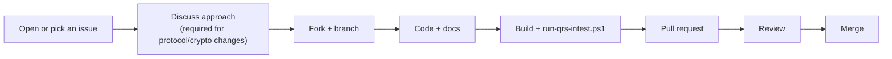

# Contributing to QRS

Thank you for your interest in QRS! This document explains how to propose changes and what we
expect from contributions. By participating you agree to follow our
[Code of Conduct](CODE_OF_CONDUCT.md).

## Ways to contribute

- **Report bugs** — open a GitHub issue with steps to reproduce, expected vs actual behaviour,
  OS/device, app and protocol version.
- **Report security vulnerabilities** — **do not** open a public issue; follow
  [SECURITY.md](SECURITY.md).
- **Improve documentation** — typos, clarifications, diagrams, translations.
- **Port QRS** to another language — see the [Porting Guide](qrs-doc/16-porting-guide.md).
- **Fix known limitations** — see the [Roadmap](ROADMAP.md).
- **Build apps** on top of QRS and tell us about them.

## Development setup

See [Building and Testing](qrs-doc/14-building-and-testing.md). In short:

```bash
dotnet build QRSHL.sln
pwsh ./run-qrs-intest.ps1
```

## Workflow



1. For anything larger than a small fix, **open an issue first** to agree on the approach.
2. Create a topic branch from `main` (e.g. `fix/pairing-message`, `docs/porting-go`).
3. Keep pull requests focused: one logical change per PR.
4. Update documentation in the same PR when behaviour changes.
5. Make sure the solution builds and the integration test passes.
6. Describe **what** and **why** in the PR; link the issue.

## Coding conventions

- C# 13 / .NET 10; async all the way (`async Task<T>`), no `.Result` / `.Wait()` in async paths.
- All cryptography goes through `Qrid.Common/Crypto/CryptoUtils.cs`. Do not implement crypto
  inline or duplicate helpers; do not add crypto dependencies without a security review.
- Wire formats are Protobuf. Never edit `*.generated.cs`; change `.proto` files, regenerate, and
  extend through partial classes.
- Server projects log via `ILogger<T>` / Serilog; never `Console.Write*`.
- **Never log** keys, DEKs, plaintext, AD values, QR contents or personal data.
- Never commit secrets, certificates, `.env` files or real API keys.
- One class per file; namespaces follow folders.

## Changes to the protocol or cryptography

These changes need extra care because they affect interoperability and security:

- Open a design issue describing the threat model impact and migration path.
- Follow [Protocol versioning](qrs-doc/06-tunnel-protocol.md#protocol-versioning): bump the version,
  keep compatibility rules, and update [Cryptography](qrs-doc/05-cryptography.md) and
  [Tunnel Protocol](qrs-doc/06-tunnel-protocol.md).
- Add or update test vectors once they exist.
- Expect at least two maintainer reviews.

## Commit messages

Use short imperative subjects (`Fix pairing error message`, `docs: add Go porting notes`) and
explain the reason in the body when it is not obvious.

## Licensing of contributions

Unless stated otherwise, contributions are accepted under the project's license (see
[FAQ → What is the license?](qrs-doc/17-faq.md#what-is-the-license)).

## AI tools usage policy

AI-augmented development is fine assuming you fully understand your changes.

## PR from the real people policy

We intend to only accept PRs from the **real people** genuinely interested in the project. We would 
try to have an online meeting with you to get to know each other before accepting your first PR.
