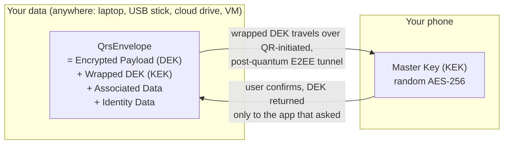

# 1. Why QRS?

> *"Encrypt your data by scanning QR code."*

QRS is the easiest way to add **post‑quantum, end‑to‑end encryption (E2EE)** to an application
**without passwords, without accounts, and without trusting any server**. The user's Master Key
lives on their phone; your application just shows a QR code.

- [The problem](#the-problem)
- [The QRS idea in one picture](#the-qrs-idea-in-one-picture)
- [Why users love it](#why-users-love-it)
- [Why developers love it](#why-developers-love-it)
- [Why security teams trust it](#why-security-teams-trust-it)
- [Why it is post‑quantum ready today](#why-it-is-postquantum-ready-today)
- [Comparison with alternatives](#comparison-with-alternatives)
- [When NOT to use QRS](#when-not-to-use-qrs)
- [QRS vs QRID](#qrs-vs-qrid)

---

## The problem

Client‑side encryption is hard to get right, and the hardest part is not the cipher — it is
**the key**:

| Where do you keep the key? | What goes wrong |
|---|---|
| Derive it from a password | Humans choose low‑entropy passwords; offline brute force; keyloggers; phishing; password reuse |
| Store it in the OS keychain | Tied to one device / one OS vendor; cannot be used on another device with different OS; hard or impossible to move; often synced to a cloud account |
| Use a cloud KMS | You now trust (and pay) a cloud provider and need an account, network access and IAM |
| Use a hardware token | Great security, but costs money, gets lost, and needs drivers/USB/NFC on every machine. Often impossible to backup keys or port keys into another token (OK for authentication use cases, but may not be ideal if directly used for data encryption) |

A new threat is emerging: **"harvest now, decrypt later (HNDL)"**. Traffic
recorded today using classical public‑key cryptography (RSA, ECDH) may be decrypted by a
cryptographically relevant quantum computer tomorrow.

## The QRS idea in one picture

QRS is **envelope encryption** (the same pattern cloud KMS systems use) where the *Key
Management Service* is **your own phone**, and the *authentication* step is **scanning a QR code
and tapping "Yes"**:

- Each piece of data is encrypted with its own random **DEK** (Data Encryption Key).
- The DEK is stored *next to the data*, **wrapped** (encrypted) by the user's **KEK** (Master Key).
- The KEK never leaves the phone. To use the data, the application sends the wrapped DEK to the
  phone; the user sees *what* is being unlocked (e.g. *"QRS VAULT — Title: my-passport-2026.vault"*) and
  confirms.

## Why users love it

| Benefit | Explanation |
|---|---|
| **Easier than passwords** | Scanning a QR code is faster than typing a strong password. Nothing to remember. |
| **More secure than passwords** | QRS keys are 256‑bit random keys. They cannot be guessed or brute‑forced, unlike keys derived from human passwords. |
| **No keyloggers** | Nothing is typed when unlocking data, so there is nothing for a keylogger to capture. |
| **You see what you unlock** | The phone displays the application name and descriptive attributes (file name, website, username…) before you confirm. A malicious app cannot silently unlock something else. |
| **Stop worrying where to keep keys** | DEKs travel *with* the data (in the same file). Open your vault from home, office or a cloud VM — you only need your phone. |
| **Stop worrying about losing keys** | If you have your data, you have your DEKs. The only thing to protect is the Master Key, backed up once into a password‑protected **Backup Image** (a QR code you can print). |
| **No cloud accounts** | No Apple / Google / Microsoft account needed. No e‑mail sign‑up. On Android, cloud backup is disabled; on iOS the Keychain stores the key on‑device. |
| **No vendor lock‑in** | Back up on Android, restore on iOS, or vice versa. The software is open source. |
| **Nothing stored server‑side** | There is no server database to be breached and no risk of server‑side data loss. |
| **Privacy** | The Mobile App collects no PII. The tunnel only ever sees ciphertext. |

## Why developers love it

| Benefit | Explanation |
|---|---|
| **A few lines of code** | Subclass `Wrapper<TPayload>`, describe your Associated Data, call `WrapNewPayload` / `UnwrapPayload`. See the [Client SDK Guide](10-client-sdk.md). |
| **No backend to build** | No user database, no password reset flows, no MFA, no session management, no key escrow. |
| **No crypto to invent** | Key generation, wrapping, AEAD binding, PQC transport, replay protection and version negotiation are done by the SDK. |
| **Batch operations** | Wrap or unwrap *many* DEKs with **one** QR scan (e.g. open a whole password folder). |
| **Flexible API, frozen Mobile App** | New kinds of Client Applications do not require Mobile App changes: the MA works on generic `KeyOp` requests + your custom Associated Data. |
| **Any UI** | Desktop (Avalonia, WinForms, MAUI), Web (Blazor WebAssembly), terminal (ASCII QR codes) or headless tests — these come built-iin. For a new platform, you just need to implement `IUserInteraction`. |
| **Any language (by design)** | The protocol is HTTPS + JSON + Protobuf + standard primitives. A [porting guide](16-porting-guide.md) is included. |
| **Self‑hostable, cheap infra** | The only server is a tiny stateless tunnel. Runs on Cloud Run's free tier (cold starts < 200 ms in tests), a $5 VM, or a Raspberry Pi. |
| **Tested end‑to‑end** | `pwsh ./run-qrs-intest.ps1` runs a real tunnel and simulated phone + client applications. |
| **Free and open source** | Permissive MIT license. |

## Why security teams trust it

- **Zero‑knowledge tunnel.** The Tunnel Server relays opaque ciphertext. It never sees keys or Associated Data in plain text. And payloads always stay local, never go via tunnel in any form or shape.
- **Defence in depth — three encryption layers in transit:**
  1. Hybrid PQC public‑key encryption (ML‑KEM‑768 + ECDH P‑256, HKDF‑SHA‑256, AES‑256‑GCM) to the
     recipient's public key;
  2. AES‑256‑GCM with an ephemeral **session key that only exists inside the QR code** (the server
     never sees the QR code);
  3. TLS provided by the OS.
- **Out‑of‑band key exchange.** The session key and the hash of the CA's ephemeral public key are
  transferred *optically* via the QR code — a channel a network attacker cannot observe or modify.
- **Anti‑replay / anti‑reflection.** Every tunnel message is AEAD‑bound to its direction
  (`CA2MA` / `MA2CA`), its message number and the sender's protocol version.
- **Human‑in‑the‑loop authorisation.** Every KEK operation requires an explicit tap on the phone
  after the user has seen the requesting application name and the Associated Data.
- **Cryptographic binding of metadata.** A wrapped DEK is bound to its Associated Data. Swapping a DEK between files, or relabelling it, makes the unwrap fail.
- **Minimal attack surface.** One stateless HTTP endpoint; no database; no accounts; no secrets on
  the server (optional API key only limits who can *open* sessions to protect from potential DDoS attempts).
- **Audited primitives.** BouncyCastle implementations of NIST‑standardised algorithms
  (FIPS 203 ML‑KEM, FIPS 197 AES, SP 800‑38D GCM, SHA‑3, HKDF RFC 5869, Argon2 RFC 9106).

The complete analysis — including known limitations — is in the
[Security Model](15-security-model.md).

## Why it is post‑quantum ready today

| Component | Quantum threat | QRS choice | Status |
|---|---|---|---|
| Symmetric encryption of data, DEKs, KEK wrap, tunnel session layer | Grover's algorithm halves effective key length | **AES‑256** (≈128‑bit post‑quantum security) | ✅ Quantum‑safe |
| Public‑key encryption in the tunnel | Shor's algorithm breaks RSA / ECDH | **Hybrid ML‑KEM‑768 + ECDH P‑256** — secure as long as *either* holds | ✅ Quantum‑safe |
| Key exchange of the tunnel session key | — | Transferred optically in a QR code, never over the network | ✅ Not exposed to harvest‑now‑decrypt‑later |
| Hashing / IDs | Grover | SHA3‑256 / SHA3‑512 | ✅ |
| Password‑based backup | Grover on password search | Argon2id (memory‑hard) + AES‑256‑GCM | ✅ as strong as the backup password |

Because QRS uses a **hybrid** construction, it keeps the well‑understood classical security of
ECDH P‑256 *and* adds ML‑KEM‑768 (NIST FIPS 203). An attacker must break **both** to decrypt
recorded tunnel traffic — and even then would still face the AES‑256‑GCM session layer whose key
was never transmitted over the network.

## Comparison with alternatives

| | Password‑derived key | Password manager master password | OS keychain | Hardware token (FIDO2/PIV) | Cloud KMS | **QRS** |
|---|---|---|---|---|---|---|
| Key entropy | Low (human) | Low–medium (human) | High | High | High | **High (256‑bit random)** |
| Keylogger‑resistant | ❌ | ❌ | ✅ | ✅ | ✅ | **✅** |
| Works across OSes / devices | ✅ | ✅ | ❌ | ⚠️ needs USB/NFC | ✅ | **✅ (any device with a screen)** |
| No account needed | ✅ | usually ❌ | usually ❌ | ✅ | ❌ | **✅** |
| No extra hardware | ✅ | ✅ | ✅ | ❌ (cost) | ✅ | **✅ (uses your phone)** |
| No servers holding critical data | ✅ | often ❌ | often ❌ | ✅ | ❌ | **✅** |
| User sees *what* is being decrypted | ❌ | ❌ | ❌ | ❌ | ❌ | **✅** |
| Metadata cryptographically bound | rarely | rarely | ❌ | n/a | ✅ (encryption context) | **✅** |
| Post‑quantum transport | n/a | depends | n/a | ❌ | depends | **✅ hybrid ML‑KEM** |
| Works on headless servers / CLI | ⚠️ | ⚠️ | ❌ | ⚠️ | ✅ | **✅ (ASCII QR in terminal)** |
| Open source & self‑hostable | — | some | ❌ | partially | ❌ | **✅** |
| Offline‑capable | ✅ | ✅ | ✅ | ✅ | ❌ | ⚠️ needs a reachable tunnel (can be LAN / self‑hosted) |

## When NOT to use QRS

QRS may not be the right fit when:

- **Unattended decryption** is required (cron jobs, servers decrypting without a human). QRS is
  deliberately human‑in‑the‑loop.
- **Multi‑user sharing / organisational key management** is required. That is the job of the
  sibling platform **QRID** (see below).

## QRS vs QRID

The repository hosts two related platforms. QRS is the **S**imple, **S**ecure, **S**tandalone,
**S**elf‑sufficient one. QRID is the more ambitious platform for building federted E2EE applications using Post Quantum Cryptography. QRID is not yet ready to be open sourced.

| | **QRS** | QRID |
|---|---|---|
| Identity | None (no usernames, no certificates, no PKI, no domains) | `username@domain` accounts, PKI, certified public keys |
| Backend | Only a stateless Tunnel Server | Tunnel, Key, Storage, Messaging, Directory services |
| Critical server‑side data | **None** | Zero‑trust but critical (key hierarchies, encrypted blobs) |
| Master key | Random AES‑256 KEK on the phone, backed up to a password‑encrypted QR image | Account keys managed by QRID Mobile App and zero-trust backend. QRID has more complex key management compared to QRS |
| Operations | Wrap / Unwrap / Reseal DEKs | Full E2EE apps: mail, multi-user encryption, storage, messaging across domains, directories of certified keys |
| Best for | Personal / single‑user encryption | Organisations; enterprise platform for building federated multi‑user E2EE applications using Post Quantum Cryptography |

---

Next: [Core Concepts & Glossary →](02-concepts.md)
