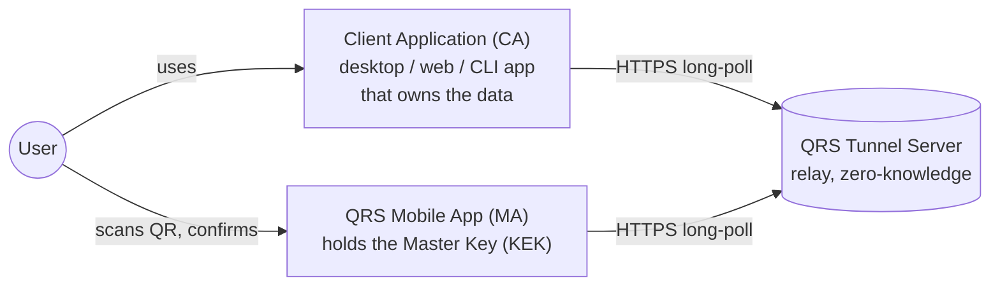
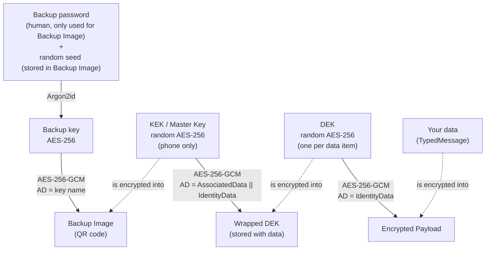
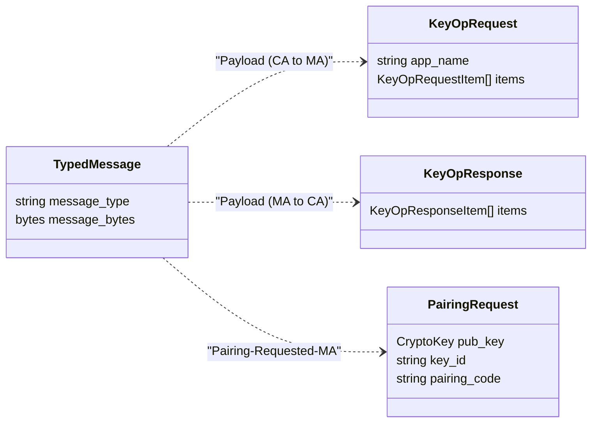

# 2. Core Concepts & Glossary

This page defines every term used throughout the QRS documentation and code. Names in
`monospace` are the actual identifiers in the source.

## The actors

| Term | Meaning |
|---|---|
| **CA — Client Application** | Any application that encrypts user data with QRS: desktop (Avalonia/WinForms/WPF/MAUI), web (Blazor/ASP.NET), CLI (console/terminal), or even another mobile app. In code: `ClientContext` and its subclasses (`VaultContext`, `PwmContext`, `QrsCliContext`…) represent headless client application functionality, not bound to any specific UI stack. Tunnel direction `CA2MA`. |
| **MA — QRS Mobile App** | The phone app that holds the Master Key and performs key operations after user confirmation. In code: `QrsAppContext` (engine) + `Qrs.Mobile.App` (MAUI UI). Tunnel direction `MA2CA`. |
| **Tunnel Server** | `Qrs.Tunnel.Server`. An HTTP relay with in‑memory "mailboxes" per session. It never sees plaintext. |
| **User** | The human who owns the phone and the data and who confirms every operation. |

## Keys

| Term | Meaning |
|---|---|
| **KEK — Key Encrypting Key / Master Key** | A random 256‑bit AES key generated by the MA (`CryptoUtils.GetRandomSymKey()`), stored in the phone's secure storage, loaded into `OrangeKeys.MasterKeySym`. It is used **only** to wrap and unwrap DEKs. It has a human‑readable user-provided **name** (`KekName`, e.g. `MasterKey_20260924_ALEX4`). |
| **DEK — Data Encryption Key** | A random 256‑bit AES key, one per protected item (file, secret, folder, etc). Generated **by the MA** and returned to the CA together with its wrapped form. |
| **Wrapped DEK** | `SymEncryptedBytes` = AES‑256‑GCM(KEK, DEK, AAD = AD‖ID). Stored in `QrsEnvelope.encrypted_dek`. |
| **Backup Image** | A QR‑encodable string `key=<password-encrypted KEK>&name=<KEK name>` (`QrBackupImage`). Restoring requires both the image and its password. `key` deserializes into `PasswordEncryptedBytes` object which contains `salt` (seed), `KdfParams` like KDF algo, memory difficulty, compute difficulty, etc |
| **Device Key (MA)** | A long‑lived **hybrid ML‑KEM‑768 + ECC P‑256** key pair generated by the MA (`DeviceKeyItem`). Its public key is given to a CA during *pairing*; CAs use it to encrypt requests to this MA. Can be re‑generated with *Reset Pairing*. |
| **Paired Key (CA)** | A copy of an MA's Device public key saved by a CA after pairing (`AsymKeyItem`, persisted by `IAsymKeyItemProvider`, e.g. `FileAsymKeyItemProvider`). |
| **Tunnel Ephemeral Key (CA)** | A fresh hybrid key pair generated by the CA for **every** command (`InitRandomSenderKeys`). The MA uses it to encrypt responses to the CA. Its SHA3‑256 hash is the **Tunnel Id**. |
| **Session Key** | A fresh random AES‑256 key generated by the CA for every command and transferred **only inside the QR code** (`sk`). Outer encryption layer of every tunnel message. |
| **KeyHashId** | `base64url(SHA3‑256(CryptoKey protobuf bytes))` of a public key. Identifies which key a message was encrypted to. |
| **TunnelHashId / Tunnel Id** | `base64url(SHA3‑256(CA ephemeral public key bytes))`. Identifies the tunnel session on the server and authenticates the CA's public key to the MA (QR param `cph`). CA's public key (hybrid) is too large to be put into QR code, so QR code contains only its hash (`cph` means Client Pub Hash). The entire public key gets included into the first command message sent to the tunnel by CA |

## Data structures

| Term | Meaning |
|---|---|
| **Payload** | The plain-text data that CA wants to protect with QRS encryption. |
| **QrsEnvelope** | The persisted, self‑contained encrypted object: `schema_version`, `encrypted_dek`, `encrypted_payload`, `identity_data_bytes`, `associated_data_bytes`. See [Key Operations](07-key-operations.md#the-qrsenvelope). |
| **Associated Data (AD)** — `AssociatedData2` | Human‑meaningful, **mutable**, non‑secret metadata bound to the wrapped DEK: `kek_name` + a list of `AssociatedDataItem {key, value}` such as `Title = my-passport-images.vault`, `Website / Resource = github.com`, `Username = alice`. Displayed to the user on the phone before confirming. Changing it requires a *Reseal* operation. |
| **Identity Data (ID)** — `IdentityData` | **Immutable** identity of the DEK: `dek_id` (16 random bytes or app‑provided), `app_name`, `top_level_key` flag, `created` date. Created by the MA on *WrapNewPayload*. Bound to both the wrapped DEK and the encrypted payload. |
| **KeyOp** | One of four key operations: `WrapNewPayload`, `WrapUpdatedPayload`, `Unwrap`, `Reseal`. |
| **KeyOpRequest / KeyOpResponse** | Batch request/response exchanged through the tunnel for command `keyop`. One QR scan can process many items. |
| **Wrapper / `Wrapper<TPayload>`** | SDK class that owns one `QrsEnvelope` + its decrypted payload and knows how to compute AD for it. App developers subclass it. |
| **App Name** | Canonical, UPPERCASE application name (e.g. `QRS VAULT`, `QRS PASSWORD MANAGER`). Mandatory, bound into ID, validated by the MA to contain AZ0..9 word(s), each word separated by exactly one (space or dash), no leading or trailing separators |

## Tunnel terms

| Term | Meaning |
|---|---|
| **QR Command (`QrCommand`)** | The key/value string rendered as a QR code by the CA: `v=2&cmd=keyop&srv=<tunnel url>&cph=<tunnel id>&sk=<session key>&cpv=<client protocol version>`. |
| **Command (`cmd`)** | What the CA asks the MA to do. Currently `keyop`. |
| **Tunnel Session** | Server‑side in‑memory object keyed by Tunnel Id, containing two **directions**: `CA2MA` and `MA2CA`, each holding the *latest* message and a list of waiting long‑poll tasks. Expires after ~6 minutes. |
| **Direction** | `CA2MA` or `MA2CA`. Bound to every message via AEAD. |
| **MessageNumber** | Monotonically increasing per‑direction counter. Bound via AEAD; the server rejects non‑increasing numbers. |
| **ExpectedResponseNumber** | The minimal message number the sender is waiting for from the other side. |
| **Long polling** | `MessageSendPoll` holds the HTTP request open until a matching message arrives or `PollingTimeout` elapses. |
| **Tunnel Message Type** | Inner `TypedMessage.message_type` values: `Payload`, `AEBKID` (asymmetric layer), `Pairing-Requested-CA`, `Pairing-Requested-MA`, `SwitchPubKey-Requested`, `SwitchPubKey-Rejected`, `Pairing-Accepted` (reserved). These are internal details of the Tunnel Protocol. |
| **Single / double encryption** | *Single*: only the Session Key layer (used only for control messages before pairing). *Double*: hybrid PQC layer to the recipient's public key **inside** the Session Key layer. All payloads are double‑encrypted. |
| **Pairing** | One‑time procedure where a CA learns and saves the MA's Device public key, confirmed by a 3‑letter pairing code typed by the user. |
| **Switch PubKey** | Lightweight alternative to pairing when the CA already knows the MA's current key but used an older one. Can only be done once per session, and only at the beginning of the session, for security reasons. |
| **Client Protocol Version** | SemVer of the end‑to‑end CA↔MA protocol (`TunnelClient.ClientProtocolVersion = "1.0.0"`). In the QR code (`cpv`) and AEAD‑bound in every message. |
| **Server Protocol Version** | SemVer of the REST protocol (`QrsTunnelProtocol.ServerProtocolVersion = "1.0.0"`), returned in every server response. |
| **Known servers** | List of tunnel URLs the MA user has already confirmed; a new server triggers a non-blocking security alert. |
| **API key** | Optional secret (`qrs_tunnel_api_key` cookie) that a CA must present to **create** a session on a protected tunnel server. Provides an easy way to protect your self-hosted server from memory overflow attacks and unauthorized usage. |
| **InstanceId** | Anonymous random identifier stored by a client (`instance_idt` cookie) used by public tunnels for rate limiting and metrics, and so it is readable by Tunnel Server in a plain text. |
| **Domain discovery** | Optional: CA resolves a tunnel server's base URL from `http(s)://qrs.<domain>/.well-known/qrs-configuration` or `http(s)://<domain>/.well-known/qrs-configuration`. |

## Protocol message vocabulary

---

Next: [How It Works →](03-how-it-works.md)
