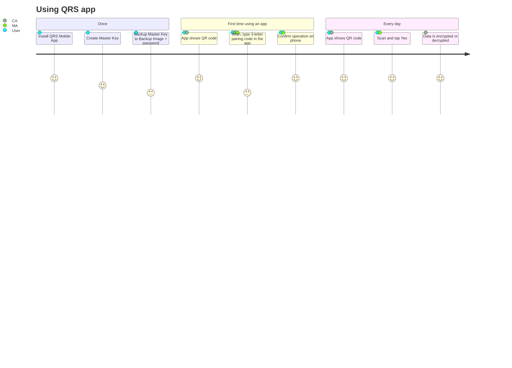
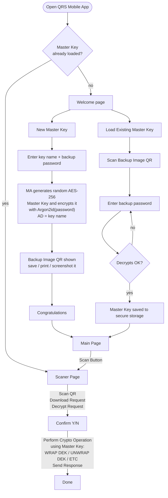
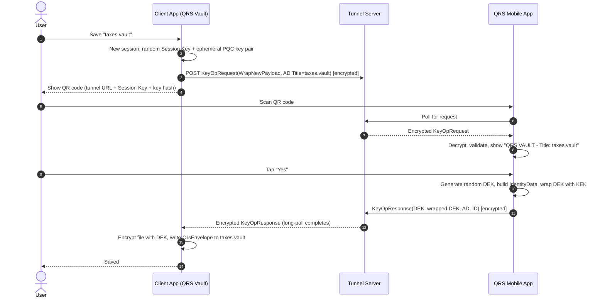
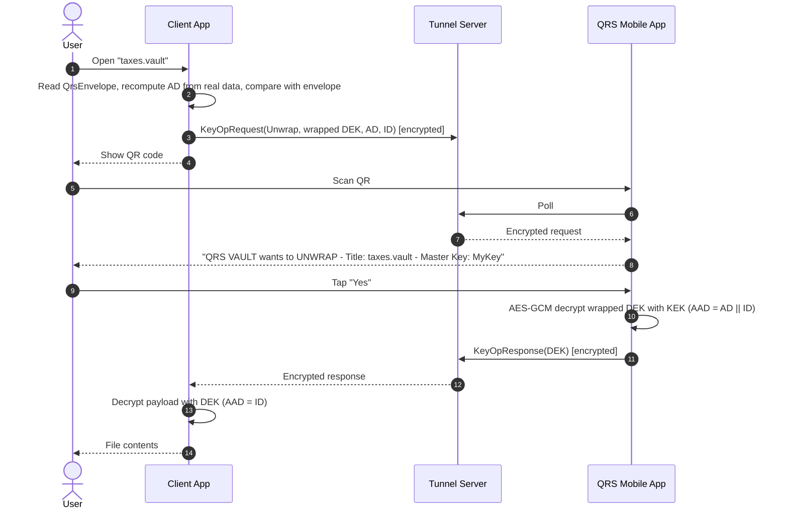
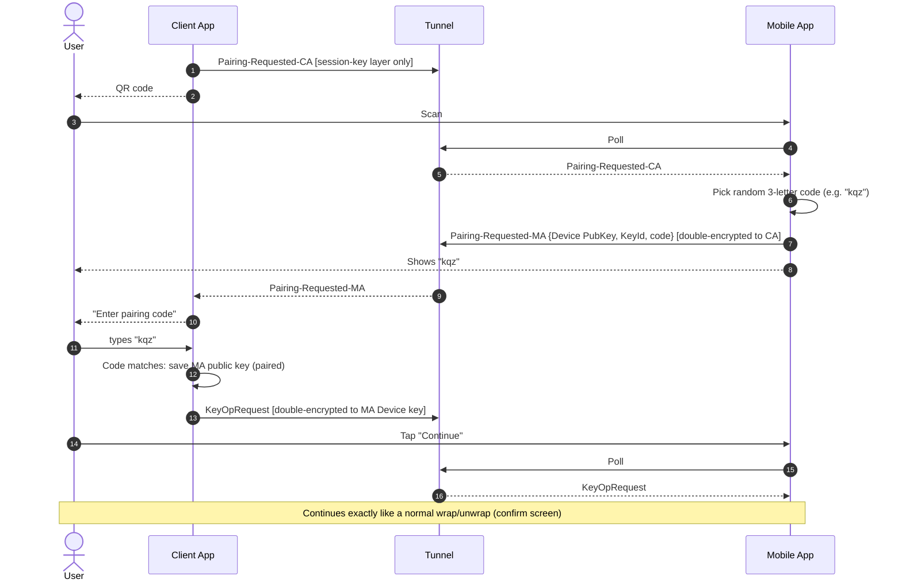
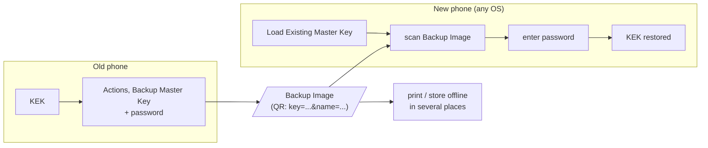
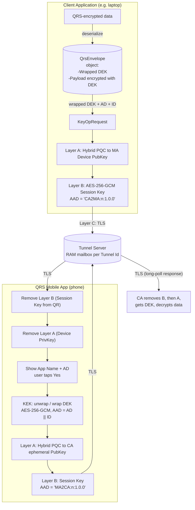

# 3. How It Works

This page explains QRS from the **user's** point of view first, then opens the hood one level to
show what travels where. Protocol‑level detail is in the
[Tunnel Protocol](06-tunnel-protocol.md), [Key Operations](07-key-operations.md) and
[Pairing](08-pairing.md) specifications.

- [1. The user journey](#1-the-user-journey)
- [2. First‑time setup on the phone](#2-firsttime-setup-on-the-phone)
- [3. Encrypting data (wrap)](#3-encrypting-data-wrap)
- [4. Decrypting data (unwrap)](#4-decrypting-data-unwrap)
- [5. First use of a new Client Application (pairing)](#5-first-use-of-a-new-client-application-pairing)
- [6. Moving to a new phone (backup & restore)](#6-moving-to-a-new-phone-backup--restore)
- [7. What is inside the QR code?](#7-what-is-inside-the-qr-code)
- [8. Example data flow](#8-the-big-picture-data-flow)
- [9. What each party knows](#9-what-each-party-knows)

---

## 1. The user journey



## 2. First‑time setup on the phone



The Master Key is a **random** 256‑bit key — the backup password only protects the *backup copy*.
Losing the phone without a Backup Image means losing access to the data.

## 3. Encrypting data (wrap)

Example: the user saves a new file into **QRS Vault**.



## 4. Decrypting data (unwrap)



If the user taps **No**, the MA simply sends nothing; the CA's long poll times out and reports
*"Timeout - no response from QRS mobile application"*.

## 5. First use of a new Client Application (pairing)

The first time a CA talks to an MA it does not know the MA's public key. It asks the MA to pair.



Details, including the *switch key* optimisation and the state machines, are in
[Pairing & Key Switching](08-pairing.md).

## 6. Moving to a new phone (backup & restore)



Because every CA stores its DEKs *wrapped* next to the data, restoring the KEK instantly restores
access to **all** data in **all** QRS applications. A new phone gets a **new Device Key**, so each
CA will transparently pair again on its first use.

## 7. What is inside the QR code?

```text
v=2&cmd=keyop&srv=https%3A%2F%2Fqrid.qrid.com%2Fqrs-tunnel-api%2F&cph=<43 chars>&sk=<Session Key>&cpv=1.0.0
```

| Param | Meaning | Secret? |
|---|---|---|
| `v` | QR format version (`2`) | no |
| `cmd` | Command, currently `keyop` | no |
| `srv` | Tunnel Server base URL | no |
| `cph` | Tunnel Id = SHA3‑256 hash of the CA's ephemeral public key | no, but authenticates the CA key |
| `sk` | **Session Key** — AES‑256 key protecting every tunnel message | **yes** |
| `cpv` | CA's QRS Client Protocol version | no |

The QR code is the *out‑of‑band channel*: it is seen by the phone camera only, never by the
tunnel server. Anyone who can photograph the screen during those seconds gets the session key, but
still cannot read requests to the MA (they are also encrypted to the MA's Device public key) or response to MA (also encrypted with CA's ephemeral public key).

## 8. Example data flow - Client Application decrypts QRS-encrypted data



## 9. What each party knows

| Secret / data | User | CA | Tunnel Server | MA | Network attacker |
|---|---|---|---|---|---|
| Master Key (KEK) | – | ❌ | ❌ | ✅ | ❌ |
| Backup password | ✅ | ❌ | ❌ | only while typing | ❌ |
| DEK | – | ✅ while in use | ❌ | ✅ while processing | ❌ |
| Plain data | ✅ | ✅ | ❌ | ❌ (never sent) | ❌ |
| Associated Data (e.g. file title) | ✅ | ✅ | ❌ | ✅ (shown) | ❌ |
| Session Key (AES) | – | ✅ | ❌ | ✅ | ❌ (only in QR code) |
| MA Device private key | – | ❌ | ❌ | ✅ | ❌ |
| CA ephemeral private key | – | ✅ | ❌ | ❌ | ❌ |
| Tunnel Id, App Name, IP, timing, message sizes | – | ✅ | ✅ | ✅ | ❌ |

---

Next: [Architecture →](04-architecture.md)
