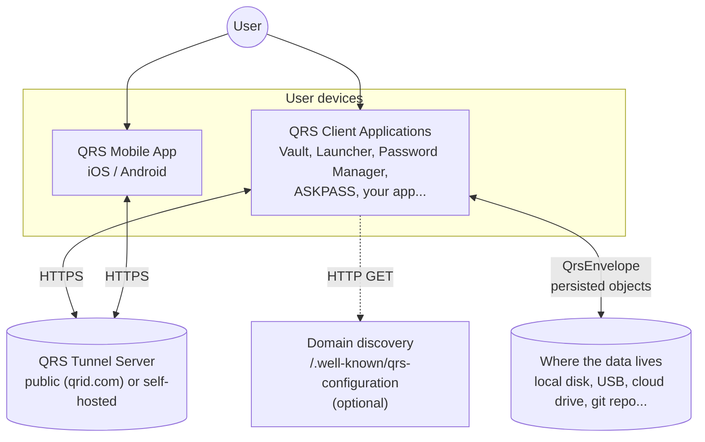
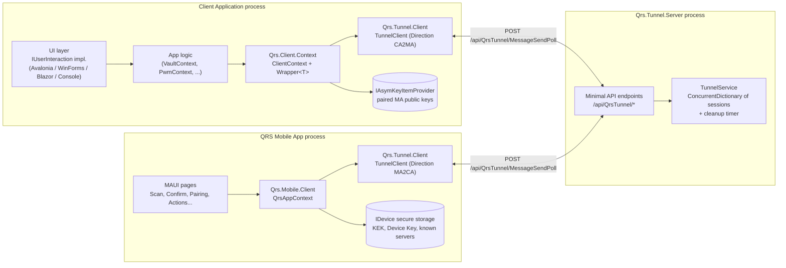
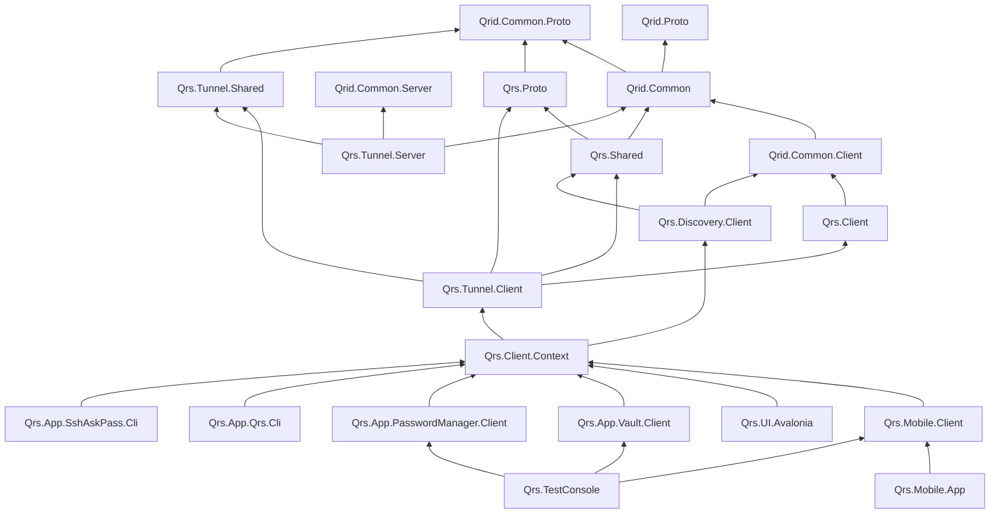
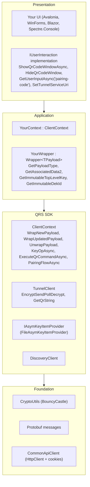
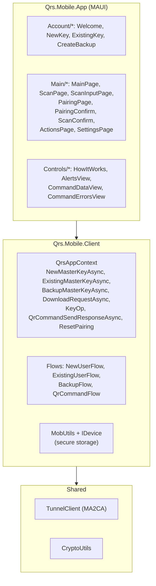
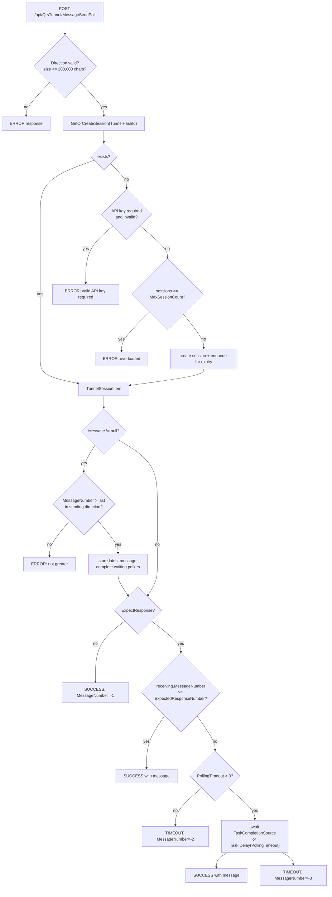
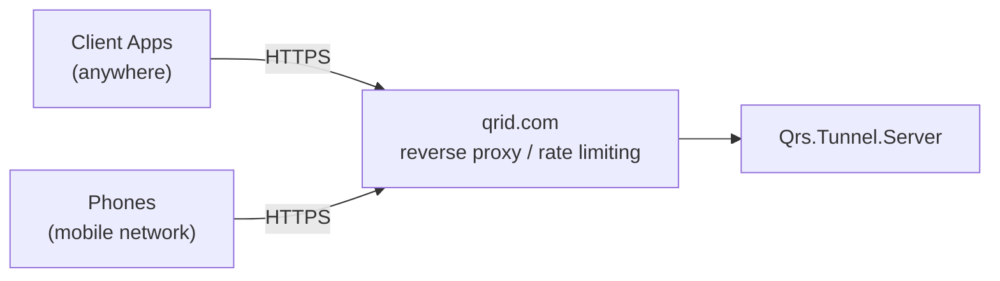
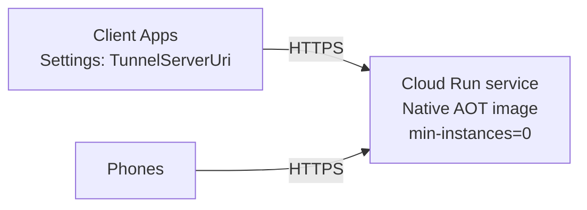
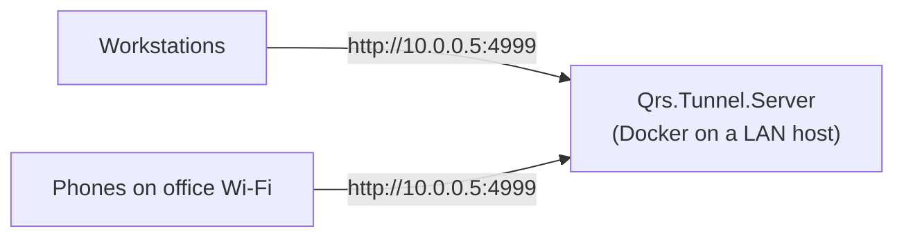

# 4. Architecture

- [System context](#system-context)
- [Container view](#container-view)
- [Project map](#project-map)
- [Project dependency graph](#project-dependency-graph)
- [Layered view of a Client Application](#layered-view-of-a-client-application)
- [Layered view of the Mobile App](#layered-view-of-the-mobile-app)
- [Tunnel Server internals](#tunnel-server-internals)
- [Deployment topologies](#deployment-topologies)
- [Design principles](#design-principles)
- [Technology stack](#technology-stack)

---

## System context

QRS has **no backend with state**. The only network service is the Tunnel Server, which can be
replaced, restarted or scaled at any time without losing anything.

## Container view

Note that **the same `TunnelClient` class** is used by both sides; only its `Direction` differs.
This guarantees that the encryption, AEAD binding, message numbering and other protocol details are all in sync.

## Project map

### Libraries

| Project | Target | Responsibility |
|---|---|---|
| `Qrid.Common.Proto` | net10.0 | Base Protobuf types shared by QRS and QRID: `ProtoBase`, `TypedMessage`, `StringObject`, crypto containers (`CryptoKey`, `CryptoKeyPair`, `SymEncryptedBytes`, `AsymEncryptedBytes`, `PasswordEncryptedBytes`, …) |
| `Qrid.Common` | net10.0 | **`CryptoUtils`** (all cryptography), `QrCommand` / `QrKeyValueBase` (QR string), constants (`CookieName`), utils |
| `Qrid.Common.Client` | net10.0 | `CommonApiClient` (HTTP, cookies, API key cookie), `CommonContext` (response helpers), `IUserInteraction`, cookie providers |
| `Qrid.Common.Server` | net10.0 | Server helpers (header extraction etc.) |
| `Qrs.Proto` | net10.0 | QRS Protobuf messages: `QrsEnvelope`, `IdentityData`, `AssociatedData2`, `AssociatedDataItem`, `KeyOp*`, `Pairing*`, plus partial‑class helpers; `QrsConfiguration` |
| `Qrs.Shared` | net10.0 | `QrBackupImage`, `KeyString`, discovery interfaces/DTOs |
| `Qrs.Tunnel.Shared` | net10.0 | REST DTOs (`MessageSendPollRequest/Response`, `VersionResponse`, `Directions`) and `QrsTunnelProtocol` version helpers |
| `Qrs.Client` | net10.0 | `QrsApiClient` base HTTP client |
| `Qrs.Tunnel.Client` | net10.0 | `TunnelClient` (double encryption, AEAD, numbering, long polling, QR generation, QR v2 key verification), `AsymKeyItem`, `IAsymKeyItemProvider`, `FileAsymKeyItemProvider`, `MsgHelper`, `TunnelMessageType` |
| `Qrs.Discovery.Client` | net10.0 | `DiscoveryClient` (cached domain discovery) |
| `Qrs.Client.Context` | net10.0 | **Client SDK**: `ClientContext` (command execution, pairing, switching, `WrapNewPayload`, `WrapUpdatedPayload`, `UnwrapPayload`), `WrapperBase`, `Wrapper<T>`, `RequestHelper` |
| `Qrs.Mobile.Client` | net10.0 | **MA engine**: `QrsAppContext` (KEK lifecycle, backup, `KeyOp()` execution, pairing), `QrCommandFlow` (parsing + validation), `MobUtils`, `IDevice` |
| `Qrs.UI.Avalonia` / `Qrs.UI.WinForms` | net10.0 | Built-in reusable implementations of `IUserInteraction` for Avalonia and WinForms that could be used while developing custom CA applications. |

### Applications and hosts

| Project | Kind | Description |
|---|---|---|
| `Qrs.Tunnel.Server` | ASP.NET Core Minimal API | The tunnel. Native‑AOT capable. Port 4999 by default |
| `Qrs.Mobile.App` (+ `.Droid`, `.iOS`, `.Mac`, `.WinUI`) | .NET MAUI | QRS Mobile App |
| `Qrs.App.Vault.Client` / `.Avalonia` / `.Cli` | Library / Desktop / CLI | Encrypt files and folders into `.vault` files |
| `Qrs.App.Qrs.Cli` | CLI (`qrs`) | *Launcher*: encrypted YAML → environment variables → child process |
| `Qrs.App.PasswordManager.Client` / `.Components` / `.Hybrid` | Library / Razor components / MAUI Blazor Hybrid | Password manager |
| `Qrs.App.SshAskPass.Cli` / `Qrs.App.SudoAskPass.Cli` | Avalonia / CLI | `SSH_ASKPASS`, `SUDO_ASKPASS` helpers - work in progress - need some testing / usage |
| `Qrs.App.FileManager.*`, `Qrs.App.EmailTools.Avalonia`, `Qrs.App.Analytics.*` | various | Experimental / internal tools |
| `Qrs.TestConsole` | Console | Headless end‑to‑end integration test |

## Project dependency graph

Arrows point from a project to what it references. 

## Layered view of a Client Application

## Layered view of the Mobile App

## Tunnel Server internals

A background `System.Timers.Timer` runs every **10 s** and removes sessions older than
**6 minutes** (FIFO queue), cancelling any pending pollers. See
[Tunnel Server Operations](13-tunnel-server-ops.md) for configuration and monitoring endpoints.

## Deployment topologies

### A. Public tunnel (default)

### B. Self‑hosted on Google Cloud Run (scale to zero)

> **Scaling note:** sessions are held **in memory of a single instance**. When running more than one
> instance, both the CA and the MA of the same session must reach the same instance. Keep
> `max-instances=1` or use session affinity keyed on the Tunnel Id. See
> [Tunnel Server Operations](13-tunnel-server-ops.md#scaling).

### C. LAN / air‑gapped office

Plain HTTP on a trusted LAN is acceptable because the two application‑level encryption layers
remain; the MA shows an explicit alert when a tunnel URL uses plain HTTP. `ClientContext.InitDomain`
also accepts a `%localip%` placeholder in the tunnel URL template for developer machines.

## Design principles

1. **Keys on the phone, data with the app, nothing on the server.**
2. **Zero‑knowledge relay.** The server stores only the latest opaque message per direction, for
   minutes, in RAM.
3. **Out‑of‑band bootstrap.** Session secrets go through the camera, not the network.
4. **Human in the loop.** Every KEK use requires an explicit, informed confirmation.
5. **Bind everything.** Direction, message number, protocol version, application name, DEK
   identity and human metadata are all AEAD‑bound.
6. **Generic Mobile App.** New Client Applications must not require MA changes: they express
   themselves through `KeyOp` + `AssociatedData2`.
7. **Symmetric code paths.** CA and MA share `TunnelClient` and `CryptoUtils`.
8. **Crypto in one place.** All primitives live in `Qrid.Common/Crypto/CryptoUtils.cs`.
9. **Protobuf for payloads, JSON only for the tunnel envelope.**
10. **Versioned protocols** with SemVer and "please upgrade" errors instead of silent failures.

## Technology stack

| Area | Technology |
|---|---|
| Language / runtime | C# on .NET 10 |
| Tunnel server | ASP.NET Core Minimal API, `System.Text.Json` source generation, Native AOT (`PublishAot=true` in `Dockerfile.gcr`), Serilog |
| Mobile App | .NET MAUI (Android, iOS; Mac Catalyst and WinUI heads for development) |
| Desktop UI | Avalonia, WinForms, MAUI Blazor Hybrid |
| CLI | Spectre.Console, QRCoder (ASCII QR codes) |
| Crypto | BouncyCastle (AES‑GCM, ML‑KEM, ECDH, HKDF, SHA‑3, Argon2) |
| Serialization | Protocol Buffers (Google.Protobuf), JSON for the tunnel REST envelope |
| Containers | Docker (`Dockerfile`, `Dockerfile.gcr`), Docker Compose (`qridroot/intest/compose.yml`), Google Cloud Build (`cloudbuild.yaml`) |
| CI | GitHub Actions `QRS Integration Test` (`.github/workflows/qrs-intest.yml`) |

---

Next: [Cryptography →](05-cryptography.md)
