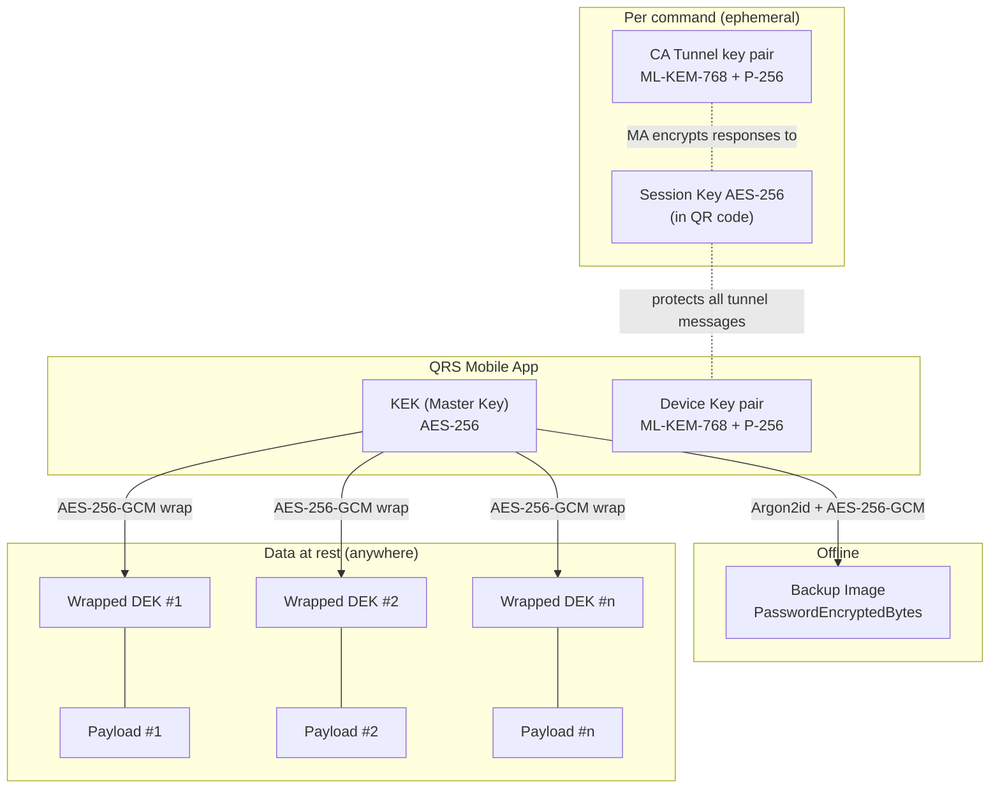
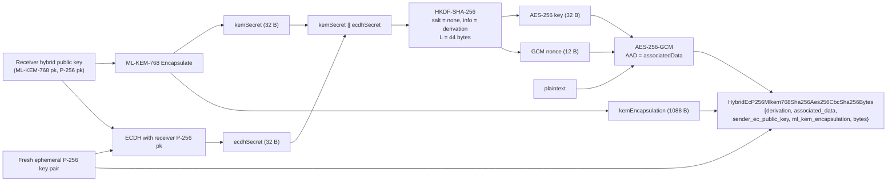
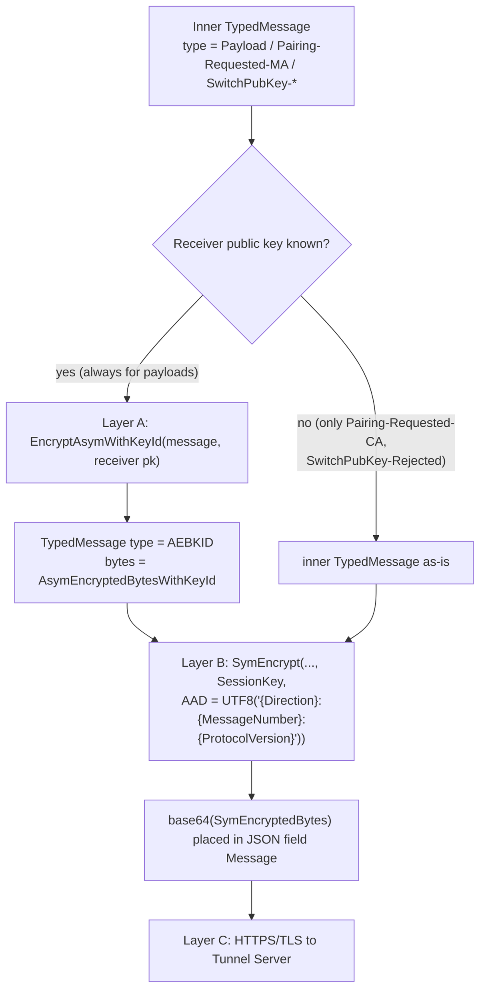
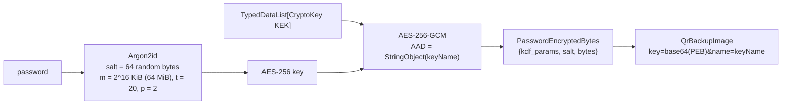

# 5. Cryptography

All cryptographic operations in QRS are implemented in a single place:
[`Qrid.Common/Crypto/CryptoUtils.cs`](../Qrid.Common/Crypto/CryptoUtils.cs), built on
[BouncyCastle for .NET](https://www.bouncycastle.org/). No other project implements crypto inline.

- [Primitives](#primitives)
- [Key inventory](#key-inventory)
- [Key hierarchy](#key-hierarchy)
- [Symmetric encryption: AES‑256‑GCM](#symmetric-encryption-aes256gcm)
- [Hybrid post‑quantum public‑key encryption](#hybrid-postquantum-publickey-encryption)
- [Tunnel message encryption (double encryption)](#tunnel-message-encryption-double-encryption)
- [DEK wrapping and payload encryption](#dek-wrapping-and-payload-encryption)
- [Master Key backup (password‑based)](#master-key-backup-passwordbased)
- [Identifiers and hashes](#identifiers-and-hashes)
- [AEAD binding summary](#aead-binding-summary)
- [Randomness](#randomness)
- [Post‑quantum assessment](#postquantum-assessment)
- [Crypto agility](#crypto-agility)

---

## Primitives

| Purpose | Algorithm | Parameters | Standard |
|---|---|---|---|
| Symmetric AEAD | AES‑256‑GCM | 256‑bit key, 96‑bit random nonce, 128‑bit tag | FIPS 197, NIST SP 800‑38D |
| Post‑quantum KEM | ML‑KEM‑768 | security category 3 | NIST FIPS 203 |
| Classical key agreement | ECDH | NIST P‑256 (`secp256r1`), ephemeral sender key | SEC 1, NIST SP 800‑56A |
| KDF (hybrid) | HKDF‑SHA‑256 | IKM = ML‑KEM secret ‖ ECDH secret, no salt, 44‑byte output | RFC 5869 |
| Password KDF | Argon2id | 64 MiB memory, 20 iterations, parallelism 2, 64‑byte random salt | RFC 9106 |
| Hash / identifiers | SHA3‑256 (ids), SHA3‑512 (default hash) | — | FIPS 202 |
| Random | BouncyCastle `SecureRandom` | — | — |

## Key inventory

| Key | Type | Generated by | Lifetime | Stored where | Protected by |
|---|---|---|---|---|---|
| **KEK** (Master Key) | AES‑256 | MA (`GetRandomSymKey`) | Until the user logs out / reinstalls | MA secure storage (`MasterKeySym`) | OS secure storage (Keychain / Android Keystore‑backed storage) |
| **Backup key** | AES‑256 | Argon2id(password, salt) | Transient | Never stored | Backup password |
| **DEK** | AES‑256 | MA (`GetRandomSymKey`) | As long as the data | Wrapped inside `QrsEnvelope`; plaintext only in CA memory while in use | KEK |
| **Device Key** (MA) | Hybrid ML‑KEM‑768 + ECC P‑256 key pair | MA (`GenerateRandomDeviceKeyItem`) | Until *Reset Pairing* / reinstall | MA secure storage (`DeviceKeyItem`) | OS secure storage |
| **Paired Key** (CA) | Public part of an MA Device Key | Received during pairing | Until deleted | CA key folder (`_asym-key-item-<KeyHashId>`) | Public — integrity matters, not secrecy |
| **Tunnel Ephemeral Key** (CA) | Hybrid ML‑KEM‑768 + ECC P‑256 key pair | CA, per command | One command | CA memory only | — |
| **Session Key** | AES‑256 | CA, per command | One command | CA memory + QR code | Optical channel |

## Key hierarchy



## Symmetric encryption: AES‑256‑GCM

`CryptoUtils.SymEncrypt(data, key, associatedData)`:

1. Requires a 32‑byte key (throws otherwise).
2. Generates a fresh **12‑byte random nonce** for every call.
3. Encrypts with AES‑GCM, 128‑bit tag, AAD = `associatedData` (empty if `null`).
4. Serialises as nested Protobuf:

```text
SymEncryptedBytes {
  encryption_algo = ENCRYPTION_ALGO_AES_GCM_256 (2)
  bytes = AesGcmBytes {
    nonce          = 12 random bytes          (field 2)
    mac_length     = 16                        (field 3)
    bytes_with_mac = ciphertext || 16-byte tag (field 10)
  }.serialize()
}
```

Decryption (`SymDecrypt` / `TrySymDecrypt`) fails with `InvalidCipherTextException` ("mac check in
GCM failed") if the key, ciphertext, nonce **or AAD** differ.

> **Nonce safety.** Random 96‑bit nonces are safe for up to ~2³² encryptions under the same key.
> A DEK that is re‑used across saves (Vault and Password Manager set
> `GenerateNewDekOnModifiedPayload = false`) encrypts only a handful of versions, far below that
> bound. A single message must be smaller than 64 GiB (enforced).

## Hybrid post‑quantum public‑key encryption

Used for the inner tunnel layer. `CryptoUtils.EncryptAsymHybrid(plaintext, receiverPubKey,
derivation = [], associatedData = [])`:



Wire format:

```text
AsymEncryptedBytesWithKeyId {
  key_id = KeyHashId(receiver public key)
  asym_encrypted_bytes = AsymEncryptedBytes {
    encryption_schema = ENCRYPTION_SCHEMA_HYBRID_EC_P256_MLKEM768_SHA256_AES256CBC_SHA256 (3)
    bytes = HybridEcP256Mlkem768Sha256Aes256CbcSha256Bytes {
      derivation            (1)  empty in QRS
      associated_data       (2)  empty in QRS
      sender_ec_public_key  (3)  CryptoKey, ephemeral P-256 public key
      ml_kem_encapsulation  (4)  ML-KEM-768 ciphertext
      bytes                 (5)  AES-256-GCM ciphertext || tag
    }.serialize()
  }
}
```

Properties:

- **Hybrid security:** the derived key is secure if **either** ML‑KEM‑768 **or** ECDH P‑256
  remains unbroken (both secrets feed HKDF).
- **Per‑message freshness:** both the KEM encapsulation and the ECDH sender key are fresh for each
  message, so the HKDF‑derived (key, nonce) pair is never reused, which is why a derived nonce is
  safe here.
- **Key identification:** `key_id` lets the receiver detect that a message was encrypted to a
  different key (used to trigger [key switching / pairing](08-pairing.md)).

> **Naming note.** The Protobuf message and enum names contain `Aes256CbcSha256` for historical
> reasons; the implementation in `EncryptAsymHybrid`/`DecryptAsymHybrid` uses **AES‑256‑GCM**
> with an HKDF‑derived key and nonce. The classical (non‑hybrid) ECIES path
> (`EncryptAsym(EccPublicKey …)`, AES‑256‑CBC + HMAC‑SHA‑256) exists in `CryptoUtils` for QRID but
> is **not used by QRS**: the MA refuses to load non‑PQC device keys
> (`MobUtils.LoadDeviceKeyItem`) and the CA always generates hybrid tunnel keys
> (`GetRandomAsymCryptoKeyPair(postQuantum: true)`).

## Tunnel message encryption (double encryption)

`TunnelClient.DoubleEncryptTypedMessage(typedMessage, SessionKey, ReceiverAsym, aead)`:



| Direction | Layer A recipient key | Layer B key | Layer B AAD example |
|---|---|---|---|
| CA → MA | MA **Device** public key (paired) | Session Key | `CA2MA:1:1.0.0` |
| MA → CA | CA **Tunnel Ephemeral** public key (from `SenderPubKeyBytes`, verified against `cph` hash from the QR code) | Session Key | `MA2CA:1:1.0.0` |

Decryption (`DoubleDecrypt`) reverses the layers and reports through `MsgHelper`:
`IsDoubleEncrypted`, `IsKeyIdDifferent` (layer A addressed to another key), `IsPayload`,
`IsPairingRequestedByMa`, etc. **Payloads and pairing responses are only accepted from layer A**
(`IsPayload` and `IsPairingRequestedByMa` check `TypedMessageAsym`).

## DEK wrapping and payload encryption

```text
AD_bytes = AssociatedData2.serialize()        // kek_name + items
ID_bytes = IdentityData.serialize()           // dek_id, app_name, top_level_key, created

wrapped_dek       = SymEncrypt( CryptoKey(DEK).serialize(), KEK, AAD = AD_bytes || ID_bytes )   // on the MA
encrypted_payload = SymEncrypt( TypedMessage(payload).serialize(), DEK, AAD = ID_bytes )         // on the CA
```

- **AD‖ID bound to the wrapped DEK** — the MA can only unwrap the DEK if the request carries
  exactly the AD and ID it was wrapped with. The MA displays that AD to the user, so the user sees
  authentic metadata.
- **ID bound to the payload** — a DEK/payload pair cannot be mixed with another envelope's ID.
- **KEK name inside AD** — the MA fills `kek_name` with the loaded Master Key's name, so a request
  for a different Master Key is detected as a fatal validation error before any crypto.
- The concatenation `AD‖ID` has no length prefix. Because both are Protobuf messages parsed
  separately by the MA from distinct request fields, and the MA re‑serialises AD it has shown to
  the user, the boundary is unambiguous for all current flows. Implementers of other languages
  must reproduce the exact byte concatenation.

## Master Key backup (password‑based)

`CryptoUtils.PasswordEncryptCryptoKey(KEK, password, AD = StringObject(keyName))`:



- KDF parameters are stored in the backup (`KdfParams`), so they can be raised in future versions
  without breaking old backups. Legacy backups without `KdfParams` are decrypted with the historic
  Argon2i parameters; legacy images without a name use `null` AD.
- Debug builds use weaker parameters (2 iterations, 8 MiB) for speed. **Never ship Debug builds of
  the MA.**
- The backup is only as strong as the password: use a long passphrase. Argon2id makes each guess
  cost 64 MiB and 20 passes.

## Identifiers and hashes

| Identifier | Construction | Encoding |
|---|---|---|
| `KeyHashId` of a public key | `SHA3‑256( CryptoKey.serialize() )` wrapped as `CryptoHash{hash_algo = SHA3_X256 (310), hash_bytes}` | base64 with `+`→`-`, `/`→`_` (padding kept) |
| `TunnelHashId` (QR `cph`) | Same as `KeyHashId` of the CA's ephemeral **public** key | same |
| `DekId` | 16 random bytes (or app‑provided immutable bytes) | raw bytes in `IdentityData` |

Because `KeyHashId` hashes the full `CryptoKey` Protobuf (algorithm + type + bytes), a hybrid key
and its classical ECC half have different ids.

## AEAD binding summary

| Ciphertext | Key | AAD | Prevents |
|---|---|---|---|
| Tunnel layer B | Session Key | `"{Direction}:{MessageNumber}:{ClientProtocolVersion}"` | Reflection (CA2MA↔MA2CA), replay/reordering, protocol version tampering by the server |
| Tunnel layer A | HKDF(ML‑KEM ‖ ECDH) | empty | — (confidentiality + integrity to the recipient key) |
| Wrapped DEK | KEK | `AssociatedData2 ‖ IdentityData` | Swapping DEKs between items, relabelling items, cross‑app use, cross‑KEK confusion |
| Encrypted payload | DEK | `IdentityData` | Swapping payloads between envelopes |
| Backup Image | Argon2id(password) | `StringObject(keyName)` | Renaming a backup image to impersonate another key |
| Launcher env vars (`qrs` CLI) | DEK | UTF‑8 variable name | Swapping values between variables in the same file |

## Randomness

All keys, nonces, salts and ids come from `CryptoUtils.GetRandomBytes()` → BouncyCastle
`SecureRandom`. ML‑KEM and ECC key generation also use `SecureRandom`. The MA inserts an unused
"dummy" key generation between creating the KEK and producing public random values as a
defence‑in‑depth measure.

## Post‑quantum assessment

| Attack | Target | Outcome with QRS |
|---|---|---|
| *Harvest now, decrypt later* on recorded tunnel traffic | Layer A (hybrid) | Requires breaking ML‑KEM‑768 **and** ECDH P‑256 |
| *Harvest now, decrypt later* on recorded tunnel traffic | Layer B (Session Key) | Key never transmitted over the network (QR code only) → nothing to harvest |
| Grover search on AES‑256 keys (KEK, DEK, Session Key) | Symmetric | ~2¹²⁸ quantum work — considered secure |
| Shor on classical signatures | — | QRS uses no signatures on the critical path |
| Quantum password search on Backup Image | Argon2id | Bounded by password entropy; Argon2id cost per guess is memory‑hard |

## Crypto agility

Every ciphertext and key is self‑describing (`EncryptionAlgo`, `EncryptionSchema`, `KeyAlgo`,
`KdfType`, `HashAlgo`). New algorithms can be introduced as new enum values without breaking stored
data. The tunnel protocols carry SemVer versions (see
[Tunnel Protocol → Versioning](06-tunnel-protocol.md#protocol-versioning)); a MAJOR bump is
required for any backwards‑incompatible change.

---

Next: [Tunnel Protocol Specification →](06-tunnel-protocol.md)
