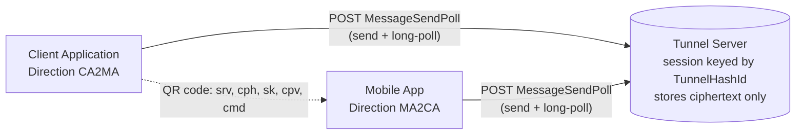
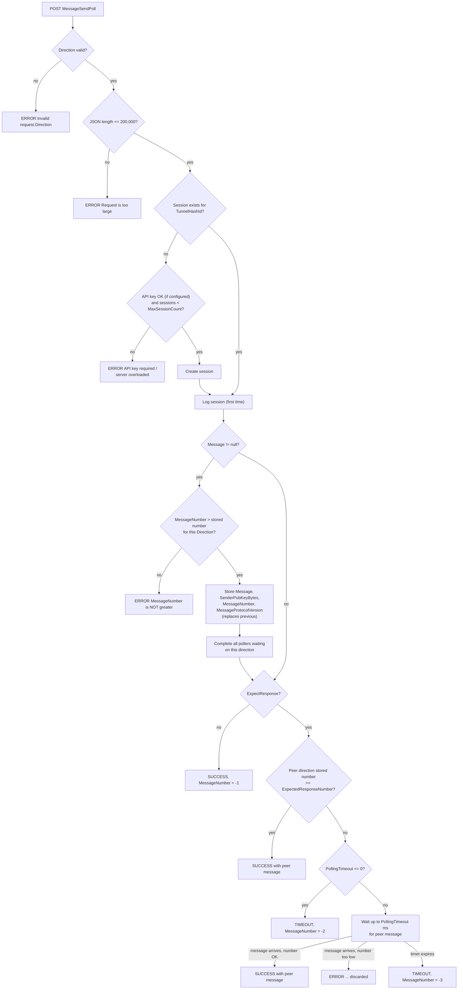
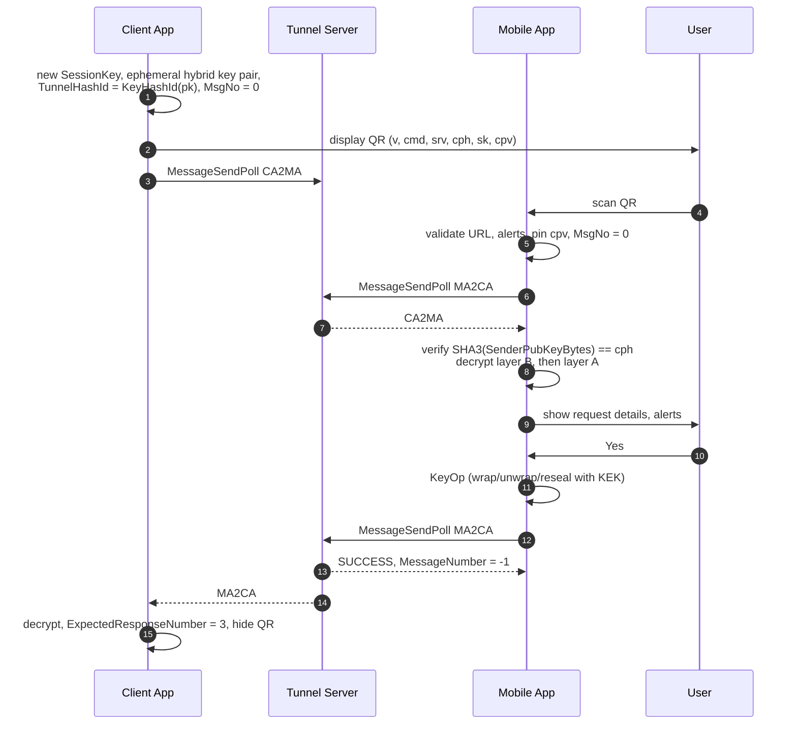
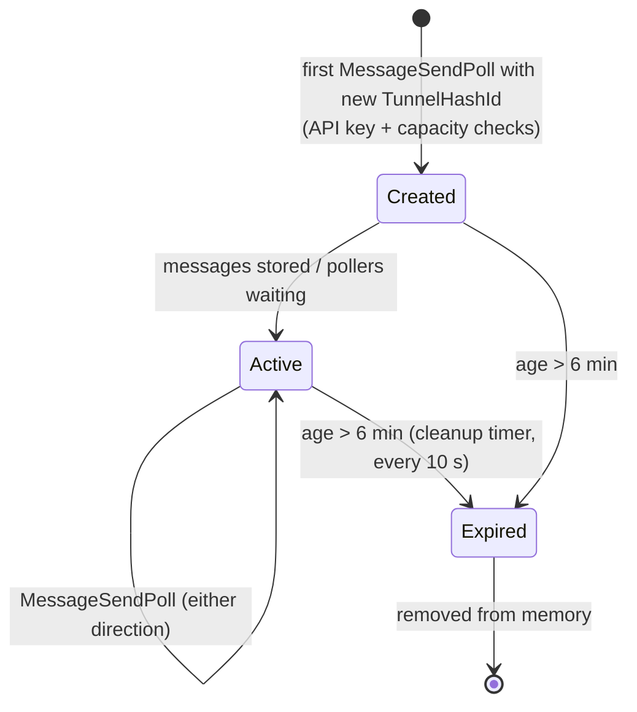

# 6. Tunnel Protocol Specification

This document specifies the **QRS Tunnel Protocol**: the QR code format, the HTTP API of the
Tunnel Server, message numbering, encryption envelopes, timeouts and versioning. It is written so
that you can implement a compatible Client Application, Mobile App or Tunnel Server in any
language. For the cryptographic primitives see [Cryptography](05-cryptography.md).

- [Overview](#overview)
- [Terminology](#terminology)
- [The QR code (QrCommand)](#the-qr-code-qrcommand)
- [HTTP API](#http-api)
- [MessageSendPoll semantics](#messagesendpoll-semantics)
- [Message numbering](#message-numbering)
- [Message envelope](#message-envelope)
- [Tunnel message types](#tunnel-message-types)
- [End-to-end exchanges](#end-to-end-exchanges)
- [Timeouts](#timeouts)
- [Protocol versioning](#protocol-versioning)
- [Session lifecycle on the server](#session-lifecycle-on-the-server)
- [Errors](#errors)
- [Conformance checklist](#conformance-checklist)

---

## Overview



- The Tunnel Server is a **dumb mailbox with long polling**. It stores, per session and per
  direction, only the **latest** message and wakes up pollers of the opposite direction.
- The server never sees keys or plaintext; the `Message` field is opaque base64.
- There is **one HTTP endpoint** for all traffic: `POST {base}/api/QrsTunnel/MessageSendPoll`.

## Terminology

| Term | Meaning |
|---|---|
| **CA** | Client Application — creates the tunnel and shows the QR code. |
| **MA** | Mobile App — scans the QR code, holds KEK and Device Key. |
| **Direction** | `CA2MA` (sent by CA) or `MA2CA` (sent by MA). Case‑sensitive. |
| **TunnelHashId** | Session identifier = `KeyHashId` of the CA's ephemeral public key (QR `cph`). |
| **Session Key** | Random AES‑256 key generated by CA per command, transferred only in the QR code (QR `sk`). |
| **MessageNumber** | Per‑direction strictly increasing integer, bound into the AEAD. |
| **ExpectedResponseNumber** | Lowest `MessageNumber` of the opposite direction the caller is willing to accept. |
| **Client Protocol Version** | SemVer of the end‑to‑end (CA↔MA) message protocol. Currently `1.0.0`. |
| **Server Protocol Version** | SemVer of the Tunnel Server HTTP API. Currently `1.0.0`. |

## The QR code (QrCommand)

The QR code contains a URL‑query‑like string produced by `TunnelClient.GetQrString(cmd)` and
parsed by `QrCommand` / `QrKeyValueBase`:

```text
v=2&cmd=keyop&srv=https%3A%2F%2Fqrid.qrid.com%2Fqrs-tunnel-api%2F&cph=CLYCEiD...%3D&sk=CAIQAxog...&cpv=1.0.0
```

| Key | Required | Value | Notes |
|---|---|---|---|
| `v` | yes | `2` | QR format version. Version 2 carries the **hash** of the CA key instead of the key itself (keeps the QR small despite ~1.2 KB ML‑KEM public keys). |
| `cmd` | yes | command name | Only `keyop` is accepted by the current MA. |
| `srv` | yes | Tunnel Server base URL | Must be `http`/`https`, no user‑info, no `?`, `&` or `#`. Ends with `/`. |
| `cph` | yes | `TunnelHashId` | `base64safe(CryptoHash{SHA3_X256, SHA3‑256(CryptoKey(CA ephemeral public key))})`. |
| `sk` | yes | Session Key | base64 of the `CryptoKey` Protobuf holding the AES‑256 key. |
| `cpv` | yes | CA client protocol version | SemVer, e.g. `1.0.0`. MA pins it for the session. |

Encoding rules:

- Values are URI‑escaped (`Uri.EscapeDataString`); pairs are joined with `&`; keys match `\w+`.
- The parser rejects any character outside printable ASCII (32–126).
- Keys appear in the order shown above; parsers must not depend on order.

**Security of the QR code:** the QR code is the only channel carrying the Session Key. Anyone who
can photograph it during the ~2 minutes it is displayed learns `sk` but still cannot decrypt
payloads, which are additionally encrypted to the MA's Device Key (see
[double encryption](05-cryptography.md#tunnel-message-encryption-double-encryption)).

## HTTP API

Base path: `{srv}api/QrsTunnel`. All responses are JSON wrapped in a `TunnelResponse<T>`:

```json
{ "Status": "SUCCESS", "Data": { }, "Message": null, "ServerProtocolVersion": "1.0.0" }
```

Property names are emitted in **PascalCase** and matched **case‑insensitively** on input.

| Method | Path | Purpose | Response `Data` |
|---|---|---|---|
| `POST` | `/MessageSendPoll` | Send a message and/or long‑poll for the peer's message | `MessageSendPollResponse` |
| `GET` | `/Test` | Liveness check (`Message = "Test - Success"`) | `null` |
| `GET` | `/Version` | Versions (**not** wrapped): `{ "ServerProtocolVersion", "BuildVersion", "BuildTime" }` | — |
| `GET` | `/Stats` | 🔒 Counters: `TimerTicks`, `ActiveSessionCount`, `TotalSessionCount`, `DequeueErrorsCount`, `RemoveErrorsCount`, `Created` | object |
| `GET` | `/Cleanup` | 🔒 Triggers expired‑session cleanup | — |
| `GET` | `/PrintHeaders` | 🔒 Diagnostics: echoes request headers | — |
| `GET` | `/XyzGetSessionLog` | 🔒 Diagnostics: session log (created, app name, IP, instance id, session hash) | list |
| `POST` | `/XyzClearSessionLog` | 🔒 Diagnostics: clears the session log | — |
| `GET/POST` | `/error` | Generic error handler | `ERROR` |

> 🔒 Admin/diagnostic endpoints (`Stats`, `Cleanup`, `PrintHeaders`, `XyzGetSessionLog`,
> `XyzClearSessionLog`) are **protected by the API key**: the request must carry the cookie
> `qrs_tunnel_api_key` matching `QrsTunnel:ApiKey`. When no API key is configured they are
> **blocked by default**, so there is no need to block them at the reverse proxy. Without a valid
> key they return `Status = "ERROR"` with a message asking for the API key. See
> [Operating the Tunnel Server](13-tunnel-server-ops.md).

### Cookies and headers read by the server

| Name | Kind | Purpose |
|---|---|---|
| `qrs_tunnel_api_key` | Cookie | Optional API key (constant‑time compare). For `MessageSendPoll` it is checked **only when a new session is created**; it is **always required** for the admin/diagnostic endpoints. |
| `instance_idt` | Cookie | Optional anonymous app‑instance id, recorded in the session log. |
| `X-Forwarded-For` | Header | Client IP from the reverse proxy, recorded in the session log. |

### `MessageSendPollRequest`

```json
{
  "TunnelHashId": "CLYCEiD...=",
  "SenderPubKeyBytes": "base64 of CryptoKey protobuf (sender's public key)",
  "AppName": "QRS VAULT",
  "Message": "base64 of SymEncryptedBytes protobuf, or null to only poll",
  "MessageNumber": 1,
  "MessageProtocolVersion": "1.0.0",
  "Direction": "CA2MA",
  "PollingTimeout": 120000,
  "ExpectedResponseNumber": 1,
  "ExpectResponse": true
}
```

| Field | Type | Description |
|---|---|---|
| `TunnelHashId` | string | Session id (from QR `cph`). |
| `SenderPubKeyBytes` | bytes (base64) | CA: its ephemeral hybrid public key; MA: its Device public key. Stored with the message and returned to the peer. |
| `AppName` | string | Human‑readable app name; logged in the session log. |
| `Message` | string or `null` | Opaque ciphertext. `null` = poll only. |
| `MessageNumber` | int | Must be **strictly greater** than the last stored number for this direction (only checked when `Message != null`). |
| `MessageProtocolVersion` | string | Sender's client protocol SemVer; bound into the AEAD. |
| `Direction` | string | `CA2MA` or `MA2CA`. |
| `PollingTimeout` | int (ms) | How long the server may hold the request waiting for the peer. |
| `ExpectedResponseNumber` | int | Minimum acceptable peer `MessageNumber`. |
| `ExpectResponse` | bool | `false` = fire‑and‑forget send. |

### `MessageSendPollResponse`

```json
{
  "Message": "base64 ciphertext from the peer",
  "SenderPubKeyBytes": "base64 CryptoKey of the peer",
  "MessageNumber": 2,
  "MessageProtocolVersion": "1.0.0",
  "Status": "SUCCESS",
  "ServerProtocolVersion": "1.0.0"
}
```

`Status` is `SUCCESS` or `TIMEOUT`. `MessageNumber` has special negative values:

| Value | Meaning |
|---|---|
| `-1` | Send‑only request (`ExpectResponse = false`) accepted. |
| `-2` | Nothing available and `PollingTimeout <= 0` (instant timeout). |
| `-3` | Long poll expired without a message. |

## MessageSendPoll semantics



Key properties:

- **Send and poll are atomic in one request** — no race between posting a request and starting to
  wait for its answer.
- **Only the latest message per direction is kept.** The protocol is strictly request/response,
  so a queue is not needed.
- **Already‑available messages are returned immediately** — a late poller never misses a message.

## Message numbering

Each `TunnelClient` keeps `MessageNumber` (its own last used number) and `ExpectedResponseNumber`.

1. On a new command, CA resets `MessageNumber = 0`, `ExpectedResponseNumber = 1`. The MA resets
   when it scans a new QR code, **except** right after pairing (`DoNotResetMessageNumbers`),
   because the same tunnel session continues.
2. Every call that goes through `MessageSendPoll` — including **poll‑only** calls — first
   increments `MessageNumber`. The number sent with a message is the one bound into the AEAD.
3. When a response with `MessageNumber > 0` arrives, `ExpectedResponseNumber = MessageNumber + 1`.
4. A response whose positive `MessageNumber` is lower than `ExpectedResponseNumber` is rejected
   by the client.

Gaps are normal (poll‑only calls consume numbers); only **monotonicity** is required. Because the
number is in the AEAD (`"{Direction}:{MessageNumber}:{Version}"`), the server cannot replay an old
message with a new number, nor reflect a CA2MA message back as MA2CA.

## Message envelope

The `Message` string is:

```text
Message = base64( SymEncryptedBytes )                                  // layer B, Session Key
          SymEncryptedBytes.plaintext = TypedMessage {
             message_type = "AEBKID"                                   // when double encrypted
             message_bytes = AsymEncryptedBytesWithKeyId               // layer A, hybrid PQC
                             plaintext = TypedMessage { message_type = <tunnel type>, message_bytes = ... }
          }
          or, single encrypted:
          SymEncryptedBytes.plaintext = TypedMessage { message_type = <tunnel type>, message_bytes = ... }

AEAD(layer B) = UTF8( Direction + ":" + MessageNumber + ":" + MessageProtocolVersion )
```

### Receiver checks (in order)

1. `ServerProtocolVersion` of the HTTP response is compatible (MAJOR ≤ own; empty accepted as legacy).
2. `Status != TIMEOUT` and `MessageNumber` ≥ `ExpectedResponseNumber` when positive.
3. **MA only (QR v2):** if the CA public key is not yet known, `SHA3‑256(SenderPubKeyBytes)` must
   equal `cph` from the QR code, otherwise *Corrupted tunnel*; then that key becomes the key the MA
   encrypts responses to.
4. Peer `MessageProtocolVersion` present, valid SemVer, MAJOR ≤ own; must equal the pinned version
   if already pinned (MA pins from QR `cpv`; CA pins from the first successfully decrypted message).
5. Layer B decrypt with Session Key and AEAD built from the **received** direction, number and version.
6. If inner type is `AEBKID`: `key_id` must equal own key's `KeyHashId` (else `IsKeyIdDifferent`),
   then layer A decrypt with own private key.

## Tunnel message types

Defined in `Qrs.Tunnel.Client/TunnelMessageType.cs`:

| Constant | Wire value | Sender | Encryption | Body |
|---|---|---|---|---|
| `PAYLOAD` | `Payload` | CA and MA | Double | `KeyOpRequest` (CA→MA) / `KeyOpResponse` (MA→CA) |
| `ASYM_ENCRYPTED` | `AEBKID` | both | — | Wrapper for layer A (`AsymEncryptedBytesWithKeyId`) |
| `PAIRING_REQUESTED_CA` | `Pairing-Requested-CA` | CA | Single (Session Key) | empty |
| `PAIRING_REQUESTED_MA` | `Pairing-Requested-MA` | MA | Double (to CA ephemeral key) | `PairingRequest{pub_key, key_id, pairing_code}` |
| `SWITCH_PUBKEY_REQUESTED` | `SwitchPubKey-Requested` | MA | Double (to CA ephemeral key) | `StringObject(KeyHashId of MA Device Key)` |
| `SWITCH_PUBKEY_REJECTED` | `SwitchPubKey-Rejected` | CA | Single | empty |
| `PAIRING_ACCEPTED` | `Pairing-Accepted` | — | — | Reserved, unused |

## End-to-end exchanges

### Normal command (already paired)



### First use (pairing)

See [Pairing & Key Switching](08-pairing.md) for the full diagrams and state machines. Summary of
the messages:

| # | Direction | Type | Encryption |
|---|---|---|---|
| CA #1 | CA2MA | `Pairing-Requested-CA` | single |
| MA #1 | MA2CA | poll only | — |
| MA #2 | MA2CA | `Pairing-Requested-MA` (Device public key + 3‑letter code) | double to CA ephemeral key |
| CA #2 | CA2MA | `Payload(KeyOpRequest)` after user typed the code | double to new Device Key |
| MA #3 | MA2CA | poll only (numbers not reset) | — |
| MA #4 | MA2CA | `Payload(KeyOpResponse)` | double |

## Timeouts

| Where | Value | Source |
|---|---|---|
| CA long poll for the MA response | 120 s | `ClientContext.TimeoutMs` |
| MA first poll after scanning | 2 s | `QrsAppContext.PayloadOrPairing` (`QrsAppContext_QrCommand.cs`) |
| MA poll after sending `SwitchPubKey-Requested` | 60 s | same |
| MA re‑download after pairing | 30 s | same |
| HTTP client timeout for long polls (> 10 s) | 200 s | `TunnelClient._pollingClient` |
| HTTP client timeout for short calls | 10 s | default client |
| Debug builds: minimum `PollingTimeout` | 15 s | `#if DEBUG` in `TunnelClient` |
| Server session lifetime | 6 min | `TunnelService.MAX_SESSION_DURATION_MINUTES` |
| Server cleanup timer | 10 s | `TunnelService` |
| Discovery request | 3 s | `DiscoveryClient` |

The server honours the client‑supplied `PollingTimeout` as is; see
[Security Model → Known limitations](15-security-model.md#known-limitations).

## Protocol versioning

Two independent SemVer versions, both `1.0.0` today:

| | Client Protocol (CA ↔ MA) | Server Protocol (client ↔ Tunnel Server) |
|---|---|---|
| Constant | `TunnelClient.ClientProtocolVersion` | `QrsTunnelProtocol.ServerProtocolVersion` |
| Carried in | QR `cpv`, `MessageProtocolVersion` of every message | `ServerProtocolVersion` of every response, `GET /Version` |
| Authenticated | Yes — in layer‑B AEAD | No (TLS only) |
| Required | Yes | No — empty means legacy server |
| Compatibility rule | peer MAJOR ≤ own MAJOR | server MAJOR ≤ client's known MAJOR |
| Pinning | Per session; a change mid‑session is an error | — |

Rules for contributors:

- **PATCH** — bug fix, no wire change.
- **MINOR** — backwards compatible additions (e.g. a new optional QR key, a new message type that
  older peers never receive).
- **MAJOR** — anything an older peer cannot process. Older peers will then show *"please upgrade
  your software"*.

## Session lifecycle on the server



Sessions live **only in memory** of a single server instance — see
[Scaling](13-tunnel-server-ops.md#scaling).

## Errors

All errors are HTTP 200 with `Status = "ERROR"` and a human‑readable `Message`:

| Message (prefix) | Cause |
|---|---|
| `Invalid request.Direction=...` | Direction not `CA2MA`/`MA2CA`. |
| `Request is too large ...` | Serialised request > 200,000 characters. |
| `A valid API key is required to open a new Tunnel Session on this server.` | `QrsTunnel:ApiKey` configured and cookie missing/wrong. |
| `Access denied. Please provide a valid API key in the 'qrs_tunnel_api_key' cookie ...` | Admin/diagnostic endpoint called without a valid API key (or no `QrsTunnel:ApiKey` configured). |
| `Tunnel Server is overloaded at the moment. ...` | `MaxSessionCount` reached. |
| `Error while sending message ... is NOT greater than previous MessageNumber ...` | Replay or client bug. |
| `Error while receiving message - request.ExpectedResponseNumber ...` | Stale message delivered to a poller. |

Client‑side errors surfaced to users include *"Timeout - no response from QRS mobile
application"*, *"Corrupted tunnel ..."*, *"... version of the other side has changed within the
same session ..."*, *"Asymmetric keys are not matching ..."*.

## Conformance checklist

A compatible implementation **must**:

- [ ] Generate a fresh AES‑256 Session Key and fresh hybrid ML‑KEM‑768 + P‑256 key pair per command (CA).
- [ ] Derive `cph` exactly as `base64safe(CryptoHash{310, SHA3‑256(CryptoKey bytes)})`.
- [ ] Put `v, cmd, srv, cph, sk, cpv` in the QR code, URI‑escaped, printable ASCII only.
- [ ] Use AES‑256‑GCM with AEAD `"{Direction}:{MessageNumber}:{Version}"` for layer B.
- [ ] Double‑encrypt every `Payload` and `Pairing-Requested-MA`/`SwitchPubKey-Requested` message.
- [ ] Verify `SHA3‑256(SenderPubKeyBytes) == cph` before encrypting to the CA key (MA).
- [ ] Increment `MessageNumber` before every `MessageSendPoll` and never reuse a number in a session.
- [ ] Pin the peer client protocol version for the session and reject MAJOR > own.
- [ ] Never log the Session Key, keys, or decrypted payloads.

---

Next: [Key Operations & Envelope Format →](07-key-operations.md)
