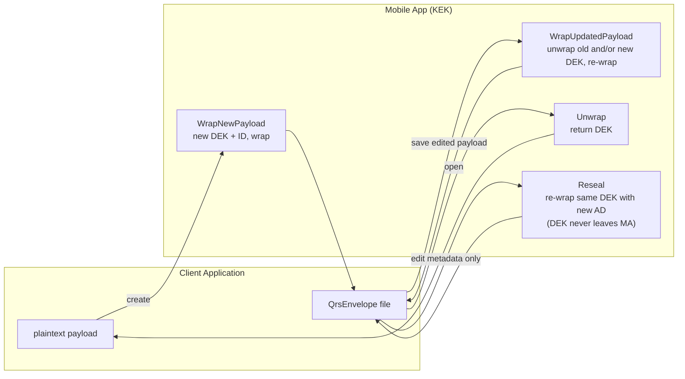
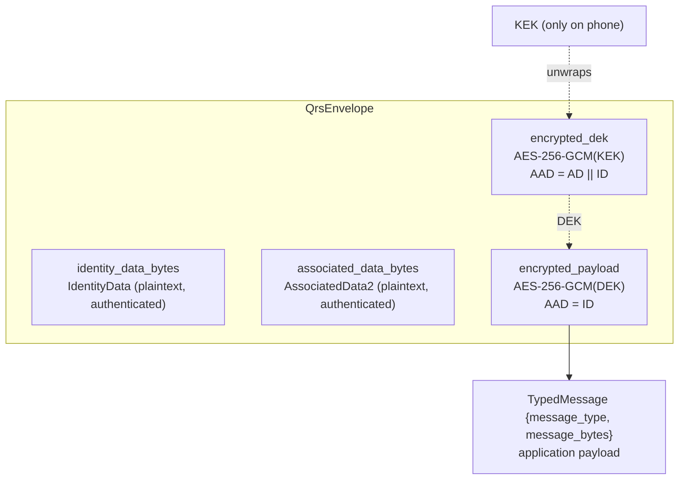
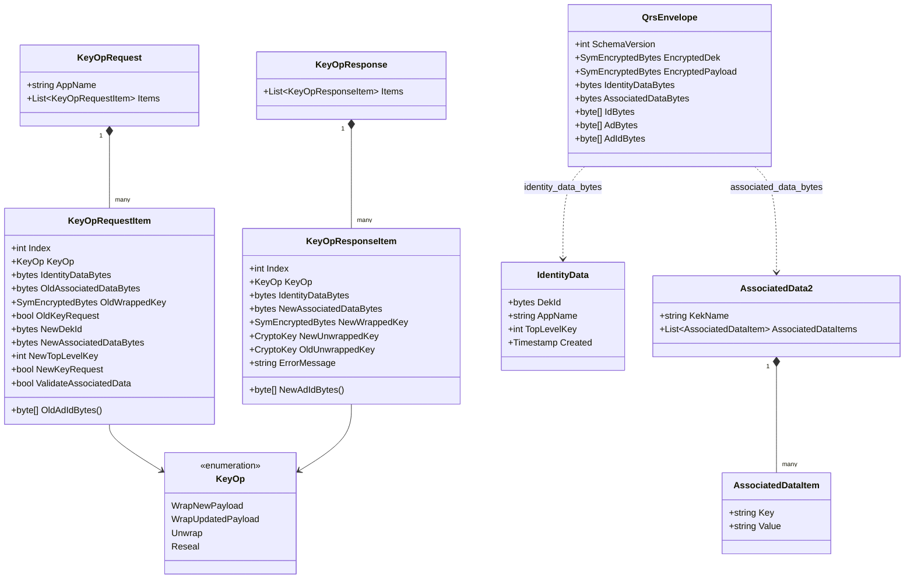
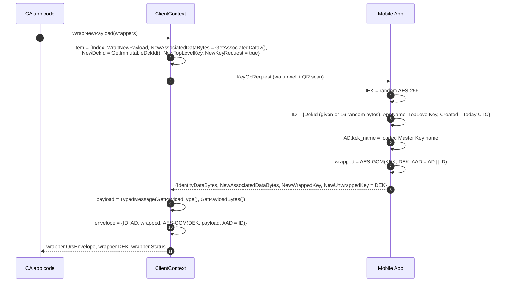
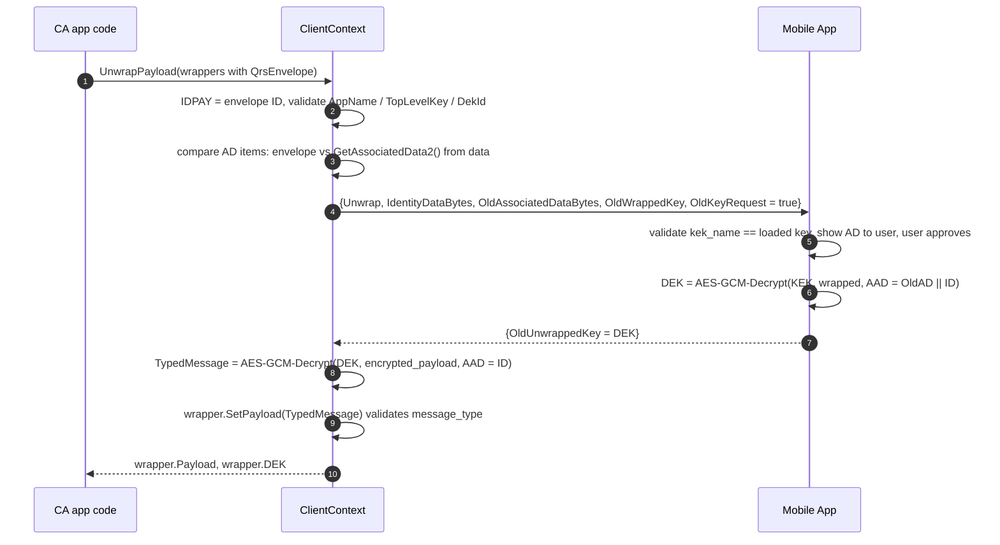
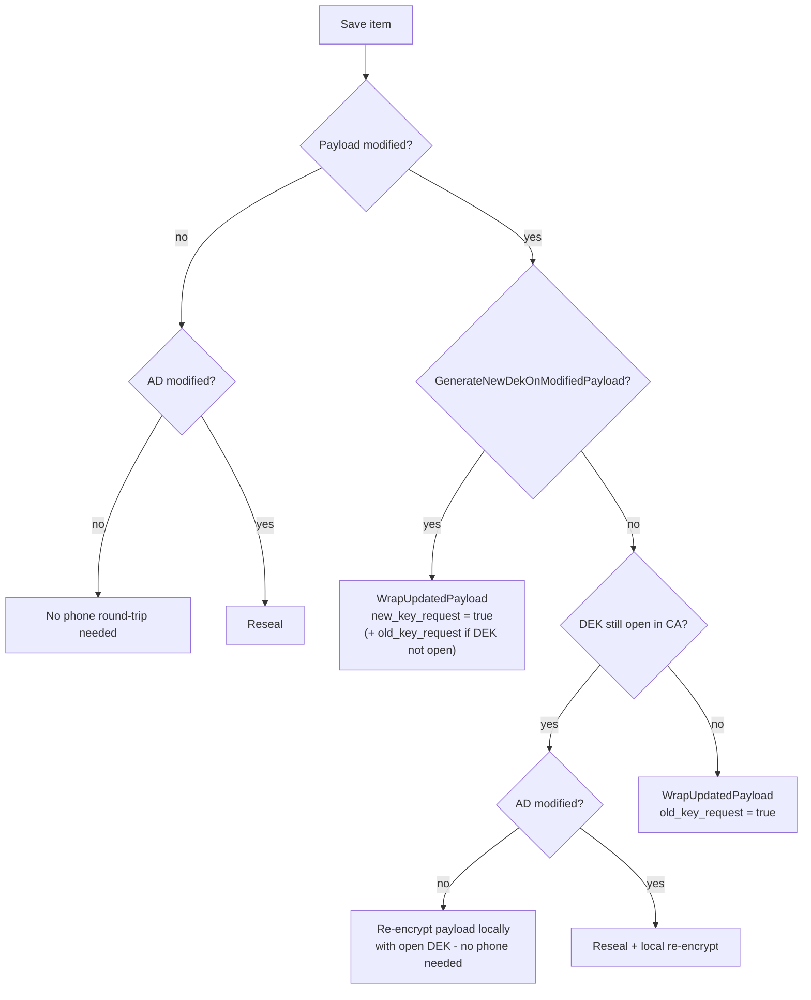

# 7. Key Operations & the QRS Envelope

This document specifies the **application‑level protocol** carried inside the tunnel: the
`KeyOpRequest` / `KeyOpResponse` messages, the four key operations, and the `QrsEnvelope` file
format used to store encrypted data at rest.

- [The four key operations](#the-four-key-operations)
- [The QrsEnvelope](#the-qrsenvelope)
- [IdentityData (ID)](#identitydata-id)
- [AssociatedData2 (AD)](#associateddata2-ad)
- [KeyOpRequest / KeyOpResponse](#keyoprequest--keyopresponse)
- [Operation details](#operation-details)
- [Choosing the operation when saving (RequestHelper)](#choosing-the-operation-when-saving-requesthelper)
- [Mobile App validation](#mobile-app-validation)
- [Batching](#batching)
- [Worked example](#worked-example)

---

## The four key operations



| `KeyOp` | Value | When | MA returns DEK to CA? |
|---|---|---|---|
| `KEY_OP_WRAP_NEW_PAYLOAD` | 0 | Creating a new protected item | Yes — new DEK (`new_unwrapped_key`) |
| `KEY_OP_WRAP_UPDATED_PAYLOAD` | 1 | Saving an item whose payload changed | Old and/or new DEK, as requested |
| `KEY_OP_UNWRAP` | 2 | Opening an item | Yes — existing DEK (`old_unwrapped_key`) |
| `KEY_OP_RESEAL` | 3 | Only the associated data (title, username, …) changed | **No** |

## The QrsEnvelope

`QrsEnvelope` is the unit of storage. The reference apps write its Protobuf bytes directly into a
file (e.g. `*.vault`) or embed it (base64) in another format (e.g. YAML for the process launcher).

```text
message QrsEnvelope {
  int32             schema_version        = 1;  // reserved, currently not set (0)
  SymEncryptedBytes encrypted_dek         = 3;  // DEK wrapped by KEK, AAD = AD || ID
  SymEncryptedBytes encrypted_payload     = 4;  // TypedMessage encrypted by DEK, AAD = ID
  bytes             identity_data_bytes   = 5;  // serialized IdentityData  (ID)
  bytes             associated_data_bytes = 6;  // serialized AssociatedData2 (AD)
}
```



Why store ID and AD **as bytes** rather than as nested messages? Because the exact bytes are the
AAD. Storing the serialised form guarantees that every implementation authenticates the very same
bytes, independent of Protobuf serialiser differences.

## IdentityData (ID)

```text
message IdentityData {
  bytes                     dek_id        = 1;  // 16 random bytes, or app-supplied immutable id
  string                    app_name      = 2;  // canonical app name, e.g. "QRS VAULT"
  int32                     top_level_key = 3;  // app-defined item class (e.g. 1 = vault file)
  google.protobuf.Timestamp created       = 4;  // UTC date (time truncated to midnight)
}
```

- Created **by the MA** during `WrapNewPayload` and never changed afterwards.
- The CA verifies it on every open/save (`WrapperBase.IsValidIdentityData`): `app_name` must equal
  the app's name, `top_level_key` must equal `GetImmutableTopLevelKey()`, and `dek_id` must equal
  `GetImmutableDekId()` if the wrapper provides one. This stops an attacker from feeding an
  envelope from app A into app B, or a "folder key" where a "secret" is expected.
- `created` is truncated to the date to avoid leaking precise timestamps.

## AssociatedData2 (AD)

```text
message AssociatedData2 {
  string                      kek_name              = 1;  // name of the Master Key (set by MA)
  repeated AssociatedDataItem associated_data_items = 2;  // app-defined key/value pairs
}
message AssociatedDataItem { string key = 1; string value = 2; }
```

- The **app** produces the items from its plaintext metadata (`WrapperBase.GetAssociatedData2()`),
  for example `Title = "Taxes 2025.vault"` or `Website / Resource = github.com`,
  `Username = alice`.
- The **MA** always overwrites `kek_name` with the loaded Master Key name before wrapping.
- The MA **shows every item to the user** before approving, so the user can confirm *what* is being
  decrypted.
- On open, the CA compares items stored in the envelope with items computed from the data it holds
  (`DifferenceInItemsWith`) and refuses to proceed on mismatch.

> Legacy messages `AssociatedData`, `AssociatedDataDek`, `AssociatedDataPayload` and
> `AssociatedDataType` exist in `Qrs.Proto` for historical data and are not used by current code.

## KeyOpRequest / KeyOpResponse

```text
message KeyOpRequest {
  string                   app_name = 1;
  repeated KeyOpRequestItem items   = 2;
}

message KeyOpRequestItem {
  int32             index                     = 1;   // position in the CA's batch
  KeyOp             key_op                    = 2;
  bytes             identity_data_bytes       = 3;   // existing ID (not for WrapNew)
  bytes             old_associated_data_bytes = 4;   // AD the DEK is currently wrapped with
  SymEncryptedBytes old_wrapped_key           = 5;   // current wrapped DEK
  bool              old_key_request           = 6;   // CA wants the existing DEK back
  bytes             new_dek_id                = 7;   // optional immutable DekId (WrapNew)
  bytes             new_associated_data_bytes = 8;   // AD to wrap with from now on
  int32             new_top_level_key         = 9;   // TopLevelKey for new ID (WrapNew)
  bool              new_key_request           = 10;  // CA wants a fresh DEK
  bool              validate_associated_data  = 11;  // reserved
}

message KeyOpResponse { repeated KeyOpResponseItem items = 1; }

message KeyOpResponseItem {
  int32             index                     = 1;   // echoes request index
  KeyOp             key_op                    = 2;   // echoes request op
  bytes             identity_data_bytes       = 3;   // ID to store in the envelope
  bytes             new_associated_data_bytes = 4;   // AD (with kek_name) to store
  SymEncryptedBytes new_wrapped_key           = 5;   // wrapped DEK to store
  CryptoKey         new_unwrapped_key         = 6;   // fresh DEK (WrapNew / WrapUpdated)
  CryptoKey         old_unwrapped_key         = 7;   // existing DEK (Unwrap / WrapUpdated)
  string            error_message             = 8;   // per-item error
}
```

Class view:



## Operation details

### WrapNewPayload



### Unwrap



### WrapUpdatedPayload

Handles all "save" cases. The MA:

1. If `old_key_request` and `old_wrapped_key` present → unwrap the existing DEK (AAD = old AD ‖ ID)
   and return it as `old_unwrapped_key`.
2. If `new_key_request` → generate a fresh DEK, return as `new_unwrapped_key`, and wrap **it**.
   Otherwise re‑wrap the old DEK (error if it is not available).
3. Wrap with AAD = **new** AD (with `kek_name`) ‖ **existing** ID. ID never changes.

The CA then stores the new wrapped DEK and AD in the existing envelope and, if the payload changed,
re‑encrypts it with the (new or existing) DEK.

### Reseal

Used when only AD changed (e.g. renamed a vault file, changed a username) and the payload is
untouched. The MA unwraps the DEK internally with the old AD and re‑wraps it with the new AD.
**The DEK is not returned**, so the CA never sees plaintext keys for a pure metadata change.

## Choosing the operation when saving (RequestHelper)

`Qrs.Client.Context/RequestHelper.cs` decides, per item, whether the phone is needed at all and
which operation to request:

| Input | Meaning |
|---|---|
| `IsModifiedPayload` | App changed the secret payload (set by app code). |
| `IsModifiedAssociatedData` | AD computed from data differs from AD in the envelope (detected automatically). |
| `GenerateNewDekOnModifiedPayload` | Wrapper policy (default `true`; Vault/PWM use `false`). |
| `IsDekOpen` | CA still has the DEK in memory from a previous Unwrap. |



Formally: `NeedsRewrap = IsModifiedAD`; `NeedsNewKey = IsModifiedPayload && GenerateNewDek`;
`NeedsOldKey = IsModifiedPayload && !IsDekOpen`; `KeyOp = (NeedsNewKey || NeedsOldKey) ?
WrapUpdatedPayload : Reseal`; the phone is needed if any of the three is true.

## Mobile App validation

Before showing the approval screen, `QrCommandFlow.ValidateCommand` checks the whole request:

| Check | Severity | User can override? |
|---|---|---|
| At least one item | Fatal | No |
| Exactly one `AppName` across request and all IDs | Validation error | Yes (session setting) |
| `AppName` is canonical: upper‑case letters/digits, words separated by one space or dash (`^(\b[A-Z0-9]+\b(-| )?)+\b$`) | Validation error | Yes (session setting) |
| Exactly one `kek_name` across all old/new AD | Fatal | No |
| `kek_name` present for `Unwrap`, `WrapUpdatedPayload`, `Reseal` | Fatal | No |
| `kek_name` equals the loaded Master Key name | Fatal ("Master Key is not loaded") | No |
| Item parse errors | Fatal | No |
| Tunnel server is plain HTTP | Alert | Informational |
| Tunnel server used for the first time and not `*.qrid.com` | Alert | Added to known servers on **Yes** |

What the user sees for each item: the operation, the app name, and **every AD item** (for
`Unwrap` the stored AD; otherwise the new AD).

## Batching

A single `KeyOpRequest` may carry many items, so one QR scan can open or save many objects — e.g.
the Password Manager can unwrap a whole folder of secrets at once. Errors are reported **per
item** (`error_message`), and the CA marks each wrapper's `Status` individually.

## Worked example

Creating a vault file `Taxes.vault` with the QRS Vault app (`VaultWrapper`):

| Field | Value |
|---|---|
| `KeyOpRequest.app_name` | `QRS VAULT` |
| item `key_op` | `KEY_OP_WRAP_NEW_PAYLOAD` |
| item `new_top_level_key` | `1` |
| item `new_associated_data_bytes` | `AssociatedData2{ items: [ {Title, "Taxes.vault"} ] }` |
| MA → `identity_data_bytes` | `IdentityData{ dek_id: 16 random bytes, app_name: "QRS VAULT", top_level_key: 1, created: 2026‑09‑30 }` |
| MA → `new_associated_data_bytes` | `AssociatedData2{ kek_name: "My Key", items: [ {Title, "Taxes.vault"} ] }` |
| payload `message_type` | `mime:application/vnd.qrs.vault` |
| payload `message_bytes` | `Vault{ vault_file_name, vault_type, created, files[...] }` |
| File on disk | `QrsEnvelope` bytes |

---

Next: [Pairing & Key Switching →](08-pairing.md)
