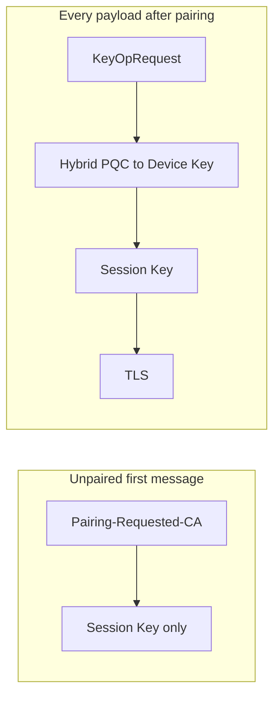
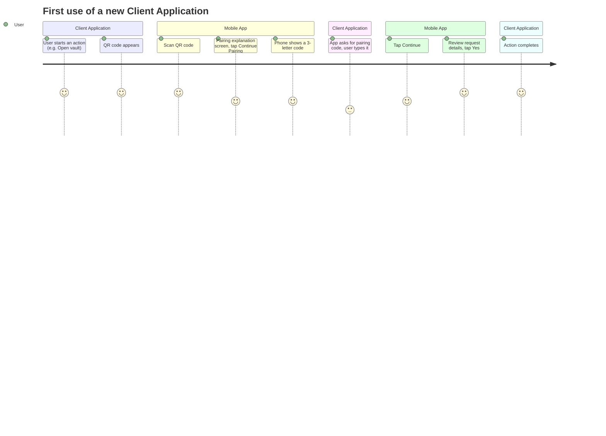
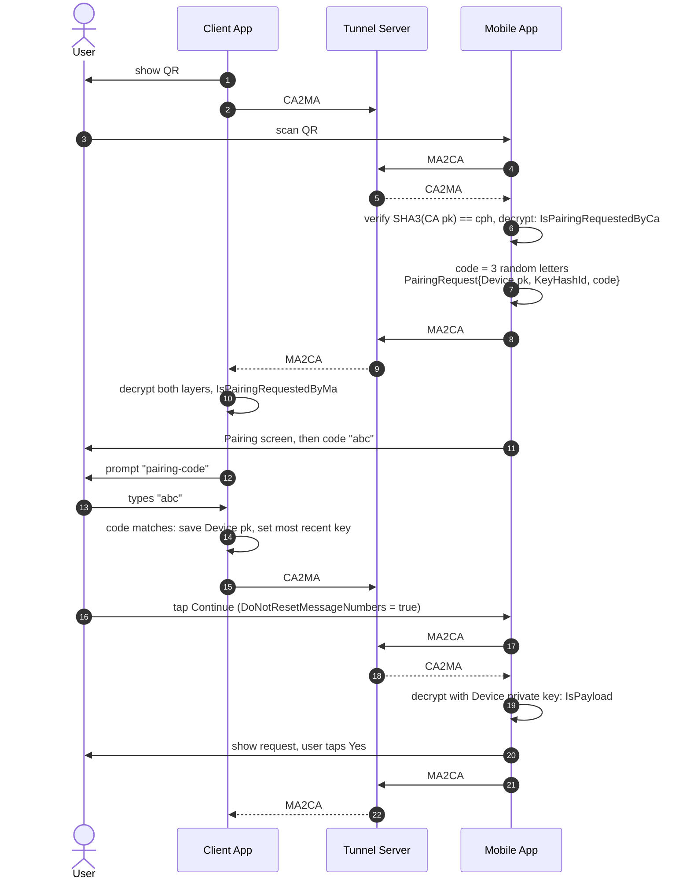
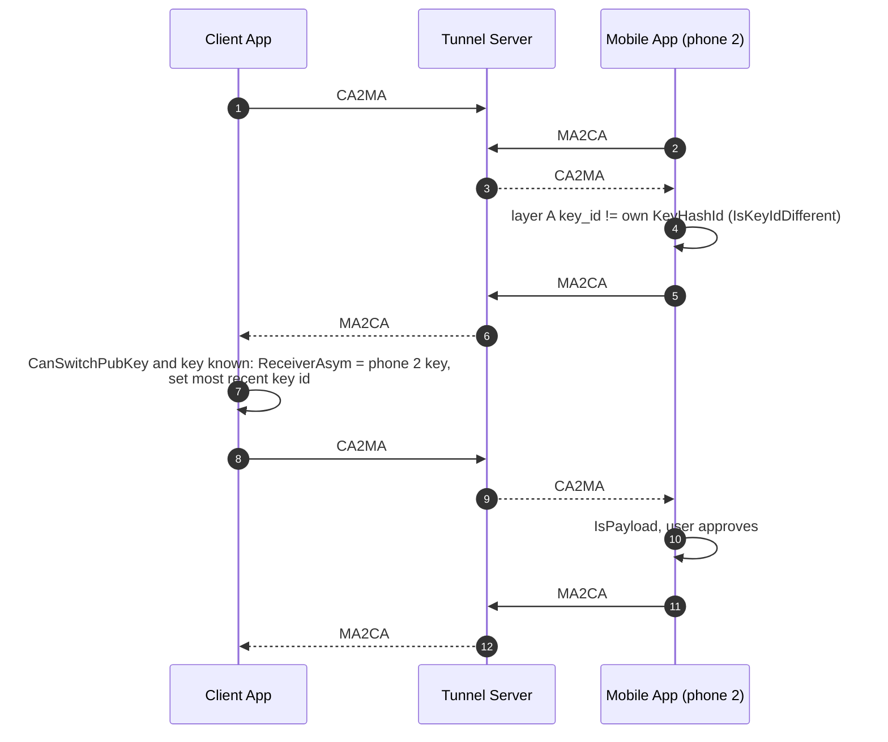
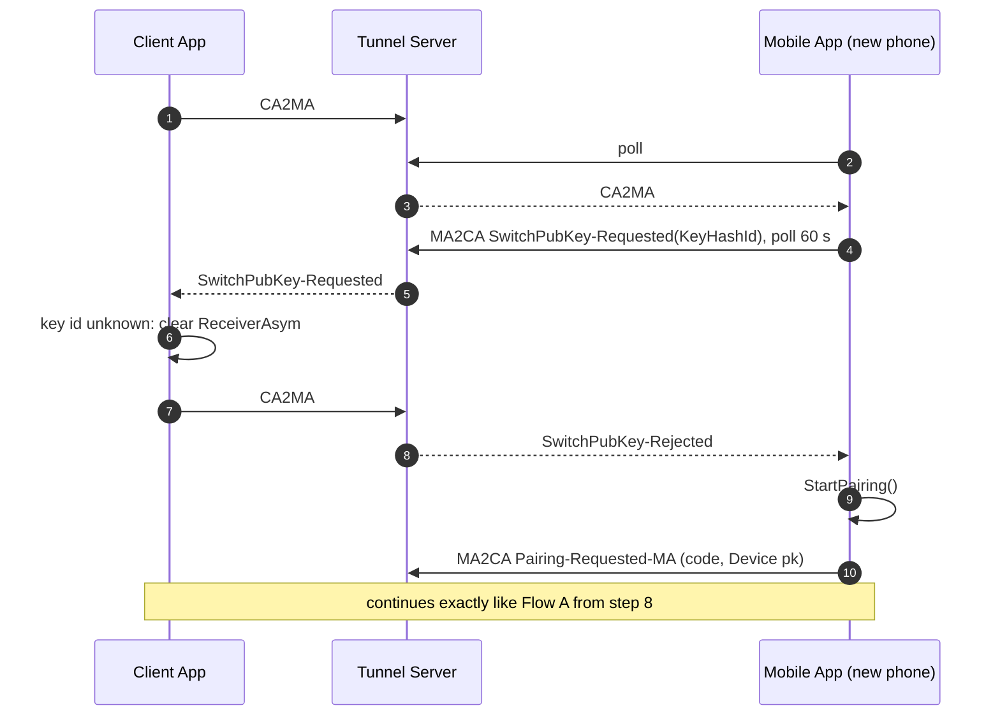
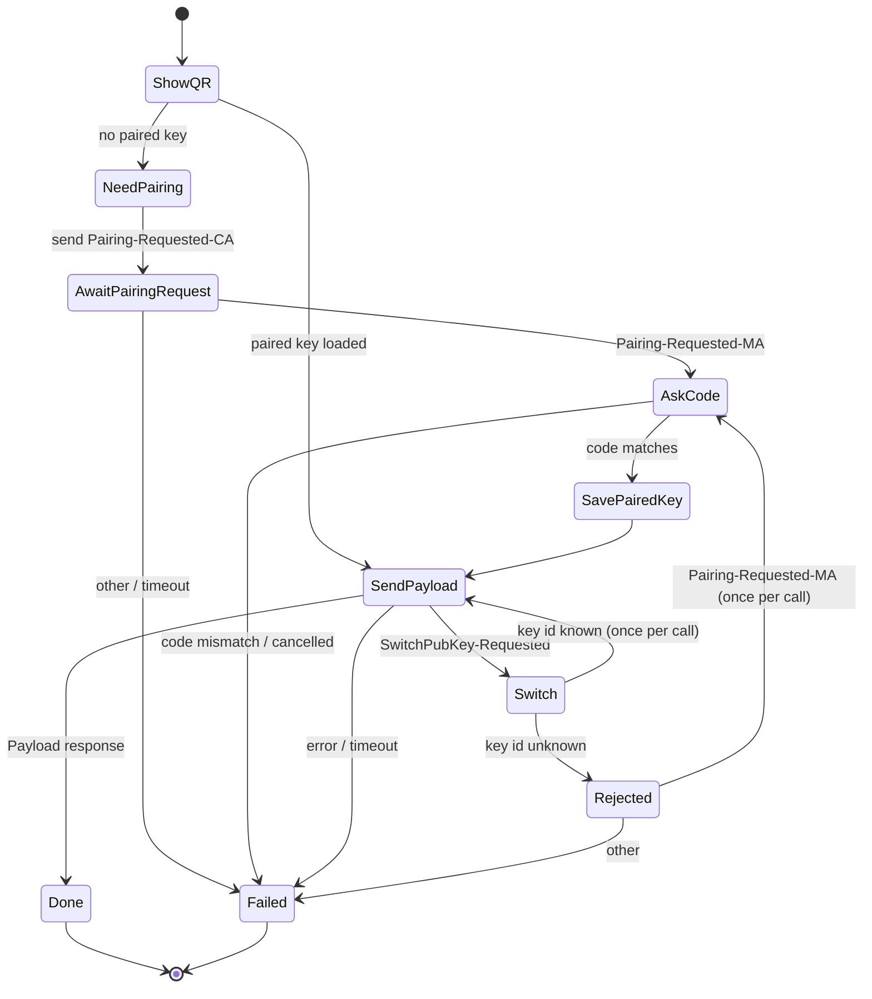
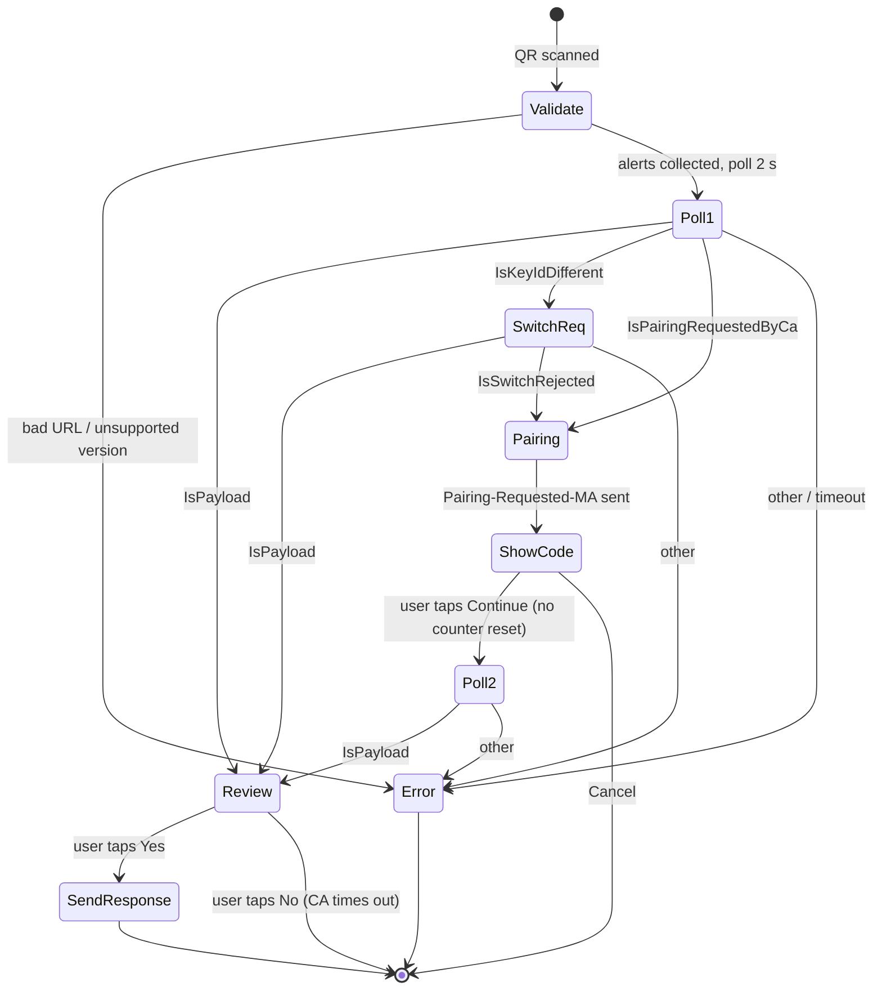

# 8. Pairing & Key Switching

Pairing is how a Client Application (CA) learns the **public Device Key** of the user's Mobile App
(MA), so that all later payloads can be encrypted to that key in addition to the Session Key from
the QR code. Pairing happens **inside the same tunnel session** as the first command; the user
does not have to scan a second QR code.

- [Why pairing exists](#why-pairing-exists)
- [Keys involved](#keys-involved)
- [User experience](#user-experience)
- [Flow A: CA has no paired key](#flow-a-ca-has-no-paired-key)
- [Flow B: key switching (CA knows several phones)](#flow-b-key-switching-ca-knows-several-phones)
- [Flow C: switch rejected, fall back to pairing](#flow-c-switch-rejected-fall-back-to-pairing)
- [State machines](#state-machines)
- [Rules and limits](#rules-and-limits)
- [Storage of paired keys](#storage-of-paired-keys)
- [Resetting pairing](#resetting-pairing)
- [Security analysis](#security-analysis)

---

## Why pairing exists

The QR code transfers the Session Key over an optical channel, which is excellent against network
attackers but can be observed by a camera or a person looking over your shoulder. After pairing,
every payload is **also** encrypted with hybrid ML‑KEM‑768 + ECDH P‑256 to the phone's Device
Key, whose private part never leaves the phone. An observer of the QR code therefore still cannot
read the requests.

## Keys involved

| Key | Owner | Role in pairing |
|---|---|---|
| Device Key pair (hybrid) | MA | Its public part is what is being paired. |
| Tunnel ephemeral key pair (hybrid) | CA | MA encrypts the `PairingRequest` to it (verified via `cph` in QR). |
| Session Key | CA (in QR) | Outer layer for all messages. |
| Pairing code | MA | 3 random lower‑case letters shown on the phone, typed into the CA. |

## User experience

## Flow A: CA has no paired key

## Flow B: key switching (CA knows several phones)

A CA can have several paired keys (e.g. the user reinstalled the MA, or uses two phones with the
same Master Key restored from backup). The CA always tries the **most recently used** key first.
If the scanning phone has a different Device Key, the MA cannot decrypt layer A and asks the CA to
switch to its key **by id only** (no public key is sent, so no user code is needed):

## Flow C: switch rejected, fall back to pairing

## State machines

### Client Application (`ClientContext.MainFlowAsync`)

### Mobile App (`QrsAppContext.PayloadOrPairing`)

## Rules and limits

| Rule | Where | Reason |
|---|---|---|
| Switch or pair **at most once** per command | `switchAllowed`, `pairingAllowed` in `MainFlowAsync` | Prevent loops driven by a malicious peer. |
| Switch/pair only when `CommandCount == 0` (`CanSwitchPubKey`, `CanPair`) | `ClientContext` | After the first successful command in an app session the phone is fixed; a different phone requires restarting the CA. Prevents a silent swap to an attacker's phone mid‑session. |
| Pairing payload must come from **layer A** | `MsgHelper.IsPairingRequestedByMa` | Only a party that received the CA's ephemeral key via the tunnel **and** knows the Session Key can produce it. |
| `SHA3(SenderPubKeyBytes) == cph` | `EnsureReceiverPublicKeyForQrV2` | The MA encrypts to the key the QR code vouches for, not to a key injected by the server. |
| MA refuses non‑PQC Device Keys | `MobUtils.LoadDeviceKeyItem` | Guarantees hybrid PQC for layer A. |

## Storage of paired keys

The CA persists paired keys through `IAsymKeyItemProvider`. The default
`FileAsymKeyItemProvider` stores, in the app's data folder:

| File | Content |
|---|---|
| `_asym-key-item-<KeyHashId>` | The paired public key (`AsymKeyItem`) |
| `_most-recent-key-id` | `KeyHashId` of the key to try first |

Paired keys are **public**; what matters is their **integrity**. Protect the folder from tampering
by other users on the same machine (standard user‑profile permissions).

## Resetting pairing

On the MA, **Actions → Reset Pairing** generates a new Device Key. All CAs will then receive a
`SwitchPubKey-Requested` with an unknown id and fall back to pairing on next use. Do this if you
suspect a CA machine was compromised or you want to revoke all CAs at once.

## Security analysis

| Threat | Mitigation | Residual risk |
|---|---|---|
| Network attacker / malicious Tunnel Server injects its own "Device Key" | Needs the Session Key (QR only) to produce a valid layer‑B message, and needs to make the user type a matching code | Low |
| Camera observes QR **and** controls the Tunnel Server during first pairing | Pairing code is shown only on the phone and must be typed by the user into the CA | Guessing: 26³ = 17,576 codes, one attempt per QR scan (the CA aborts on mismatch) |
| Attacker swaps phones after the first command | `CanPair`/`CanSwitchPubKey` false when `CommandCount > 0` | None within an app session |
| Stale / revoked phone | Reset Pairing on the MA; delete key files on the CA | — |

---

Next: [Mobile App Internals →](09-mobile-app.md)
