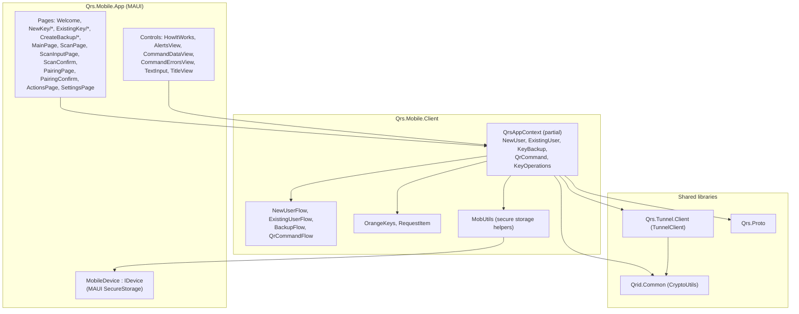
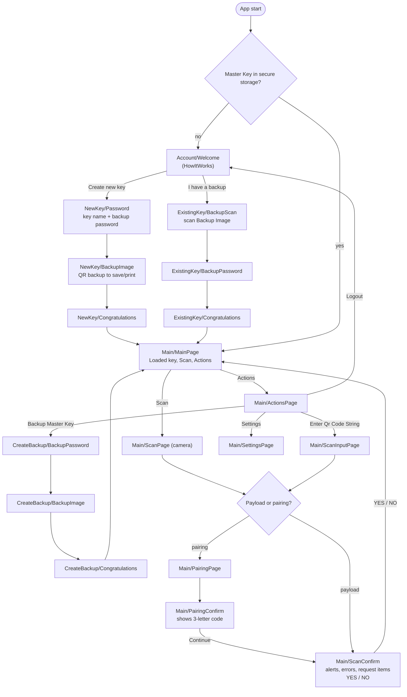
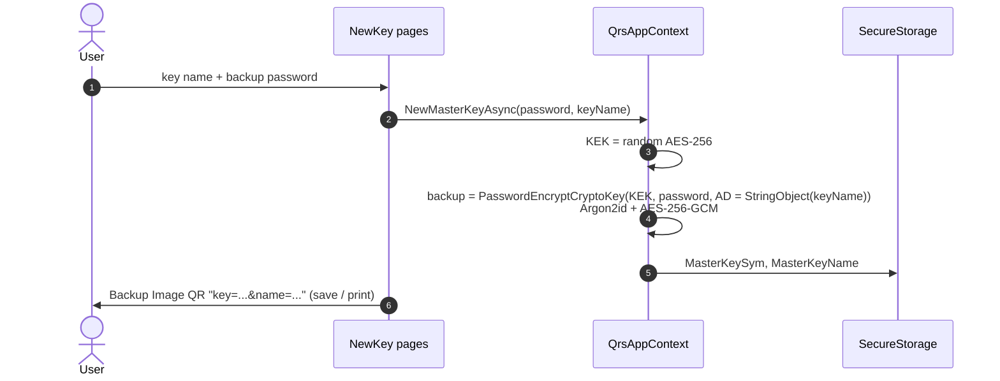
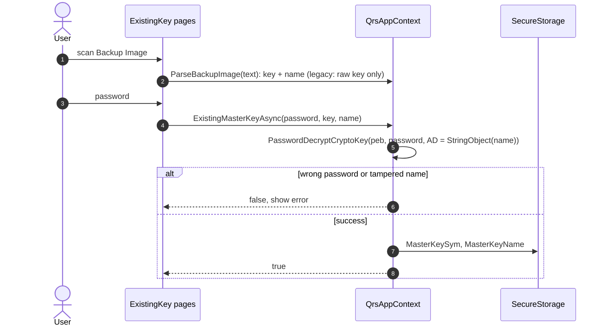
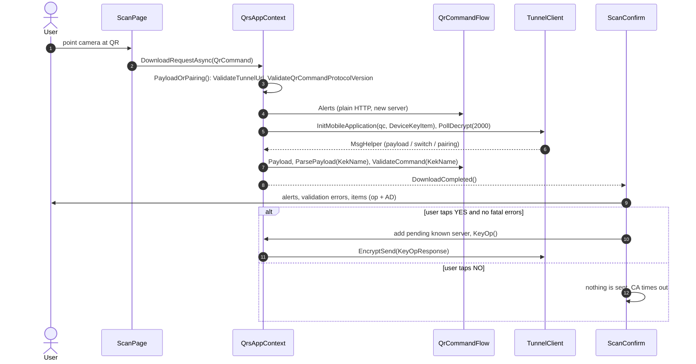

# 9. Mobile App Internals

The **QRS Mobile App (MA)** is the user's hardware‑like key: it holds the Master Key (KEK) and the
Device Key, scans QR codes, shows what is being requested and performs key operations after the
user approves.

- [Projects](#projects)
- [Layering](#layering)
- [Secure storage](#secure-storage)
- [Screens and navigation](#screens-and-navigation)
- [Account flows](#account-flows)
- [Command flow (scan → approve → respond)](#command-flow-scan--approve--respond)
- [Alerts and validation](#alerts-and-validation)
- [Actions and settings](#actions-and-settings)
- [Threading notes](#threading-notes)
- [Building and running the MA](#building-and-running-the-ma)

---

## Projects

| Project | Target | Role |
|---|---|---|
| `Qrs.Mobile.App/Qrs.Mobile.App` | `net10.0`, .NET MAUI | Shared UI (XAML pages, controls, navigation) |
| `Qrs.Mobile.App/Qrs.Mobile.App.Droid` | Android head | Platform entry point |
| `Qrs.Mobile.App/Qrs.Mobile.App.iOS` | iOS head | Platform entry point |
| `Qrs.Mobile.App/Qrs.Mobile.App.Mac` | Mac Catalyst head | Platform entry point |
| `Qrs.Mobile.App/Qrs.Mobile.App.WinUI` | Windows head | Platform entry point (development/testing) |
| `Qrs.Mobile.Client` | `net10.0` | **UI‑independent engine**: `QrsAppContext`, flows, validation, key ops, secure‑storage helpers. Also driven headless by `Qrs.TestConsole`. |

Key UI packages: `CommunityToolkit.Maui`, `BarcodeScanning.Native.Maui` (QR scanning),
`QRCoder` (Backup Image rendering).

## Layering

## Secure storage

All secrets are stored through `IDevice` → MAUI `SecureStorage` (iOS Keychain, Android
Keystore‑encrypted preferences, Windows DPAPI).

| Key | Value | Written by |
|---|---|---|
| `MasterKeySym` | base64 `CryptoKey` (AES‑256 KEK) | New key / restore |
| `MasterKeyName` | user‑chosen key name | New key / restore |
| `DeviceKeyItem` | base64 hybrid `CryptoKeyPair` | First use / Reset Pairing |
| `KnownTunnelServers` | JSON array of tunnel URLs the user accepted | Approve with a new server |

**Logout** calls `SecureStorage.RemoveAll()` — Master Key, Device Key and known servers are all
wiped. Only a Backup Image + password can restore the Master Key afterwards.

## Screens and navigation

## Account flows

### Create a new Master Key

### Restore from a Backup Image

### Backup the current key

`BackupMasterKeyAsync(password)` re‑encrypts the loaded KEK with a (possibly new) password and
renders the Backup Image. Each backup uses a fresh random salt and nonce.

## Command flow (scan → approve → respond)

`ParsePayload` turns the `KeyOpRequest` into a list of `RequestItem` objects (`IdentityData`,
`OldAssociatedData`, `NewAssociatedData`, `DisplayAssociatedData`); `KeyOp()` then produces a
`KeyOpResponse` (see [Key Operations](07-key-operations.md#operation-details)).

## Alerts and validation

| Category | Examples | Effect |
|---|---|---|
| **Alerts** (informational, shown in `AlertsView`) | Plain HTTP tunnel; first use of a non‑`*.qrid.com` server | User decides; new server is remembered after **YES** |
| **Validation errors** | Multiple app names; non‑canonical app name | Block **YES** unless *Ignore Validation Errors (for this session only)* is enabled in Settings |
| **Fatal errors** | Empty request; multiple/missing KEK names; KEK not loaded; item parse error | Block **YES** |

## Actions and settings

| Action | Effect |
|---|---|
| Backup Master Key | Create a new Backup Image (new password allowed). |
| Logout | Wipe secure storage (KEK, Device Key, known servers). |
| Settings | *Ignore Validation Errors (for this session only)*. |
| Enter Qr Code String | Paste a QR string instead of scanning (desktop testing, accessibility). |
| Reset Pairing | Generate a new Device Key; all CAs must re‑pair. |
| Reset Known Servers | Forget accepted tunnel servers; alerts will reappear. |
| Test | Developer diagnostics. |

## Threading notes

- `QrsAppContext.InitAsync` runs initialisation on a background thread so iOS' launch watchdog is
  not triggered by secure‑storage access or key generation.
- Network and crypto calls from pages are wrapped in `Task.Run` with a loading overlay
  (`IsLoading`).
- `MobileDevice` exposes both sync and async secure‑storage methods; the sync versions block on a
  background task and must not be called from the UI thread in new code.

## Building and running the MA

See [Building & Testing](14-building-and-testing.md#mobile-app). In short: install the .NET 10 SDK
and the MAUI workload (`dotnet workload install maui`), then build the platform head you need,
e.g. `dotnet build Qrs.Mobile.App/Qrs.Mobile.App.Droid -c Debug`. For end‑to‑end tests without a
phone, `Qrs.TestConsole` drives `Qrs.Mobile.Client` directly.

> **Release builds only for real users.** Debug builds use weak Argon2 parameters for backups and
> force long polling timeouts.

---

Next: [Client SDK Guide →](10-client-sdk.md)
