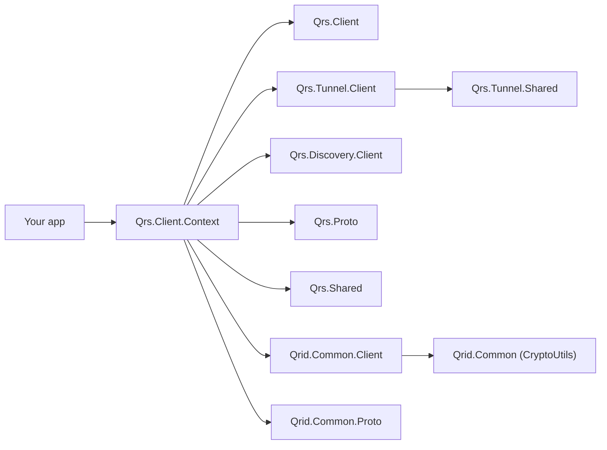
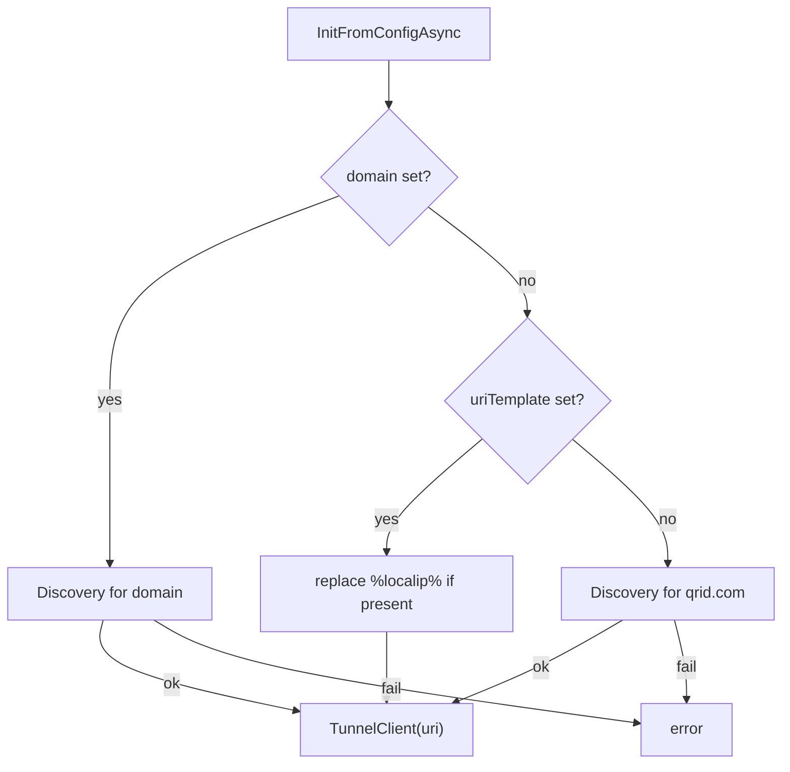
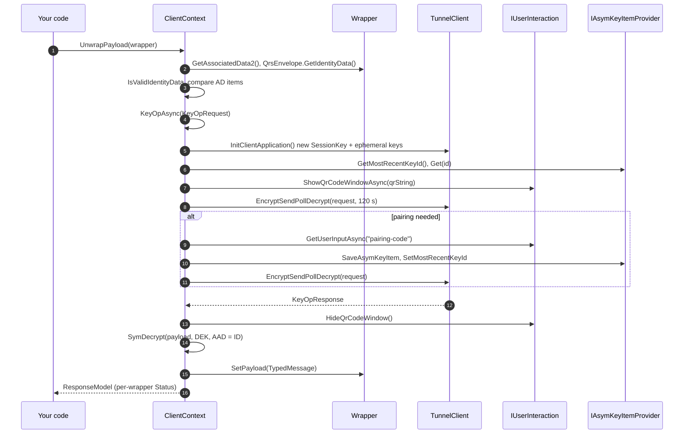

# 10. Client SDK Guide (C#)

This guide shows how to add QRS protection to your own .NET application using the **Client SDK**
(`Qrs.Client.Context` and friends). If you are not on .NET, read
[Porting Guide](16-porting-guide.md) instead.

- [What you get](#what-you-get)
- [Packages / project references](#packages--project-references)
- [Core abstractions](#core-abstractions)
- [Step 1 — define your payload](#step-1--define-your-payload)
- [Step 2 — write a Wrapper](#step-2--write-a-wrapper)
- [Step 3 — implement or use existing IUserInteraction](#step-3--implement-or-use-existing-iuserinteraction)
- [Step 4 — create and initialise the ClientContext](#step-4--create-and-initialise-the-clientcontext)
- [Step 5 — create, open, save](#step-5--create-open-save)
- [Batch operations](#batch-operations)
- [Configuration and discovery](#configuration-and-discovery)
- [Execution flow inside the SDK](#execution-flow-inside-the-sdk)
- [Error handling](#error-handling)
- [Best practices](#best-practices)
- [API reference (summary)](#api-reference-summary)

---

## What you get

With ~100 lines of code your app gets:

- a random AES‑256 **DEK per object**, wrapped by the user's **KEK** on their phone;
- a **QR‑code approval** UI with pairing and key switching handled for you;
- post‑quantum hybrid encryption of every request/response in transit;
- a self‑contained `QrsEnvelope` you can store anywhere (file, DB column, cloud object).

## Packages / project references

The SDK is currently consumed as project references (NuGet packages are on the
[roadmap](../ROADMAP.md)). Reference **`Qrs.Client.Context`**; it brings in:



```xml
<ItemGroup>
  <ProjectReference Include="..\Qrs.Client.Context\Qrs.Client.Context.csproj" />
</ItemGroup>
```

All projects target **`net10.0`**.

## Core abstractions

| Type | Namespace | You… |
|---|---|---|
| `ClientContext` | `Qrs.Client.Context` | create one per app (or derive from it, like `VaultContext`). |
| `Wrapper<TPayload>` / `WrapperBase` | `Qrs.Client.Context` | subclass once per kind of protected object. |
| `IUserInteraction` | `Qrid.Common.Client.UI` | implement to show the QR code and ask for the pairing code. |
| `IAsymKeyItemProvider` | `Qrs.Tunnel.Client` | usually use `FileAsymKeyItemProvider(folder)`. |
| `ICookieProvider` | `Qrid.Common.Client.Cookie` | usually use `FileCookieProvider(folder)`. |
| `QrsEnvelope` | `Qrs.Proto` | persist `envelope.GetByteArray()`; load with `QrsEnvelope.Create(bytes)`. |

## Step 1 — define your payload

Payloads are Protobuf messages deriving from `ProtoBase`. Example `ProtoFiles/Note.proto`:

```proto
syntax = "proto3";
package mynotes;
option csharp_namespace = "MyNotes.Proto";

message Note {
  string title = 1;
  string body  = 2;
}
```

Generate `Note.generated.cs` with `protoc` (see the `GenerateProto.cmd` pattern in
`Qrs.App.Vault.Client`), then add a partial class so it derives from `ProtoBase`:

```csharp
namespace MyNotes.Proto
{
    public partial class Note : Qrid.Common.Proto.ProtoBase
    {
        public static Note Create(byte[] bytes) => Parser.ParseFrom(bytes);
        public static Note Create(Google.Protobuf.ByteString bytes) => Parser.ParseFrom(bytes);
        public static Note Create(string base64) =>
            string.IsNullOrWhiteSpace(base64) ? null : Parser.ParseFrom(System.Convert.FromBase64String(base64));
    }
}
```

## Step 2 — write a Wrapper

The wrapper tells QRS **what the payload is**, **which metadata the user should see** on the phone
(associated data), and the immutable identity rules.

```csharp
using Qrs.Client.Context;
using Qrs.Proto;

public class NoteWrapper : Wrapper<MyNotes.Proto.Note>
{
    public const string APP_NAME = "MY NOTES";     // canonical: UPPERCASE words, space or dash

    public string Title { get; set; }               // plaintext metadata shown on the phone

    public NoteWrapper() : base(APP_NAME) { }

    // Identifies the payload type inside the encrypted TypedMessage
    public override string GetPayloadType() => "mime:application/vnd.mynotes.note";

    // Distinguishes classes of objects in your app (checked on every open)
    public override int GetImmutableTopLevelKey() => 1;

    // true  = fresh DEK every time the payload changes (default, strongest)
    // false = keep the DEK while the object is open, save without scanning again
    public override bool GenerateNewDekOnModifiedPayload => false;

    // What the user sees on the phone; authenticated with the wrapped DEK
    public override AssociatedData2 GetAssociatedData2()
    {
        var ad = new AssociatedData2 { KekName = string.Empty };   // MA fills KekName
        ad.AssociatedDataItems.Add(new AssociatedDataItem { Key = "Title", Value = Title ?? "" });
        return ad;
    }
}
```

Rules for associated data:

- Include what helps the user decide ("which item is this?") — a title, a host name, a username.
- **Never include secrets** — AD is stored and transmitted in plaintext (inside the encrypted tunnel,
  but plaintext in the envelope).
- AD must be **re‑computable from data you have without decrypting** (e.g. file name), because it is
  compared with the envelope before unwrapping.

## Step 3 — implement or use existing IUserInteraction

Avalonia and WinForms implementations are already provided by the corresponding
`Qrs.UI.Avalonia/Qrs.UI.Avalonia.csproj` and `Qrs.UI.WinForms/Qrs.UI.WinForms.csproj` projects.
Use one of these if it matches your UI framework; otherwise, implement `IUserInteraction` for your app.

A minimal console implementation (see `Qrs.App.Qrs.Cli/Program.cs` for a complete one using
`QRCoder` to print an ASCII QR code):

```csharp
using Qrid.Common.Client.Api;
using Qrid.Common.Client.UI;
using Qrid.Common.Http;
using QRCoder;

public class ConsoleUi : IUserInteraction
{
    public void ShowQrCodeWindow(string sessionId, string qrString)
    {
        var data = new QRCodeGenerator().CreateQrCode(qrString, QRCodeGenerator.ECCLevel.L);
        System.Console.WriteLine(new AsciiQRCode(data).GetGraphicSmall(true, false, System.Environment.NewLine));
        System.Console.WriteLine("Scan this QR code with the QRS app...");
    }
    public Task ShowQrCodeWindowAsync(string sessionId, string qrString)
    { ShowQrCodeWindow(sessionId, qrString); return Task.CompletedTask; }
    public void HideQrCodeWindow(string sessionId) => System.Console.Clear();

    public async Task<HttpResponseModel<StringResponse>> GetUserInputAsync(string inputContext)
    {
        // inputContext == "pairing-code"
        System.Console.Write("Enter the 3-letter pairing code shown on your phone: ");
        var code = System.Console.ReadLine();
        return string.IsNullOrWhiteSpace(code)
            ? CommonContext.ErrorStringResponse("Pairing cancelled")
            : CommonContext.SuccessStringResponse(code.Trim());
    }

    public void ShowMessage(string message) => System.Console.WriteLine(message);
    public void ShowError(string message) => System.Console.Error.WriteLine(message);
    public void ShowMessageWindow(string title) { }
    public void HideMessageWindow() { }
    public void SetDescription(string title, string subtitle) { }
    public void SetTunnelServiceUri(string tunnelServiceUri) { }
    public void ShowUsernameWindow(System.Action<string> continueWithUsername) => throw new System.NotSupportedException();
}
```

Notes for GUI apps:

- The SDK may call these methods **from a non‑UI thread**; marshal to the UI thread
  (`Dispatcher`, `Invoke`, …).
- `ShowQrCodeWindowAsync` should return once the QR is visible — the SDK then starts the tunnel
  exchange; `HideQrCodeWindow` is called when it finishes (success or failure).
- Offer a **Cancel** button that calls `ClientContext.CancelQrCodePolling()`.

## Step 4 — create and initialise the ClientContext

```csharp
using Qrid.Common.Client.Cookie;
using Qrs.Client.Context;
using Qrs.Tunnel.Client;

var appRoot = Path.Combine(Environment.GetFolderPath(Environment.SpecialFolder.ApplicationData), "MyNotes");
Directory.CreateDirectory(appRoot);

var ctx = new ClientContext(
    NoteWrapper.APP_NAME,
    new ConsoleUi(),
    new FileAsymKeyItemProvider(appRoot),   // paired phone public keys
    new FileCookieProvider(appRoot));       // anonymous instance id cookie, API key cookie

// Either a domain (discovery), or a tunnel URI template, or nothing (defaults to qrid.com discovery)
var init = await ctx.InitFromConfigAsync(
    tunnelServiceDomain: null,
    tunnelServiceUriTemplate: "https://qrid.qrid.com/qrs-tunnel-api/",
    apiKey: null);
if (init.IsError()) throw new Exception(init.Message);
```

## Step 5 — create, open, save

```csharp
// CREATE
var w = new NoteWrapper { Title = "Wi-Fi password" };
w.CreatePayload();
w.Payload.Title = w.Title;
w.Payload.Body  = "correct horse battery staple";

var r = await ctx.WrapNewPayload(w);           // shows QR, user scans + approves
if (r.IsError()) throw new Exception(r.Message);
await File.WriteAllBytesAsync("wifi.note", w.QrsEnvelope.GetByteArray());

// OPEN
var w2 = new NoteWrapper { Title = "Wi-Fi password" };
w2.QrsEnvelope = QrsEnvelope.Create(await File.ReadAllBytesAsync("wifi.note"));
r = await ctx.UnwrapPayload(w2);               // shows QR again
if (r.IsError()) throw new Exception(r.Message);
Console.WriteLine(w2.Payload.Body);

// SAVE after editing the payload
w2.Payload.Body = "new password";
w2.IsModifiedPayload = true;
r = await ctx.WrapUpdatedPayload(w2);          // no QR needed: DEK still open and AD unchanged
await File.WriteAllBytesAsync("wifi.note", w2.QrsEnvelope.GetByteArray());

// RENAME (metadata only) -> Reseal, DEK never leaves the phone
w2.Title = "Home Wi-Fi";
w2.IsModifiedPayload = false;
r = await ctx.WrapUpdatedPayload(w2);          // shows QR, phone re-wraps DEK with new AD

// Close: forget plaintext and DEK
w2.ClearPayload();
```

The decision table used by `WrapUpdatedPayload` is described in
[Key Operations → RequestHelper](07-key-operations.md#choosing-the-operation-when-saving-requesthelper).

## Batch operations

Every method has an `IEnumerable<WrapperBase>` overload. One QR scan then covers all items:

```csharp
var wrappers = files.Select(f => new NoteWrapper { Title = Path.GetFileName(f),
                                                   QrsEnvelope = QrsEnvelope.Create(File.ReadAllBytes(f)) }).ToList();
var r = await ctx.UnwrapPayload(wrappers);
foreach (var w in wrappers)
    Console.WriteLine($"{w.Title}: {(w.Status.IsError() ? w.Status.Message : "ok")}");
```

## Configuration and discovery

`InitFromConfigAsync(domain, uriTemplate, apiKey)` resolves the Tunnel Server in this order:



**Discovery** (`Qrs.Discovery.Client`) requests
`http://qrs.<domain>/.well-known/qrs-configuration`, then `http://<domain>/.well-known/qrs-configuration`
(3 s timeout, cached per process). The response body is the Tunnel Server URI. See
[Operating the Tunnel Server → Discovery](13-tunnel-server-ops.md#domain-discovery).

**API key:** if your tunnel server requires one, pass it as `apiKey`; it is sent as the
`qrs_tunnel_api_key` cookie. A user‑supplied key overrides one from discovery.

Typical settings file (as used by the reference apps):

```json
{
  "TunnelServerDomain": "",
  "TunnelServerUri": "https://qrid.qrid.com/qrs-tunnel-api/",
  "ApiKey": ""
}
```

## Execution flow inside the SDK



## Error handling

- All SDK methods return `ResponseModel` / `HttpResponseModel<T>` — check `IsError()` and
  `Message`; they do not throw for expected failures.
- Batch methods return an aggregate error **and** set `wrapper.Status` per item.
- Common messages:

| Message | Meaning | What to do |
|---|---|---|
| `Timeout - no response from QRS mobile application` | User did not scan / tapped **NO** within 120 s | Let the user retry. |
| `Invalid Pairing Code! ...` | User typed a wrong code | Retry the operation (a new QR and new code). |
| `Mobile Application declined our PAIRING request` | MA sent something unexpected | Retry; check MA version. |
| `Invalid QrsEnvelope.AppName=...` | Envelope belongs to another app | Refuse the file. |
| `Invalid QrsEnvelope - Associated Data from envelope are not matching ...` | Metadata changed outside the app (e.g. renamed file) | Ask the user to confirm or use the original name. |
| `Cannot SWITCH ... / Cannot PAIR ...` | Different phone after a successful command in this session | Restart the app. |
| `Cannot support QRS Client Protocol X ...` | Peer is newer (MAJOR) | Upgrade. |

## Best practices

- **Keep `APP_NAME` stable and canonical** — it is baked into every envelope's `IdentityData`.
- **Use `ClearPayload()`** as soon as you no longer need plaintext; do not write plaintext to temp
  files unless unavoidable.
- **Choose AD carefully**: meaningful to the user, non‑secret, stable.
- **Batch** where your UX allows (open a folder with one scan).
- **Prefer HTTPS tunnel URLs**; plain HTTP works (payloads are still double‑encrypted) but the MA
  warns the user.
- **Never log** QR strings, `SessionKey`, DEKs or payloads.
- **Protect the app data folder** that holds paired keys against tampering.

## API reference (summary)

### `ClientContext`

| Member | Description |
|---|---|
| `ClientContext(appName, ui, asymKeyItemProvider, cookieProvider)` | Constructor. |
| `Task<...> InitFromConfigAsync(domain, uriTemplate, apiKey = null)` | Resolve the Tunnel Server (see above). |
| `Task<...> InitDomainAsync(domain)` / `InitDomain(uriTemplate)` | Lower‑level initialisers. |
| `Task<ResponseModel> WrapNewPayload(wrapper \| wrappers)` | Create envelopes. |
| `Task<ResponseModel> UnwrapPayload(wrapper \| wrappers)` | Open envelopes. |
| `Task<ResponseModel> WrapUpdatedPayload(wrapper \| wrappers)` | Save (WrapUpdated / Reseal / local). |
| `Task<HttpResponseModel<KeyOpResponse>> KeyOpAsync(KeyOpRequest)` | Raw key operation (advanced). |
| `Task<HttpResponseModel<TypedMessage>> ExecuteQrCommandAsync(cmd, request)` | Raw tunnel command (advanced). |
| `bool CancelQrCodePolling()` | Cancel an in‑flight poll. |
| `int CommandCount`, `bool CanPair`, `bool CanSwitchPubKey` | Session pairing guards. |
| `string ApiKey`, `TunnelClient TunnelClient`, `IUserInteraction UI` | Configuration and plumbing. |

### `WrapperBase` / `Wrapper<TPayload>`

| Member | Override? | Description |
|---|---|---|
| `string GetPayloadType()` | **must** | Payload type string stored in the encrypted `TypedMessage`. |
| `AssociatedData2 GetAssociatedData2()` | **must** | User‑visible, authenticated metadata. |
| `int GetImmutableTopLevelKey()` | optional (default `0`) | Object class id. |
| `ByteString GetImmutableDekId()` | optional (default empty → random) | Stable id if your app needs one. |
| `bool GenerateNewDekOnModifiedPayload` | optional (default `true`) | DEK rotation policy on save. |
| `byte[] GetPayloadBytes()` / `string SetPayload(TypedMessage)` | provided by `Wrapper<T>` | Serialisation and type check. |
| `TPayload Payload`, `CreatePayload()`, `ClearPayload()` | — | Plaintext handling. |
| `QrsEnvelope QrsEnvelope`, `CryptoKey DEK`, `ResponseModel Status` | — | State. |
| `bool IsModifiedPayload` | set by you | Mark payload as changed before saving. |

---

Next: [Class Diagrams →](11-class-diagrams.md)
