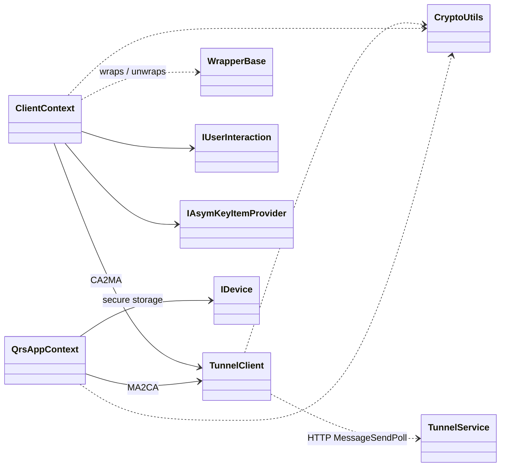
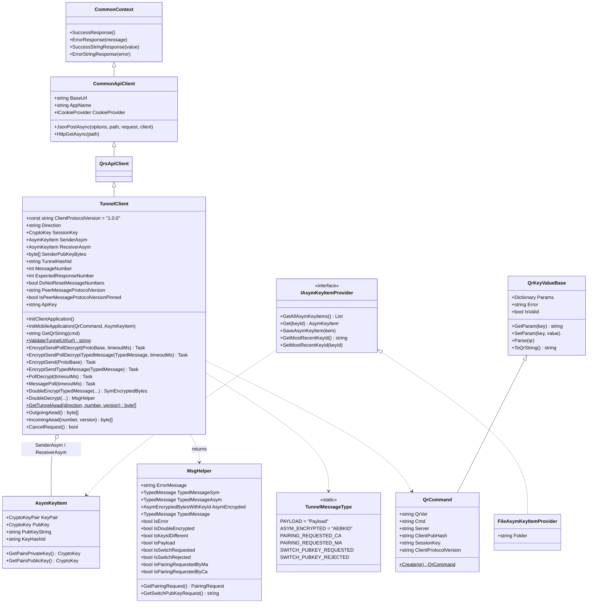
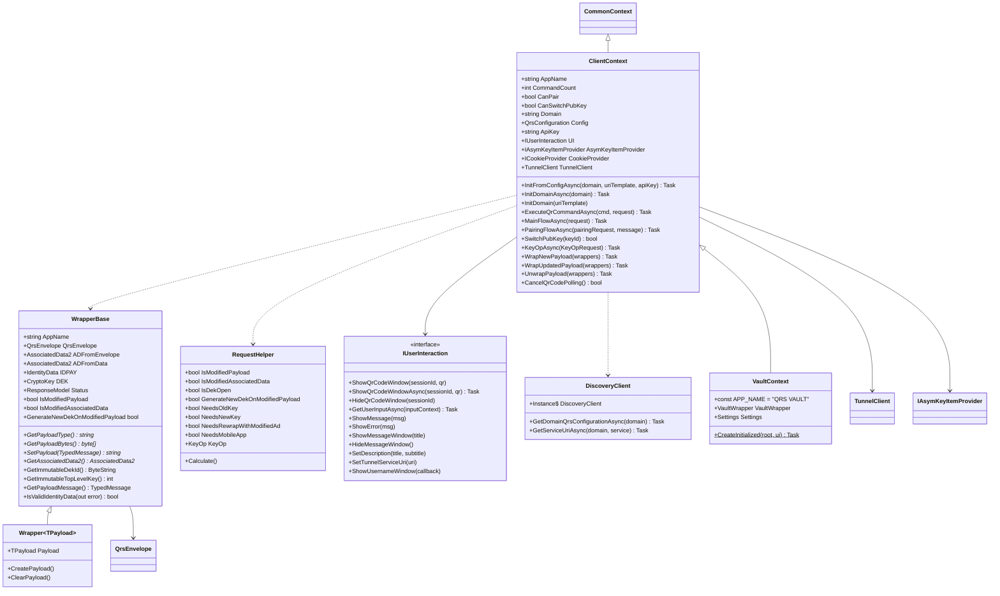
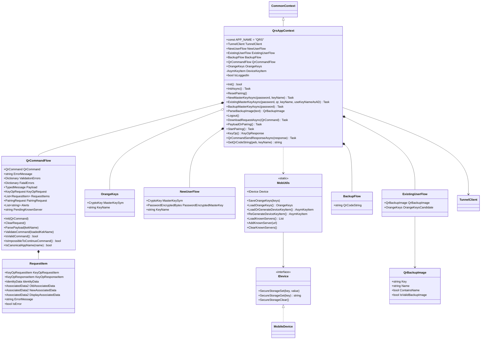
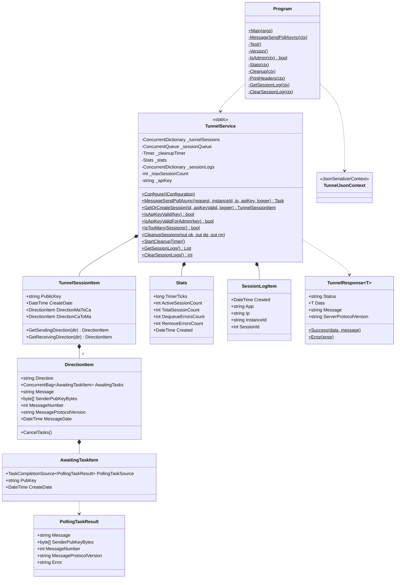
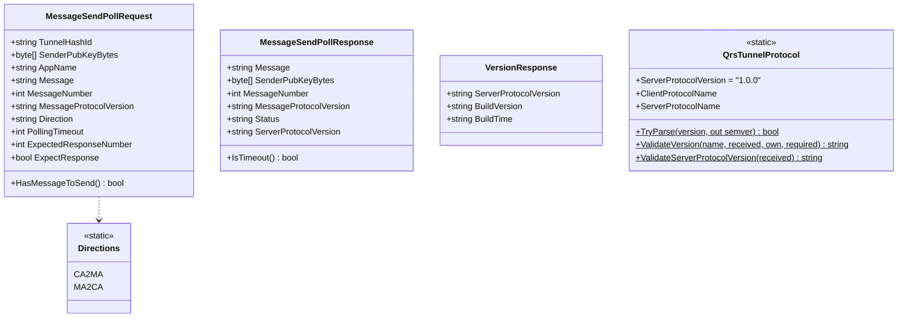
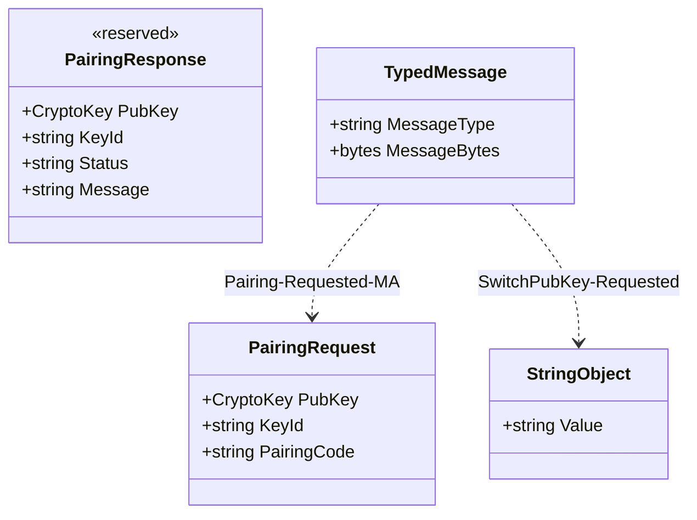
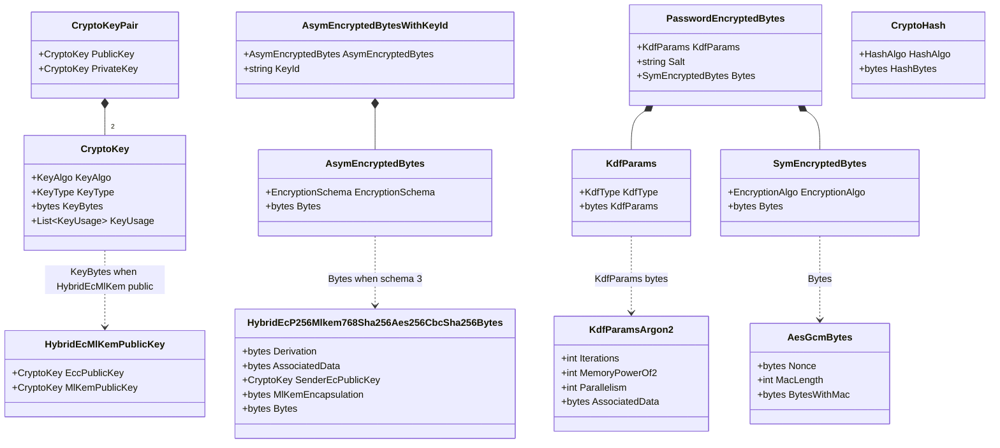
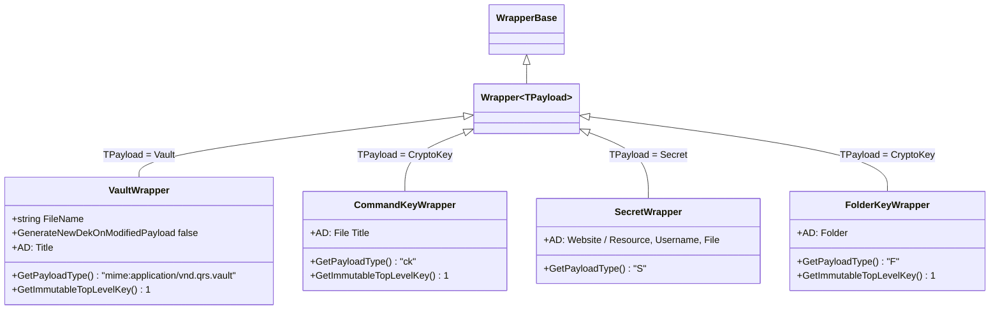

# 11. Class Diagrams

UML class diagrams (Mermaid) for the main QRS components. Diagrams show the members that matter
for understanding the design; private helpers are omitted.

- [Overview: who uses whom](#overview-who-uses-whom)
- [Tunnel client](#tunnel-client)
- [Client SDK (Client Application side)](#client-sdk-client-application-side)
- [Mobile App engine](#mobile-app-engine)
- [Tunnel Server](#tunnel-server)
- [Tunnel wire DTOs](#tunnel-wire-dtos)
- [Protobuf: QRS messages](#protobuf-qrs-messages)
- [Protobuf: crypto containers](#protobuf-crypto-containers)
- [Reference app wrappers](#reference-app-wrappers)

---

## Overview: who uses whom

## Tunnel client

## Client SDK (Client Application side)

## Mobile App engine

## Tunnel Server

## Tunnel wire DTOs

## Protobuf: QRS messages

See [Key Operations](07-key-operations.md#keyoprequest--keyopresponse) for the diagram of
`KeyOpRequest`, `KeyOpResponse`, `QrsEnvelope`, `IdentityData` and `AssociatedData2`. Pairing:

## Protobuf: crypto containers

## Reference app wrappers

---

Next: [Reference Applications →](12-reference-apps.md)
