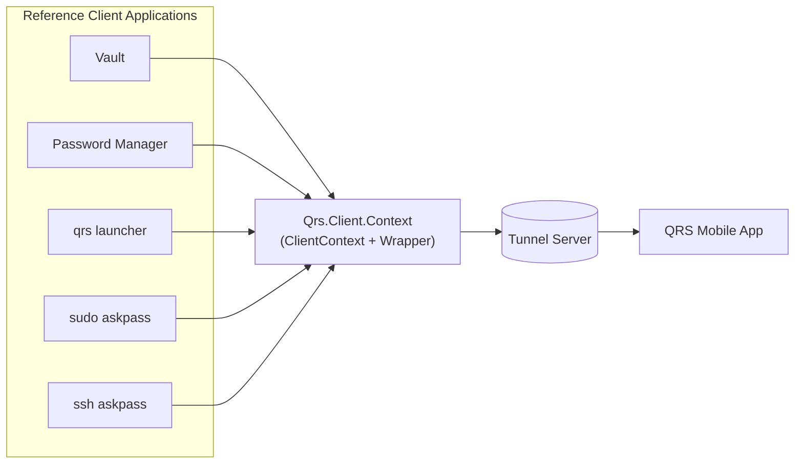
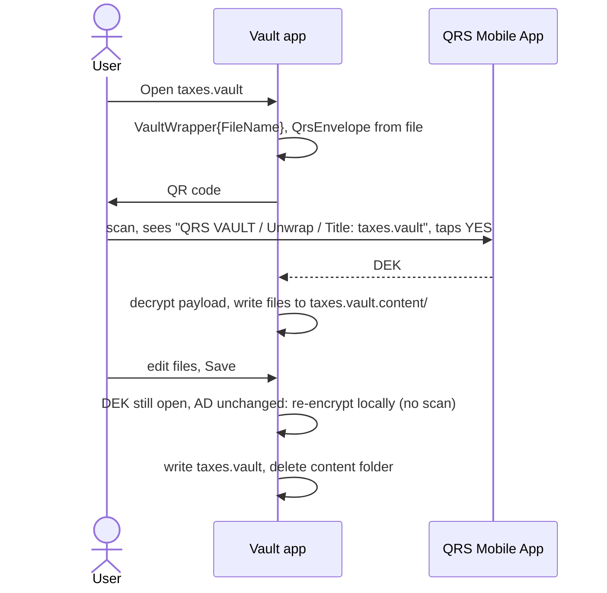

# 12. Reference Applications

The repository ships several Client Applications that use QRS. They are both **useful tools** and
**worked examples** of the [Client SDK](10-client-sdk.md). This page summarises what each one
protects, how it maps to the SDK, and what the user sees on the phone.

- [Overview](#overview)
- [QRS Vault (desktop + CLI)](#qrs-vault-desktop--cli)
- [Password Manager](#password-manager)
- [QRS Process Launcher (`qrs` CLI)](#qrs-process-launcher-qrs-cli)
- [Sudo AskPass (`qrs-sudo-askpass`)](#sudo-askpass-qrs-sudo-askpass)
- [SSH AskPass (`qrs-ssh-askpass`)](#ssh-askpass-qrs-ssh-askpass)
- [Patterns to copy](#patterns-to-copy)

---

## Overview

| App | Projects | Executable | `APP_NAME` | Protected object | Payload type | AD shown on phone |
|---|---|---|---|---|---|---|
| Vault | `Qrs.App.Vault.Client`, `.Avalonia`, `.Cli` | `qrsvault`, `vault` | `QRS VAULT` | A folder of files packed into one `.vault` file | `mime:application/vnd.qrs.vault` | `Title` = file name |
| Password Manager | `Qrs.App.PasswordManager.Client`, `.Components`, `.Hybrid` | MAUI Blazor Hybrid | `PASSWORD MANAGER` | Secrets and folder keys | `S`, `F` | `Website / Resource`, `Username`, `File` / `Folder` |
| Process Launcher | `Qrs.App.Qrs.Cli` | `qrs` | `PROCESS LAUNCHER` | Secret environment variables for a command | `ck` (a DEK used to encrypt each variable) | `File Title` |
| Sudo AskPass | `Qrs.App.SudoAskPass.Cli` | `qrs-sudo-askpass` | `SUDO ASKPASS` | sudo password | `sp` | host name, password file |
| SSH AskPass | `Qrs.App.SshAskPass.Cli` | `qrs-ssh-askpass` | `SSH ASKPASS` | ssh key passphrase | `ssh` | host name, ssh key file |



## QRS Vault (desktop + CLI)

**What it does:** encrypts a whole folder into a single `.vault` file. Open the vault → scan →
files are extracted into a `<name>.vault.content` folder; save → files are packed back and the
content folder is deleted. Opening the special `_close.vault` file inside the content folder
saves and closes the vault (handy from a file explorer).

- `VaultContext : ClientContext` holds settings (`Settings.json`: `TunnelServerDomain`,
  `TunnelServerUri` default `https://qrid.qrid.com/qrs-tunnel-api/`, `ApiKey`, `RecentFiles`).
- `VaultWrapper : Wrapper<Vault>` — top‑level key `1`, AD `Title = file name`,
  `GenerateNewDekOnModifiedPayload = false` so saving an already‑open vault does not require a new
  scan.
- Payload `Vault { vault_file_name, vault_type, created, repeated File files }` where each
  `File { path, node_type, content, padding }`.
- The `.vault` file is simply the `QrsEnvelope` bytes.
- Export helpers: ZIP (`ZipExporter`) and GPG (`GpgExporter`).

CLI (`vault`):

```bash
vault extract secrets.vault        # scan QR, extract into secrets.vault.content/
vault save secrets.vault.content   # scan QR (if needed), pack back, delete folder
vault secrets.vault                # default = extract
```



## Password Manager

A MAUI Blazor Hybrid app (`Qrs.App.PasswordManager.Hybrid`) with shared Razor components
(`.Components`) and logic (`.Client`, `PwmContext`).

- `SecretWrapper : Wrapper<Secret>` — payload type `S`; AD `Website / Resource`, `Username`,
  `File`. The phone shows which login is being revealed.
- `FolderKeyWrapper : Wrapper<CryptoKey>` — payload type `F`, top‑level key `1`, AD `Folder`:
  a per‑folder key, enabling one scan to unlock a folder.
- Protobuf payloads: `Secret`, `ResourceData`, `Attachment*`, `Export*`.

## QRS Process Launcher (`qrs` CLI)

**What it does:** keeps secrets such as API tokens out of shell history and plaintext `.env`
files. A YAML file describes a process and its environment; secret values are stored encrypted
and injected only after a QR approval.

```yaml
Title: Deploy production
DekId: ...
Key: keytype=qrs&wrappedkey=...        # QrsEnvelope of the DEK (CommandKeyWrapper)
Environment:
  - Name: AWS_SECRET_ACCESS_KEY
    Value: ""                          # plaintext only before `qrs init`
    EncryptedValue: ...                # AES-256-GCM(DEK), AAD = UTF-8 variable name
ProcessType: ...
ProcessFile: /usr/local/bin/deploy.sh
ProcessArguments: --env prod
```

```bash
qrs init deploy.yml   # scan QR: creates a DEK, encrypts every Value into EncryptedValue
qrs run  deploy.yml   # scan QR: unwraps the DEK, decrypts variables, starts the process
```

- `CommandKeyWrapper : Wrapper<CryptoKey>` — payload type `ck`, top‑level key `1`,
  AD `File Title`. The payload **is** a key (the DEK used for variables), a nice example of
  envelope‑inside‑envelope design.
- App data: `~/Documents/QrsProcessLauncher/prod` (paired keys, cookies).
- Config (`appsettings.json`): `Settings:TunnelServiceUri`, `Settings:TunnelServiceDomain`,
  `Settings:ApiKey`.

## Sudo AskPass (`qrs-sudo-askpass`)

Same idea for `sudo -A` / `SUDO_ASKPASS`: the sudo password is stored in a QRS envelope and
printed to stdout only after approval. AD items: host name and password file. Commands:
`init`, `run`.

## SSH AskPass (`qrs-ssh-askpass`)

**What it does:** an [`SSH_ASKPASS`](https://man.openbsd.org/ssh-add) helper that releases an
ssh key passphrase only after confirmation on the phone. Cross‑platform (Avalonia UI).

```bash
qrs-ssh-askpass init ~/.ssh/id_ed25519      # store the passphrase (scan to encrypt)
export SSH_ASKPASS=/path/to/qrs-ssh-askpass
export SSH_ASKPASS_REQUIRE=force            # OpenSSH 8.4+
ssh-add ~/.ssh/id_ed25519                    # QR appears, scan, approve
```

- Parses the prompt from `ssh`/`ssh-add` to get the key file name; uses **host name** and **key
  file** as two AD items, so the phone shows exactly *which key on which host*.
- Storage: `~/.config/qrs-ssh-askpass/prod/ssh-password.qrs` (Windows:
  `%APPDATA%\qrs-ssh-askpass\prod\ssh-password.qrs`), overridable with `--file`.
- Full documentation: [`Qrs.App.SshAskPass.Cli/README.md`](../Qrs.App.SshAskPass.Cli/README.md).

## Patterns to copy

| Pattern | Example | When to use |
|---|---|---|
| **Envelope per file** | Vault | Documents, archives |
| **Envelope holding a DEK that encrypts many small values** | Process Launcher (`ck`), Password Manager folder key (`F`) | Many small secrets; one scan unlocks all |
| **Askpass helper** | ssh / sudo askpass | Integrate with tools that already support external password programs |
| **Keep DEK open while editing** (`GenerateNewDekOnModifiedPayload = false`) | Vault, Password Manager | Frequent saves without re‑scanning |
| **Batch unwrap** | SDK batch methods (see [Client SDK](10-client-sdk.md#batch-operations)) | Lists and folders |

---

Next: [Operating the Tunnel Server →](13-tunnel-server-ops.md)
