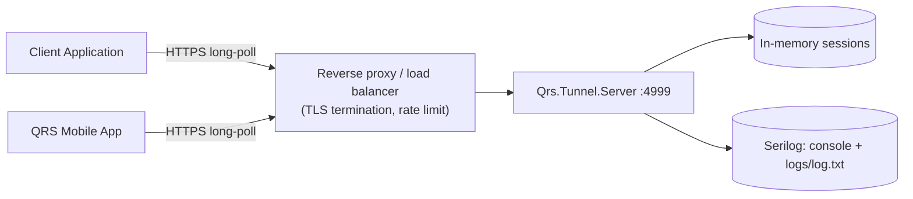
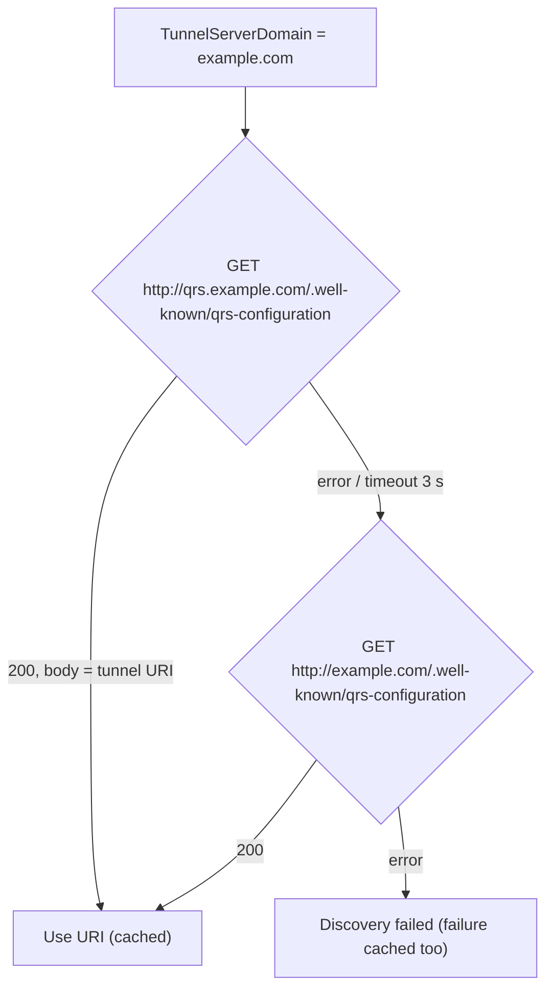

# 13. Operating the Tunnel Server

`Qrs.Tunnel.Server` is a small, stateless‑by‑design (but in‑memory) ASP.NET Core minimal‑API
service. It relays **ciphertext only** between a Client Application and the Mobile App. This page
is for anyone who wants to self‑host it.

- [At a glance](#at-a-glance)
- [Configuration](#configuration)
- [Running locally](#running-locally)
- [Docker](#docker)
- [Google Cloud Run (Native AOT)](#google-cloud-run-native-aot)
- [Reverse proxy and TLS](#reverse-proxy-and-tls)
- [Endpoints](#endpoints)
- [Access control (API key)](#access-control-api-key)
- [Capacity and limits](#capacity-and-limits)
- [Scaling](#scaling)
- [Domain discovery](#domain-discovery)
- [Monitoring](#monitoring)
- [Logging and privacy](#logging-and-privacy)
- [Hardening checklist](#hardening-checklist)

---

## At a glance

| Property | Value |
|---|---|
| Runtime | .NET 10, ASP.NET Core minimal APIs (Native AOT capable) |
| Default port | `4999` (`Urls: http://+:4999/`) |
| Base path | `/api/QrsTunnel` |
| State | In‑memory `ConcurrentDictionary` of sessions |
| Session lifetime | 6 minutes, swept by a 10‑second timer |
| Max message size | 200,000 characters (Base64) |
| Max sessions | `QrsTunnel:MaxSessionCount` (default 10,000) |
| Persistence | None — restart = all in‑flight sessions lost (users just re‑scan) |
| Sees plaintext? | **Never.** Messages are encrypted twice by the endpoints ([Cryptography](05-cryptography.md#tunnel-message-encryption-double-encryption)). |



## Configuration

Configuration uses the standard ASP.NET Core layering:
`appsettings.json` → `appsettings.<Environment>.json` → environment variables (`__` as separator).

| Key | Env variable | Default | Description |
|---|---|---|---|
| `Urls` | `ASPNETCORE_URLS` / `--urls` | `http://+:4999/` | Listen address |
| `QrsTunnel:MaxSessionCount` | `QrsTunnel__MaxSessionCount` | `10000` | New sessions are refused above this number |
| `QrsTunnel:ApiKey` | `QrsTunnel__ApiKey` | empty (open) | If set, new sessions require cookie `qrs_tunnel_api_key` with this value. Also required for the admin/diagnostic endpoints, which are blocked while it is empty |
| `Serilog:*` | `Serilog__...` | Console + Debug + File (`logs/log.txt`) | Standard [Serilog.Settings.Configuration](https://github.com/serilog/serilog-settings-configuration) |
| `ASPNETCORE_ENVIRONMENT` | — | `Production` | Selects `appsettings.Development.json`, `.intest.json`, `.prod.json` |
| `PORT` (Cloud Run image only) | `PORT` | `4999` | Port for the AOT container entrypoint |

> Never commit a real `ApiKey`. Pass it through the environment or your platform's secret store.

## Running locally

```bash
cd Qrs.Tunnel.Server
dotnet run -c Release --urls http://127.0.0.1:4999
curl http://127.0.0.1:4999/api/QrsTunnel/Test
curl http://127.0.0.1:4999/api/QrsTunnel/Version
```

Point a Client Application at it by setting its tunnel URI to `http://127.0.0.1:4999/` (the
Mobile App must be able to reach the same address — use your LAN IP when testing with a phone).

## Docker

The standard image (`Qrs.Tunnel.Server/Dockerfile`, .NET 10 `aspnet` runtime) is built from the
**repository root** because the project references sibling projects:

```bash
docker build -f Qrs.Tunnel.Server/Dockerfile -t qrs-tunnel-server .
docker run -d --name qrs-tunnel -p 4999:4999 \
  -e QrsTunnel__ApiKey="$(openssl rand -hex 32)" \
  qrs-tunnel-server
```

A prebuilt image is published by the QRID team as `qridcom/qrs-tunnel-server` on Docker Hub.

The integration‑test environment runs it as service `qrs.tunnel.server` in
`qridroot/intest/compose.yml` (port `4999`, logs mounted to `qridroot/intest/logs/qrs.tunnel.server`).

## Google Cloud Run (Native AOT)

`Dockerfile.gcr` publishes a **Native AOT** binary on `runtime-deps:10.0` — small image, cold start
well under a second, fits the Cloud Run free tier. The entrypoint honours Cloud Run's `$PORT`.

`cloudbuild.yaml` powers the *Deploy to Cloud Run* button:

| Substitution | Default |
|---|---|
| `_SERVICE_NAME` | `qrs-tunnel-server` |
| `_REGION` | `us-central1` |
| `_RUNTIME_IDENTIFIER` | `linux-x64` |

Manual equivalent:

```bash
gcloud builds submit --config Qrs.Tunnel.Server/cloudbuild.yaml .
gcloud run deploy qrs-tunnel-server \
  --image gcr.io/$PROJECT_ID/qrs-tunnel-server:latest \
  --region us-central1 --allow-unauthenticated \
  --max-instances 1 --timeout 3600 \
  --set-env-vars QrsTunnel__ApiKey=...
```

`--max-instances 1` matters — see [Scaling](#scaling). The request timeout must exceed the longest
client polling timeout.

## Reverse proxy and TLS

The server speaks plain HTTP; terminate TLS in front of it. The endpoints already protect message
confidentiality, but TLS still hides metadata (session ids, timing, cookies) and the API key.

Proxy requirements:

- Allow **long requests** (long‑poll): read/idle timeouts ≥ the maximum polling timeout used by
  your clients (a few minutes is typical).
- Disable response buffering for `/api/QrsTunnel/MessageSendPoll`.
- Forward `X-Forwarded-For` (it is logged for abuse investigation).
- Request body limit ≥ 256 KB.
- No need to block the diagnostic endpoints: they are protected by the API key and blocked by default (see below).
- Apply per‑IP rate limiting to `MessageSendPoll`.

Example (nginx):

```nginx
location /qrs-tunnel-api/ {
    proxy_pass         http://127.0.0.1:4999/;
    proxy_read_timeout 600s;
    proxy_buffering    off;
    client_max_body_size 256k;
    proxy_set_header   X-Forwarded-For $proxy_add_x_forwarded_for;
}
```

## Endpoints

| Method + path | Purpose | Expose publicly? |
|---|---|---|
| `POST /api/QrsTunnel/MessageSendPoll` | The protocol: create session, send, poll ([protocol](06-tunnel-protocol.md)) | **Yes** |
| `GET /api/QrsTunnel/Version` | Server version (unwrapped JSON) | Yes |
| `GET /api/QrsTunnel/Test` | Liveness / readiness probe | Yes (harmless) |
| `GET /api/QrsTunnel/Stats` | Counters (`ActiveSessionCount`, `TotalSessionCount`, …) | 🔒 API key required |
| `GET /api/QrsTunnel/Cleanup` | Force expired‑session cleanup | 🔒 API key required |
| `GET /api/QrsTunnel/PrintHeaders` | Echo request headers (debugging proxies) | 🔒 API key required |
| `GET /api/QrsTunnel/XyzGetSessionLog`, `POST .../XyzClearSessionLog` | Session log for the Analytics tool | 🔒 API key required |

🔒 = admin/diagnostic endpoint. It only responds when the request carries the cookie
`qrs_tunnel_api_key` matching `QrsTunnel:ApiKey`; otherwise it returns `Status = "ERROR"` with a
message asking for the API key. When no API key is configured these endpoints are **blocked by
default**, so they do not need to be blocked at the reverse proxy.

## Access control (API key)

When `QrsTunnel:ApiKey` is non‑empty, a request that **creates** a session must carry the cookie
`qrs_tunnel_api_key=<key>`. Requests for existing sessions are not checked (possession of the
random session id is the capability). Client Applications set this through their `ApiKey`
setting. The Mobile App never creates sessions, so it needs no key.

The same key is **always** required for the admin/diagnostic endpoints (`Stats`, `Cleanup`,
`PrintHeaders`, `XyzGetSessionLog`, `XyzClearSessionLog`). If `QrsTunnel:ApiKey` is empty, these
endpoints are blocked for everyone. Example:

```bash
curl -b "qrs_tunnel_api_key=$QRS_TUNNEL_API_KEY" https://tunnel.example.com/qrs-tunnel-api/api/QrsTunnel/Stats
```

This is a coarse abuse‑prevention control, not user authentication.

## Capacity and limits

- Each session holds at most a few messages of ≤ 200,000 chars → memory per session is bounded
  (~ hundreds of KB worst case). 10,000 sessions ≈ low GBs worst case; typical sessions are a few KB.
- Every waiting long‑poll holds an open HTTP request. Size your proxy's connection limits
  accordingly.

## Scaling

Sessions live **in process memory**. Both peers of a session must reach the **same instance**.

| Option | How | Notes |
|---|---|---|
| Single instance (recommended) | `--max-instances 1`, one container | One small instance handles thousands of concurrent sessions |
| Sticky routing by session id | Hash `TunnelSessionId` (in the JSON body) at an L7 proxy | Requires body‑aware routing; cookies do not help because CA and MA are different devices |
| Sharding by DNS | Several tunnel URIs, each client picks one; the URI is inside the QR code | Simple and robust — the MA always follows the URI from the QR |
| Shared store | Not implemented (would need Redis‑style pub/sub) | See [Roadmap](../ROADMAP.md) |

Because the tunnel URI travels **inside the QR code**, the Mobile App always talks to the same
tunnel as the Client Application — sharding by hostname needs no coordination.

## Domain discovery

Client Applications may be configured with a **domain** instead of a URI
(`TunnelServerDomain`). `Qrs.Discovery.Client` resolves it:



To publish discovery for your domain, serve a plain‑text file:

```text
# http://qrs.example.com/.well-known/qrs-configuration
https://tunnel.example.com/qrs-tunnel-api/
```

> Discovery currently uses **HTTP** — an on‑path attacker could redirect clients to a malicious
> tunnel. This does not break confidentiality (the tunnel only sees ciphertext and the QR
> carries the keys), but it enables denial of service. Prefer configuring `TunnelServerUri`
> explicitly until HTTPS discovery lands.

## Monitoring

- **Liveness/readiness:** `GET /api/QrsTunnel/Test` → `200`.
- **Metrics:** `GET /api/QrsTunnel/Stats` (requires the `qrs_tunnel_api_key` cookie):

```json
{ "TimerTicks": 1234, "ActiveSessionCount": 3, "TotalSessionCount": 812,
  "DequeueErrorsCount": 0, "RemoveErrorsCount": 0, "Created": "2026-09-30T10:00:00" }
```

Alert on `ActiveSessionCount` approaching `MaxSessionCount`, on growing error counters, and on
`TimerTicks` not increasing (cleanup timer stuck).

## Logging and privacy

- Serilog writes to console and `logs/log.txt`. The shipped configs use `Debug` level, which logs
  full requests — **ciphertext only**, never keys or plaintext, but still unnecessary volume.
  Use `Information` or higher in production.
- Logged metadata: timestamps, session ids, message numbers, client IP (`X-Forwarded-For`),
  `instance_idt` cookie. Treat logs as personal data under your privacy policy and rotate them
  (QRID's hosted service keeps web logs for 90 days — see <https://qrid.com/web/privacy>).

## Hardening checklist

- [ ] TLS in front of the server; HTTP disabled from the internet.
- [ ] `QrsTunnel__ApiKey` set if you do not want an open relay.
- [ ] Diagnostic endpoints (`Stats`, `Cleanup`, `PrintHeaders`, `Xyz*`) are API‑key protected and blocked by default — keep `QrsTunnel__ApiKey` secret (no proxy rule needed).
- [ ] Proxy caps request duration (bounds `PollingTimeout`) and body size.
- [ ] Per‑IP rate limiting on `MessageSendPoll`.
- [ ] Log level `Information`+, log rotation, retention policy.
- [ ] Single instance or session‑affine routing.
- [ ] Container runs as non‑root, read‑only filesystem except `logs/`.

---

Next: [Building and testing →](14-building-and-testing.md)
