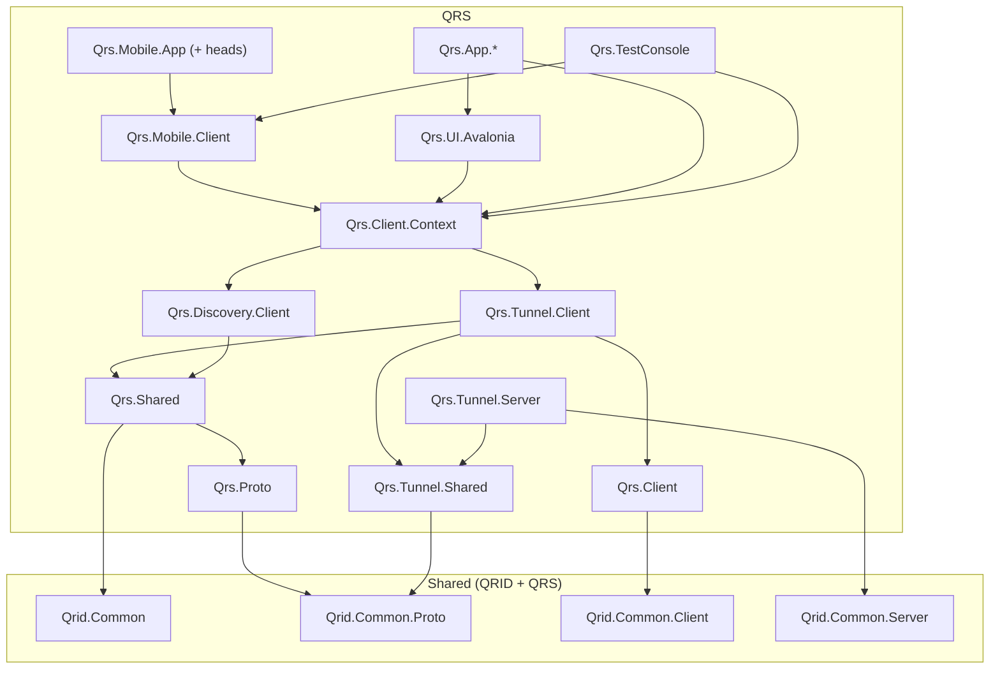
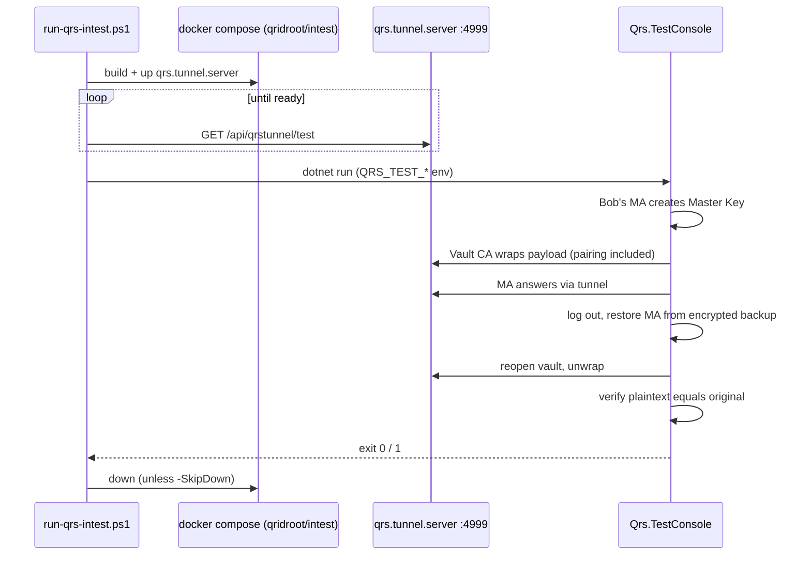

# 14. Building and Testing

- [Prerequisites](#prerequisites)
- [Repository layout for QRS](#repository-layout-for-qrs)
- [Building](#building)
- [Mobile App](#mobile-app)
- [Integration test](#integration-test)
- [Continuous integration](#continuous-integration)
- [Manual end-to-end testing with a phone](#manual-end-to-end-testing-with-a-phone)
- [Regenerating protobuf classes](#regenerating-protobuf-classes)
- [Troubleshooting](#troubleshooting)

---

## Prerequisites

| Tool | Version | Needed for |
|---|---|---|
| .NET SDK | **10.0** (all QRS projects target `net10.0`) | Everything |
| PowerShell | 7+ (`pwsh`) | `run-qrs-intest.ps1` |
| Docker + Docker Compose v2 | recent | Integration test, container builds |
| .NET MAUI workload | matching the SDK | Mobile App only |
| Android SDK / Xcode | current | Mobile App device builds |
| `protoc` | via `Grpc.Tools` | Only when changing `.proto` files |

## Repository layout for QRS

QRS shares a repository with QRID. The QRS‑relevant projects are listed in **`QRSHL.sln`**
(28 projects: `Qrs.*` plus the shared `Qrid.Common*` libraries).



(Arrows mean "depends on"; simplified.)

## Building

```bash
# Everything QRS (Linux/macOS/Windows; Windows-only and mobile heads may be skipped on Linux)
dotnet build QRSHL.sln

# Individual pieces
dotnet build Qrs.Tunnel.Server/Qrs.Tunnel.Server.csproj -c Release
dotnet build Qrs.App.Vault.Cli -c Release
dotnet build Qrs.TestConsole -c Release
```

`QRID.sln` (Windows) contains everything, including WinForms apps and all Mobile App heads.

## Mobile App

The Mobile App is a .NET MAUI application:

| Project | Target |
|---|---|
| `Qrs.Mobile.App/Qrs.Mobile.App` | `net10.0` shared UI |
| `Qrs.Mobile.App/Qrs.Mobile.App.Droid` | `net10.0-android` |
| `Qrs.Mobile.App/Qrs.Mobile.App.iOS` | `net10.0-ios` |
| `Qrs.Mobile.App/Qrs.Mobile.App.Mac` | `net10.0-maccatalyst` |
| `Qrs.Mobile.App/Qrs.Mobile.App.WinUI` | `net10.0-windows10.0.19041.0` |

```bash
dotnet workload install maui
# Android (device or emulator connected)
dotnet build Qrs.Mobile.App/Qrs.Mobile.App.Droid -t:Run -c Debug
# iOS (on macOS with Xcode)
dotnet build Qrs.Mobile.App/Qrs.Mobile.App.iOS -t:Run -c Debug
# Windows desktop head (handy for UI work without a phone)
dotnet build Qrs.Mobile.App/Qrs.Mobile.App.WinUI -t:Run -c Debug
```

Notes:

- All engine logic lives in `Qrs.Mobile.Client` (plain `net10.0`), so most changes can be tested
  headlessly with `Qrs.TestConsole` without a device.
- **Debug builds use weak Argon2 parameters** for faster iteration. Never distribute Debug builds.
- The QR scanner uses `BarcodeScanning.Native.Maui`; camera permission is required.

## Integration test

`Qrs.TestConsole` is a real end‑to‑end test: it plays **both** the Client Application and the
Mobile App against a real Tunnel Server — no mocks.

```bash
pwsh ./run-qrs-intest.ps1                     # build image, start tunnel, run test, tear down
pwsh ./run-qrs-intest.ps1 -SkipBuild          # reuse existing image
pwsh ./run-qrs-intest.ps1 -SkipDown           # leave containers running for debugging
pwsh ./run-qrs-intest.ps1 -TimeoutSeconds 300 # overall timeout (default 180)
```

Exit code `0` = success, `1` = failure.



Environment variables:

| Variable | Default | Description |
|---|---|---|
| `QRS_TEST_DOMAIN` | `localhost` | Domain for test accounts |
| `QRS_TEST_TUNNEL_URL` | `http://localhost:4999/` | Tunnel Server base URL |
| `QRS_TEST_ROOT` | `Root` (relative) | Working folder for simulated device/app storage |

Run the test console directly against any tunnel:

```bash
QRS_TEST_TUNNEL_URL=http://127.0.0.1:4999/ dotnet run --project Qrs.TestConsole -c Release
```

## Continuous integration

`.github/workflows/qrs-intest.yml` runs on pushes to `main`, pull requests and manual dispatch:
build `Qrs.TestConsole`, run `run-qrs-intest.ps1 -TimeoutSeconds 300`, dump tunnel logs and upload
`qridroot/intest/logs/` on failure, and always tear down.

> The workflow currently installs **.NET 9** (`setup-dotnet 9.0.x`) while the projects target
> `net10.0`; it relies on the runner's preinstalled SDKs. Updating it to `10.0.x` is tracked in
> the [Roadmap](../ROADMAP.md).

## Manual end-to-end testing with a phone

1. Run the Tunnel Server on your machine bound to your LAN address
   (`--urls http://0.0.0.0:4999`).
2. Build and install the Mobile App on a phone on the same network.
3. Configure a Client Application (e.g. `vault`) with `TunnelServerUri = http://<LAN-IP>:4999/`.
4. Create an account in the Mobile App, then open/save a vault and scan the QR.

Plain HTTP triggers a warning in the apps; that is expected in a lab.

## Regenerating protobuf classes

1. Edit/add `.proto` files under `Qrs.Proto/ProtoFiles/` (or `Qrid.Common.Proto/ProtoFiles/`).
2. Add new files to the project's `FileList.txt`.
3. Run `GenerateProto.cmd` in that project (Windows). On Linux, run the same `protoc` command
   line from the repository root with `--proto_path=.` using `protoc` from the `Grpc.Tools`
   NuGet package.
4. Never edit `*.generated.cs`. Add a partial class file that derives from `ProtoBase` and
   defines the static `Create()` methods, following existing examples.
5. Wire‑format changes affect interoperability — read
   [Protocol versioning](06-tunnel-protocol.md#protocol-versioning) first.

## Troubleshooting

| Symptom | Likely cause | Fix |
|---|---|---|
| `NETSDK1045: The current .NET SDK does not support targeting .NET 10.0` | Old SDK | Install .NET 10 SDK |
| Intest times out waiting for readiness | Port 4999 busy or Docker not running | `docker ps`, free the port |
| MA cannot reach tunnel | Using `localhost` from a phone | Use LAN IP; check firewall |
| `Invalid QrsEnvelope - Associated Data ... not matching` | AD changed (e.g. file renamed) | See [Client SDK errors](10-client-sdk.md) |
| Very slow account creation/restore | Release Argon2 parameters (by design) | Expected: seconds on phones |

---

Next: [Security model →](15-security-model.md)
