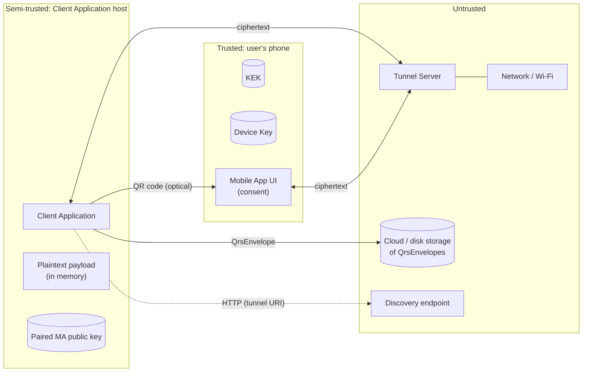

# 15. Security Model

This page states **what QRS protects, against whom, under which assumptions**, and — equally
important — **what it does not protect** and which weaknesses are currently known. We publish
this openly because honest threat modelling is the basis of trust in any cryptographic system.

- [Security goals](#security-goals)
- [Assets](#assets)
- [Actors and trust assumptions](#actors-and-trust-assumptions)
- [Trust boundaries](#trust-boundaries)
- [Threats and mitigations (STRIDE)](#threats-and-mitigations-stride)
- [Post-quantum posture](#post-quantum-posture)
- [What QRS does not protect against](#what-qrs-does-not-protect-against)
- [Known limitations](#known-limitations)
- [Guidance for integrators](#guidance-for-integrators)
- [Reporting vulnerabilities](#reporting-vulnerabilities)

---

## Security goals

| # | Goal |
|---|---|
| G1 | **Confidentiality of payloads**: only someone who can get a DEK unwrapped by the user's Mobile App can read a payload. |
| G2 | **KEK never leaves the phone** (except as an Argon2id‑password‑encrypted backup created by the user). |
| G3 | **Zero‑knowledge relay**: the Tunnel Server learns nothing but ciphertext, sizes and timing. |
| G4 | **Explicit user consent**: every key operation is shown on the phone (app name, operation, Associated Data) and requires a tap. |
| G5 | **Integrity & binding**: a wrapped DEK is bound to its Associated Data and envelope ID; tampering is detected (AEAD). |
| G6 | **Post‑quantum confidentiality** of everything that crosses the network (hybrid ML‑KEM‑768 + P‑256). |
| G7 | **No passwords, no accounts on servers**: nothing to phish on a server, nothing to leak in a server breach. |

## Assets

| Asset | Where | Sensitivity |
|---|---|---|
| Master Key (KEK) | Phone secure storage | Critical — unwraps every DEK |
| Backup file + backup password | User's storage + user's memory | Critical together; backup alone is Argon2id‑protected |
| Device Key (MA hybrid private key) | Phone secure storage | High — decrypts double‑encrypted tunnel messages |
| DEK (plaintext) | CA memory while in use | High — decrypts one payload |
| CA ephemeral tunnel private key | CA memory, one session | Medium — decrypts MA→CA responses of that session |
| Paired MA public key | CA local storage (`AsymKeyItemProvider`) | Integrity‑relevant — substituting it would redirect requests |
| QrsEnvelope file | Anywhere (disk, cloud, e‑mail) | Low — ciphertext only |
| Session keys in QR | Screen, camera | Short‑lived (≤ 6 min) |
| Tunnel metadata (IP, timing, session ids) | Tunnel Server logs | Privacy‑relevant |

## Actors and trust assumptions

| Actor | Trusted for | Not trusted for |
|---|---|---|
| **User** | Reading the phone screen before tapping YES; keeping backup password secret | — |
| **Mobile App + phone OS** | Protecting KEK and Device Key; honest UI | — (a compromised phone is out of scope) |
| **Client Application + host OS** | Handling plaintext it is authorised for | Accessing DEKs it did not request (the phone shows every request) |
| **Tunnel Server operator** | Availability | Confidentiality, integrity (assumed malicious) |
| **Network** | Nothing | Everything (assumed malicious) |
| **Camera path / screen** | Displaying the QR to the phone | Secrecy against a shoulder‑surfer for more than one session |

## Trust boundaries

Only two things cross from the Client Application to the phone: the **optical QR code** (session
keys, tunnel URI, CA public key hash) and **ciphertext** via the tunnel. The KEK never crosses any
boundary.

## Threats and mitigations (STRIDE)

| Threat | Example | Mitigation |
|---|---|---|
| **S**poofing the Mobile App | Attacker answers in the tunnel pretending to be the phone | Tunnel messages must be encrypted with the session key that exists only in the QR code; after pairing, CA requests are additionally encrypted to the paired Device Key, so an impostor cannot even read them |
| **S**poofing the Client Application | Rogue CA asks the phone to unwrap a stolen envelope | Phone shows app name, operation and AD; user must approve. *Requester is not cryptographically authenticated — see [Known limitations](#known-limitations).* |
| **T**ampering with envelopes | Change AD to show a benign title | AD is AEAD‑bound to the wrapped DEK; the MA fails to unwrap. CA additionally checks AD/DekId against the wrapper. |
| **T**ampering with tunnel messages | Reorder / replay / reflect messages | AEAD with `"{Direction}:{MessageNumber}:{Version}"`; message counters; per‑session keys |
| **R**epudiation | "I never approved that" | Out of scope: no audit log is kept by design (privacy). The MA may add a local history in future. |
| **I**nformation disclosure at the tunnel | Operator reads messages | Double encryption (session AES key + hybrid PQ public‑key), zero‑knowledge relay |
| **I**nformation disclosure via stolen phone | Thief extracts KEK | OS secure storage (Keychain / Keystore); device lock |
| **I**nformation disclosure via backup theft | Offline brute force | Argon2id (m = 64 MiB, t = 20, p = 2) with domain‑separated password |
| **I**nformation disclosure via QR observation | Camera/screen recording | QR gives session keys for **one** session only; DEKs sent MA→CA are additionally encrypted to the CA's ephemeral tunnel public key (only its hash `cph` is in the QR), so observing the QR does not reveal DEKs |
| **D**enial of service | Flood the tunnel, rogue discovery | `MaxSessionCount`, optional API key, proxy rate limiting; clients can pin tunnel URI |
| **E**levation of privilege | Use one DEK to open other envelopes | Each envelope has its own DEK (DEK ≠ KEK); wrapped DEK bound to envelope ID |

## Post-quantum posture

- All **public‑key** operations use the hybrid **ML‑KEM‑768 (FIPS 203) + ECDH P‑256** KEM with
  HKDF‑SHA‑256 combining both shared secrets. Breaking confidentiality requires breaking **both**.
- All **symmetric** encryption uses **AES‑256‑GCM**; Grover's algorithm reduces AES‑256 to ~128‑bit
  security, which remains adequate.
- Hashes are **SHA3‑256** / SHA‑256.
- The KEK is **symmetric** (AES‑256) and never transmitted, so "harvest‑now‑decrypt‑later" against
  stored envelopes would require breaking AES‑256.
- There are **no signatures** in the current protocol, hence no dependency on (not yet PQ)
  ECDSA/EdDSA. Future request authentication should use ML‑DSA (FIPS 204) or a hybrid.

Details: [Cryptography](05-cryptography.md).

## What QRS does not protect against

- A **compromised phone** (root/jailbreak malware, OS‑level attacker).
- A **compromised Client Application host** *while* the payload is open: plaintext is in memory.
- **Loss of both** the phone and the backup (data is unrecoverable by design — there is no server
  copy and no recovery backdoor). If you've lost the backup image or its password, but still have the phone, you can create a new backup image and password.
- **Traffic analysis** at the tunnel (timing, message sizes, IP Addresses).

## Security review by GPT 5.6 Sol (mostly non-issues)

The following are items raised by GPT 5.6 Sol during a security review. Leaving those here for traceability and as a case study of GPT 5.6 Sol security review capabilities (judge for yourself how good or bad it is), annotated with QRS Team comments.

| ID | Area | Issue | Impact | QRS Team comments |
|---|---|---|---|---|
| L1 | Pairing | Pairing code is **3 lower‑case letters** (26³ = 17,576) | An attacker who can observe the QR **and** control the tunnel during first pairing could guess with low probability per attempt | 3 letters is by design. Any such attack would be discovered by user b/c of the sequence of non-matching pairing code attempts |
| L2 | Pairing | CA error message on wrong code reveals the expected code | Weakens L1 if the attacker sees CA errors | If the attacker sees CA errors, they may also see the user's phone with MA showing the REAL Pairing Code. So the error message with Pairing Code would not be the main issue anyways. But I have removed the real Pairing Code from the CA error message b/c it adds almost no value but raises these questions. Still, pairing process is more sensitive than other parts of the protocol, b/c pairing is only protected by 1 layer of encryption (via symmetric session key in QR code). So indeed attacker who sees QR code during Pairing may attempt to slip in their own Pub Key into a tunnel to make CA pair with their Pub Key. So we have taken some extra measures to harden the pairing flow. UI flow is intentionally structured the way that when users sees Pairing Code in MA, the Pairing Message has been already delivered to CA, either by MA or by Attacker. Attacker's message cannot contain Pairing Code stolen from MA screen b/c MA only shows Pairing Code *AFTER* sending Pairing Message. Active CA poller would immediately grab the incoming message and return to CA and will never re-attempt the pairing poll. So if Attacker wants to win the race, they have to *guess* the Paring Code. If they wait to steal real code from MA screen, they are guaranteed to lose the race. So they will have to catch user during Pairing (infrequent flow, not performed in regular day-to-day usage), then steal the QR code, and even then take 1/17,576 chance which I think they realise will fail miserably and the user will be alerted by the failed Pairing Codes errors from CA. So I think pairing flow is secure even in its current version. |
| L3 | Requester identity | CA requests are **not signed/certified**; the phone trusts the displayed app name | Phishing: a rogue CA can request an unwrap of a stolen envelope with real AD | AI: Signed requests (ML‑DSA), app registration, domain binding. QRS Team: Where would you keep the signing Private Keys so rogue CA cannot use those keys? Also, the phone does not just trust the AppName - it is verified and bound via AEAD to Master Key. If rogue CA steals some "Other App"s encrypted data and tries to decrypt, the real "Other App" name will be on the phone - user has to read and confirm the AppName before confirming operation with the "YES" button. For some envelopes that mark the entry into the app and marked as TopLevelKey in AEAD (like folder key in QRS PASSWORD MANAGER - that one has to be unwrapped before any password can be unwrapped), we could have a bit more hostile UI where instead of one green "YES" button theere would be 3 green buttons with AppName written slightly differently and user will be forced to read app names carefully b/c wrong button would abort the operation. This is not implemented yet, and we are not sure if it is really needed.  |
| L4 | Transport | Mobile App allows **cleartext HTTP** (Android `UsesCleartextTraffic`, iOS ATS exceptions); only a warning is shown | Metadata exposure, tunnel redirection (not payload disclosure) | AI: HTTPS‑only builds for release. QRS Team: We use release MA builds (much faster) during debugging CA on a localhost. We have a warning in MA "...using PLAIN HTTP..." but maybe you are right and we should block http in release builds.  |
| L5 | Discovery | `.well-known/qrs-configuration` fetched over **HTTP** | Rogue tunnel → DoS / metadata | AI: HTTPS discovery, URI validation. QRS Team: you are right, and QRS Discovery Protocol is not yet finalized and http is a bad choice here - TODO: needs action  |
| L6 | Input validation | `RequestItem.Validate()` on the MA does almost nothing | Malformed requests reach key‑operation code | AI: Per‑operation validation. QRS Team: this is protobuf object and C# is a memory-safe langueage. |
| L7 | Tunnel server | Client‑supplied `PollingTimeout` is honoured without an upper bound | Resource exhaustion | AI: Server‑side cap. QRS Team: Good catch! Fixed - added a hard-coded server-side cap of 4 minutes. |
| L8 | Tunnel server | ~~Diagnostic endpoints (`Stats`, `Cleanup`, `PrintHeaders`, `Xyz*`) are unauthenticated~~ **Resolved:** they require the admin API key (`qrs_tunnel_api_key` cookie matching `QrsTunnel:ApiKey`) and are blocked by default when no key is configured | Information leakage / nuisance (mitigated) | No proxy‑level blocking needed |
| L9 | Tunnel server | Sessions are in memory only | No horizontal scaling; restart drops sessions | AI: Optional shared store. QRS Team: good enough as is for an MVP |
| L10 | Envelope | Wrapped‑DEK AAD = `AD bytes ‖ ID bytes` without length prefix | Theoretical ambiguity between AD/ID boundaries (both are protobuf, so practical risk is low) | AI: Length‑prefixed or protobuf‑encoded AAD in a new envelope `schema_version`. QRS Team: good enough as is for an MVP |
| L11 | Envelope | `QrsEnvelope.schema_version` is never set (always 0) | Harder future migrations | AI: Set explicitly. QRS Team: good enough as is for an MVP |
| L12 | Builds | Debug builds use weak Argon2 parameters | Weak backups if a Debug build is distributed | AI: Build‑time guard. QRS Team: we do not distribute debug builds|
| L13 | Naming | Some protobuf names say `Aes256Cbc...`/`Sha256` while AES‑256‑GCM is used; the MA "How it works" text mentions AES‑256‑CBC + HMAC | Confusion for auditors | AI: Rename / fix texts (wire format unchanged). QRS Team: TODO: needs action |
| L14 | Mobile UI | Some password inputs are not masked; sensitive screens are not blanked on background | Shoulder‑surfing / task‑switcher snapshots | AI: `IsPassword`, secure flags. QRS Team: password inputs masked - this is already done. TODO: sensitive screens are not blanked on background |

## Guidance for integrators

1. **Choose meaningful Associated Data.** It is what the user sees. Include the file name,
   account, host — whatever lets the user recognise the request.
2. **Keep the DEK in memory only as long as needed** and zero buffers where the platform allows.
3. **Use HTTPS** tunnel URIs and configure `TunnelServerUri` explicitly in production.
4. **Do not log** payloads, DEKs, envelopes' AD, or QR contents.
5. **Pin your tunnel** (and optionally set an API key) if you run your own server.
6. **Tell users to create a backup** immediately after creating a Master Key.
7. **Treat plaintext on the host as your responsibility** — QRS protects data at rest and in
   transit, not a compromised endpoint.

## Reporting vulnerabilities

Please report privately — see [SECURITY.md](../SECURITY.md). Do not open public issues for
vulnerabilities.

---

Next: [Porting guide →](16-porting-guide.md)
