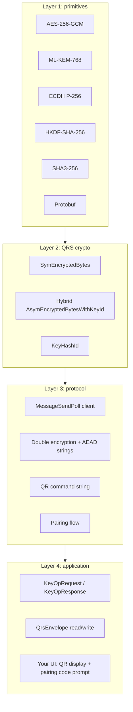
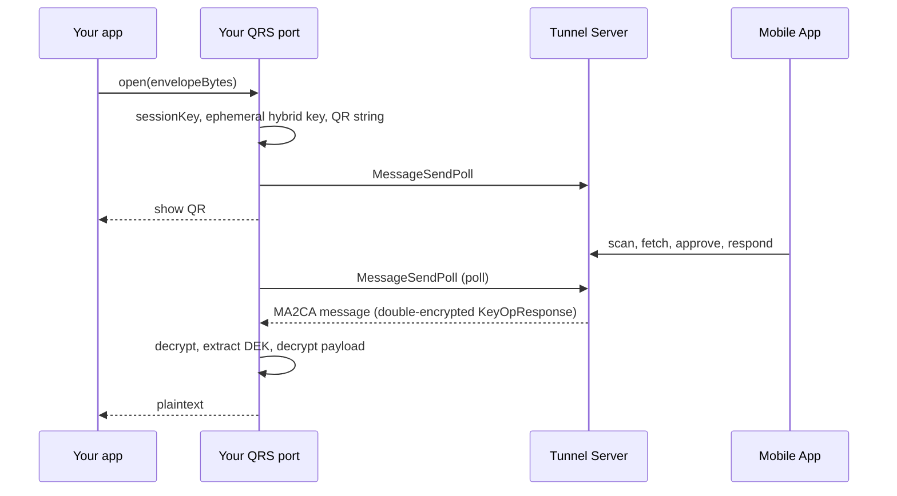

# 16. Porting Guide

This guide is for developers who want to implement a **QRS Client Application in another
language** (TypeScript/WebCrypto, Python, Go, Rust, Swift, Kotlin, …) or build an alternative
Mobile App. It lists every byte‑level decision you must reproduce to interoperate with the .NET
reference implementation.

> The reference implementation is authoritative. Where this guide and the code disagree, the code
> wins — please open an issue so we can fix the guide.

- [Scope: what you need to implement](#scope-what-you-need-to-implement)
- [Library requirements](#library-requirements)
- [Step 1 — Protobuf messages](#step-1--protobuf-messages)
- [Step 2 — Primitive recipes](#step-2--primitive-recipes)
- [Step 3 — Tunnel client](#step-3--tunnel-client)
- [Step 4 — QR code](#step-4--qr-code)
- [Step 5 — Pairing](#step-5--pairing)
- [Step 6 — Key operations and the envelope](#step-6--key-operations-and-the-envelope)
- [Pseudo-code: a minimal Client Application](#pseudo-code-a-minimal-client-application)
- [Interoperability pitfalls](#interoperability-pitfalls)
- [Testing your port](#testing-your-port)

---

## Scope: what you need to implement



A Client Application needs **all four layers**, but **not** Argon2id or KEK handling (those live
only on the Mobile App).

## Library requirements

| Need | Suggested libraries |
|---|---|
| Protobuf (proto3) | Official `protoc` generators for your language |
| AES‑256‑GCM | WebCrypto, `cryptography` (Python), Go `crypto/cipher`, RustCrypto `aes-gcm` |
| ML‑KEM‑768 (FIPS 203 final) | liboqs, `mlkem` (Go 1.24 `crypto/mlkem`), RustCrypto `ml-kem`, BouncyCastle, `@noble/post-quantum` |
| ECDH P‑256 | Any standard library |
| HKDF‑SHA‑256 | Any standard library |
| SHA3‑256 | Any standard library |

Use **FIPS 203 final** ML‑KEM, not pre‑standard Kyber round‑3 — their encodings and KDFs differ.

## Step 1 — Protobuf messages

Generate code from:

- `Qrid.Common.Proto/ProtoFiles/**` — `CryptoKey`, `SymEncryptedBytes`, `AesGcmBytes`,
  `AsymEncryptedBytes`, `AsymEncryptedBytesWithKeyId`, `HybridEcP256Mlkem768Sha256Aes256CbcSha256Bytes`,
  `HybridEcMlKemPublicKey`, `EccPublicKey`, `MlKemPublicKey`, `CryptoHash`, `TypedMessage`, enums.
- `Qrs.Proto/ProtoFiles/**` — `QrsEnvelope`, `IdentityData`, `AssociatedData2`,
  `AssociatedDataItem`, `KeyOp`, `KeyOpRequest(Item)`, `KeyOpResponse(Item)`, `PairingRequest`,
  `PairingResponse`.

Protobuf serialisation is **not canonical** in general, but the .NET implementation always
serialises fields in field‑number order with default values omitted. Hashes (KeyHashId) and AAD
(AD/ID bytes) are computed over serialised bytes, so:

- **Never re‑serialise** bytes you received and then hash/AAD them — keep and reuse the original
  bytes (`identity_data_bytes`, `associated_data_bytes` are `bytes` fields for exactly this reason).
- When *you* create a message whose bytes will be hashed, serialise in field order, omit defaults,
  and do not emit unknown fields.

## Step 2 — Primitive recipes

### SymEncrypt / SymDecrypt

```text
nonce = random(12)
ct||tag = AES-256-GCM(key32, nonce, plaintext, aad)       // 16-byte tag
out = SymEncryptedBytes{ encryption_algo = 2,
        bytes = AesGcmBytes{ nonce = nonce, mac_length = 16, bytes_with_mac = ct||tag }.serialize() }
```

### Hybrid encryption to a receiver public key

```text
pk     = HybridEcMlKemPublicKey.parse(receiverCryptoKey.key_bytes)   // key_algo must be 5
(kemSs, kemCt) = MLKEM768.Encaps(pk.ml_kem_public_key.PublicBytes)   // 32 B, 1088 B
eph    = P256.generate()
ecdhSs = P256.ECDH(eph.priv, pk.ecc_public_key)                      // x-coordinate, 32 B big-endian
okm    = HKDF-SHA256(ikm = kemSs || ecdhSs, salt = "", info = "", L = 44)
key, nonce = okm[0:32], okm[32:44]
ct||tag = AES-256-GCM(key, nonce, plaintext, aad = "")
hybrid = HybridEcP256Mlkem768Sha256Aes256CbcSha256Bytes{
           derivation = "", associated_data = "",
           sender_ec_public_key = CryptoKey(P-256 public, eph.pub),
           ml_kem_encapsulation = kemCt, bytes = ct||tag }
out = AsymEncryptedBytesWithKeyId{
        asym_encrypted_bytes = AsymEncryptedBytes{ encryption_schema = 3, bytes = hybrid.serialize() },
        key_id = KeyHashId(receiverCryptoKey) }
```

Decryption is the mirror image with ML‑KEM decapsulation and ECDH using the receiver private key
and `sender_ec_public_key`.

### P‑256 coordinates

`EccPublicKey.x_q` / `y_q` are produced with BouncyCastle `BigInteger.ToByteArray()` — a
**minimal two's‑complement big‑endian** encoding. That means:

- 33 bytes with a leading `0x00` when the top bit of the 32‑byte value is set;
- fewer than 32 bytes when the value has leading zero bytes.

When **parsing**, treat the bytes as an unsigned big‑endian integer. When **producing** a key whose
KeyHashId must match the .NET side, emit the same minimal signed encoding.

### KeyHashId / TunnelHashId

```text
h  = SHA3-256( CryptoKey.serialize() )            // the public key's CryptoKey message
id = base64( CryptoHash{ hash_algo = 310, hash_bytes = h }.serialize() )
id = id.replace('+','-').replace('/','_')         // padding '=' is KEPT
```

## Step 3 — Tunnel client

Implement `POST {tunnelUri}api/QrsTunnel/MessageSendPoll` exactly as in
[Tunnel Protocol](06-tunnel-protocol.md):

- JSON; the server returns **PascalCase** property names and accepts any casing.
- Keep a per‑session **MessageNumber** that increments on **every** call, including poll‑only calls.
- Encrypt outgoing messages in two layers ([Cryptography](05-cryptography.md#tunnel-message-encryption-double-encryption)):
  inner hybrid layer to the receiver's public key (when known), outer `SymEncrypt` with the
  Session Key and AAD = UTF‑8 `"{Direction}:{MessageNumber}:{ProtocolVersion}"`, e.g. `CA2MA:1:1.0.0`.
- Use the **incoming** message's number and version to build the AAD for decryption.
- Pin the peer protocol version for the session; reject a different MAJOR version.
- Send the cookie `qrs_tunnel_api_key` if your tunnel requires it.
- Respect long‑poll timeouts; retry network errors with back‑off; give up at session expiry (6 min).

## Step 4 — QR code

```text
v=2&cmd=keyop&srv=<tunnel URI>&cph=<TunnelHashId of CA ephemeral public key>&sk=<base64 CryptoKey(session AES key)>&cpv=1.0.0
```

URL‑encode values. Render with error correction level M or higher and a quiet zone of at least
4 modules. Generate a **fresh session key and fresh CA ephemeral hybrid key pair per QR code**.

## Step 5 — Pairing

The CA stores the Mobile App's device public key after the first successful pairing
([Pairing](08-pairing.md)). Your port must:

1. Handle `PAIRING_REQUESTED_MA` responses: parse `PairingRequest`, prompt the user for the code
   shown on the phone, compare in constant time, then store `pub_key` and `key_id`.
2. Handle `SWITCH_PUB_KEY_*` messages when the phone reports it holds a different key.
3. Never show the expected code in error messages.

## Step 6 — Key operations and the envelope

Follow [Key Operations](07-key-operations.md):

```text
// Save (new envelope)
AD  = AssociatedData2{ items = [ {key:"Title", value:"taxes.vault"} ] }        // kek_name filled by MA
req = KeyOpRequest{ app_name, items = [ KeyOpRequestItem{ index = 0, key_op = WRAP_NEW_PAYLOAD,
        new_associated_data_bytes = AD.bytes, new_top_level_key = 1,
        new_dek_id = <optional>, new_key_request = true } ] }
r   = tunnel.roundtrip(req).items[0]
// the MA creates IdentityData{dek_id, app_name, top_level_key, created} and a fresh DEK
DEK = r.new_unwrapped_key
payloadCt = SymEncrypt( TypedMessage(payload).serialize(), DEK, aad = r.identity_data_bytes )
envelope  = QrsEnvelope{ encrypted_dek = r.new_wrapped_key, encrypted_payload = payloadCt,
                         identity_data_bytes = r.identity_data_bytes,
                         associated_data_bytes = r.new_associated_data_bytes }

// Open
req  = KeyOpRequest{ items = [ { key_op = UNWRAP, identity_data_bytes = env.identity_data_bytes,
         old_associated_data_bytes = env.associated_data_bytes, old_wrapped_key = env.encrypted_dek,
         old_key_request = true } ] }
DEK  = resp.items[0].old_unwrapped_key
payload = SymDecrypt( env.encrypted_payload, DEK, aad = env.identity_data_bytes )
```

Store `identity_data_bytes` and `associated_data_bytes` **exactly as returned by the Mobile App**
(the MA creates the ID and fills `kek_name` into AD), because the wrapped DEK is bound to those
exact bytes. Validate on your side that the returned AD items and `app_name` match what you asked
for before showing success.

## Pseudo-code: a minimal Client Application



## Interoperability pitfalls

| Pitfall | Symptom | Fix |
|---|---|---|
| Re‑serialising AD/ID before AAD | `mac check in GCM failed` on the MA | Use original bytes |
| Kyber round‑3 instead of FIPS 203 ML‑KEM | Decapsulation yields wrong secret | Use ML‑KEM final |
| ECDH secret with leading zeros stripped | Occasional (1/256) decryption failure | Always 32 bytes, left‑padded |
| Base64 padding stripped from KeyHashId | Pairing / key switch loops | Keep `=` |
| MessageNumber not incremented on poll‑only calls | AAD mismatch | Increment on every call |
| Wrong direction string | AAD mismatch | `CA2MA` for CA→MA, `MA2CA` for MA→CA |
| Setting `schema_version` | Currently ignored; keep 0 for identical files | — |
| HTTP instead of HTTPS | MA security alert | Use HTTPS |

## Testing your port

1. Run a local Tunnel Server ([Operating](13-tunnel-server-ops.md#running-locally)).
2. **Cross‑test envelopes:** create a vault with the .NET `vault` CLI, open it with your port
   (and vice versa).
3. **Cross‑test the tunnel:** use `Qrs.TestConsole`'s simulated Mobile App (`Qrs.Mobile.Client`)
   to answer your CA, or the real Mobile App on a phone.
4. **Fuzz** your parsers with truncated/garbled protobuf and base64.
5. Publish your port — we will happily link it from the [README](../README.md).

Official test vectors (fixed keys, nonces and expected outputs) are planned — see the
[Roadmap](../ROADMAP.md).

---

Next: [FAQ →](17-faq.md)
